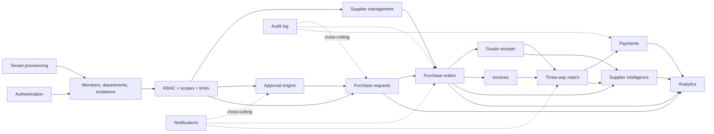

# Deliverable 01 — Product Feature Specification

## 1. Business understanding

### 1.1 Problems behind the brief
The brief lists eight problems. Each one has a cost, and each one is the reason for at least one feature:

| # | Problem from the brief | What it costs the business | SupplyMesh answer |
|---|---|---|---|
| P1 | Managing hundreds of suppliers | Duplicate supplier records, unverified suppliers paid, expired certificates go unnoticed | Supplier master with verification workflow, duplicate detection (tax id) and document expiry tracking |
| P2 | Tracking purchase requests from many departments | Requests lost in email; no one knows the status | Structured purchase requests with status tracking and a per-department view |
| P3 | Complicated approval workflows | Approvals depend on who is around; policy is applied inconsistently | **Configurable** rule-based approval engine with SLA escalation |
| P4 | Monitoring supplier performance | Renewals are decided by gut feeling | Performance records built automatically from POs, receipts and invoices |
| P5 | Managing contracts and invoices | Over-billing, duplicate invoices, paying for goods never received | Three-way match (PO ↔ goods receipt ↔ invoice) with discrepancy workflow. Contracts are stored as supplier documents (type `contract`) with issue and expiry dates, expiry reminders and a risk flag; full contract lifecycle management is Release 2 |
| P6 | Identifying supplier risks | Disruption from a single supplier, fraud, compliance gaps | Risk indicators: late-delivery trend, discrepancy rate, expired documents, spend concentration |
| P7 | Procurement transparency | No answer to "who approved this and why?" | Immutable audit trail, decision comments, analytics |
| P8 | Unauthorized purchasing ("maverick spend") | Money spent outside policy and outside approved suppliers | "No PO, no pay" rule: invoices must reference a PO, POs need an approved request and an active supplier |

### 1.2 Core principle
SupplyMesh enforces one **controlled chain**. Each link checks the previous one before letting money move forward:

```
Verified supplier ─► Approved request ─► Issued PO ─► Goods received ─► Matched invoice ─► Approved payment
```

Each arrow is a business rule (§5). Each box has a single owner role. Every transition is written to `audit_logs`.

## 2. Users, roles and capabilities

### 2.1 Roles
| Role | Primary goal | Typical count in a 2,000-person org |
|---|---|---|
| Organization Owner | Configure the organization, control access, see the big picture | 1–3 |
| Procurement Manager | Run sourcing and supplier relationships, turn approved needs into POs | 5–20 |
| Department Manager | Control their department's spending | 30–80 |
| Finance Officer | Make sure only correct, received, approved invoices are paid | 5–15 |
| Employee | Get what they need to do their job, with minimal friction | everyone |

Roles are **additive**: a Department Manager is also an Employee. Roles can be **scoped** to a department and can carry an **approval limit** (`member_roles.scope_department_id`, `member_roles.approval_limit_amount`). Organizations can create custom roles from the permission catalog (from Release 1.1; the MVP ships the five system roles, whose permissions can be adjusted).

### 2.2 Capability matrix
✅ = allowed · 🔸 = allowed within scope (own department / own records / within limit) · — = not allowed

| Capability | Owner | Proc. Mgr | Dept. Mgr | Finance | Employee |
|---|:-:|:-:|:-:|:-:|:-:|
| Manage organization settings, departments | ✅ | — | — | — | — |
| Invite members, assign roles and limits | ✅ | — | — | — | — |
| Configure approval workflows | ✅ | ✅ | — | — | — |
| Configure invoice match tolerances | ✅ | — | — | ✅ | — |
| Create / edit suppliers | ✅ | ✅ | — | — | — |
| Verify / suspend / blacklist suppliers | ✅ | ✅ | — | — | — |
| View suppliers | ✅ | ✅ | ✅ | ✅ | 🔸 active only |
| Create purchase requests | ✅ | ✅ | ✅ | ✅ | ✅ |
| View purchase requests | ✅ | ✅ | 🔸 department | ✅ | 🔸 own |
| Approve / reject requests | ✅ | 🔸 per workflow step | 🔸 department + limit | 🔸 per workflow step | — |
| Create / issue purchase orders | — | ✅ | — | — | — |
| Record goods receipts | — | ✅ | 🔸 department | — | 🔸 own requests |
| Record invoices, run matching | — | — | — | ✅ | — |
| Approve invoices / record payments | — | — | — | ✅ (not own records) | — |
| Supplier intelligence dashboards | ✅ | ✅ | 🔸 read | ✅ | — |
| Organization analytics | ✅ | ✅ | 🔸 department | ✅ | — |
| View audit log | ✅ | — | — | 🔸 financial entities | — |
| Comment on requests | ✅ | ✅ | ✅ | ✅ | 🔸 own |

Notes:
- Owners deliberately **cannot** issue POs or record payments by default. Configuring the system and moving money are separate duties, because the person who controls the rules should not also execute transactions. An organization can grant those permissions explicitly, and the grant is audited.
- "Within limit" means a Department Manager can be the **final** approver only for requests where `estimated_total_base ≤ approval_limit_amount`. Above the limit, the engine adds a higher approver (BR-09).

## 3. Core features (by module)

Feature IDs are referenced from the MoSCoW matrix (§9) and the dependency graph (§7).

### A. Supplier Management (SUP)
| ID | Feature | Description |
|---|---|---|
| SUP-01 | Supplier registration | Procurement creates a supplier internally, **or** sends a one-time onboarding link (`suppliers.onboarding_token_hash`, 7-day expiry) so the supplier fills in its own profile and uploads documents without an account |
| SUP-02 | Supplier profile | Legal and trade name, registration and tax ids, country, currency, payment terms, contact, address, encrypted bank details |
| SUP-03 | Categorization | Hierarchical categories (`supplier_categories`), e.g. IT › Hardware |
| SUP-04 | Verification workflow | `draft → pending_verification → active` or `rejected`. Required documents per category must be approved before activation. |
| SUP-05 | Supplier documents | Upload (presigned S3, virus scanned), type (trade licence, tax certificate, contract, …), issue and expiry dates, approve/reject per document |
| SUP-06 | Status management | Suspend / reactivate / blacklist, with a mandatory reason. Suspended and blacklisted suppliers can't receive new POs. |
| SUP-07 | Duplicate detection | The same (country, tax id) is blocked. Similar names are flagged with a trigram search. |
| SUP-08 | Performance history | Monthly records (see INT) shown on the supplier profile |

### B. Procurement Request Management (PR)
| ID | Feature | Description |
|---|---|---|
| PR-01 | Create request | Title, description, department, category, priority, required delivery date, currency, **line items** (name, description, quantity, unit, estimated unit price, optional preferred supplier) |
| PR-02 | Draft and submit | Drafts are private. Submitting locks the content and starts the approval workflow. |
| PR-03 | Status tracking | `draft → submitted → in_approval → approved / rejected / returned → converted`, plus `cancelled`. Timeline view with every decision and comment. |
| PR-04 | Return for changes | An approver can **return** a request (instead of rejecting it). The requester edits and resubmits, and the approval chain restarts. |
| PR-05 | Cancel | The requester can cancel until the request is converted to a PO |
| PR-06 | Comments | Discussion thread between the requester and procurement (the brief's "communicate with procurement teams") |
| PR-07 | Department view | Department managers see all of their department's requests and spending against them |

### C. Approval Workflow Engine (APR)
| ID | Feature | Description |
|---|---|---|
| APR-01 | Rule-based routing | Rules match on amount range (base currency), department, category and priority. First match by priority wins. |
| APR-02 | Multi-step chains | Sequential steps (step_order 1, 2, 3…) and parallel steps (same step_order) |
| APR-03 | Approver types | By role (any procurement manager), department manager of the request's department, or a specific person |
| APR-04 | Quorum | "2 of N finance officers must approve" (`required_approvals`) |
| APR-05 | Versioned policies | Editing a workflow creates a new draft version. Publishing makes it live for **new** requests only; requests already in flight keep their snapshot. |
| APR-06 | Approval inbox | One list of everything waiting on me, with amount, requester, age and SLA status |
| APR-07 | SLA and escalation | Each step has `sla_hours`. Reminders are sent at 75% of the SLA; once overdue, the request is escalated to the Owner / Procurement Manager. |
| APR-08 | Delegation (out of office) | Temporarily delegate approval rights to another member (**Should**) |

### D. Purchase Order Management (PO)
| ID | Feature | Description |
|---|---|---|
| PO-01 | Create PO from approved request | Pre-filled from request lines. One request can be split into several POs (different suppliers). |
| PO-02 | Supplier assignment | Only `active` suppliers can be selected |
| PO-03 | Order items | Final quantity, agreed unit price, tax rate. Line totals are computed. |
| PO-04 | Issue PO | Generates the PDF and emails the supplier contact. Status becomes `issued`. The PO number is assigned earlier, when the draft is created. |
| PO-05 | Status tracking | `draft → issued → acknowledged → partially_received → received → closed`, plus `cancelled` |
| PO-06 | Delivery tracking (goods receipts) | Record what arrived, per line: received and rejected quantities. Partial deliveries are supported. Late deliveries are detected against `expected_delivery_date`. |
| PO-07 | PO history | Full timeline plus the audit trail. Revisions after issuing are tracked as versions. |

### E. Invoice & Payment Management (INV)
| ID | Feature | Description |
|---|---|---|
| INV-01 | Record invoice | Against a PO (mandatory). Lines are mapped to PO lines, and the invoice PDF is attached. |
| INV-02 | Duplicate invoice prevention | The same supplier invoice number from the same supplier is rejected |
| INV-03 | Three-way matching | Compares invoice lines with PO lines (price) and goods receipts (quantity), within tolerances configured per organization |
| INV-04 | Discrepancy review | Each mismatch becomes an `invoice_discrepancies` row that Finance accepts, rejects or resolves, with a note |
| INV-05 | Invoice approval | Approved by a Finance Officer **other than** the person who recorded it |
| INV-06 | Payment recording | Full or partial payments. Method and bank reference. Idempotent. |
| INV-07 | Payment status and history | `scheduled → processing → completed / failed`, plus an aging view of invoices coming due |

### F. Supplier Intelligence (INT)
| ID | Feature | Description |
|---|---|---|
| INT-01 | Delivery performance | On-time rate and average delay, from goods receipts vs `expected_delivery_date` |
| INT-02 | Order completion rate | Completed POs ÷ issued POs per period |
| INT-03 | Invoice discrepancy rate | Invoices with discrepancies ÷ invoices |
| INT-04 | Reliability score | A 0–100 weighted score. Default weights: on-time 40%, completion 25%, discrepancy 20%, quality/rejections 15%. Weights can be configured per org (**Should**). |
| INT-05 | Historical spending | Spend per supplier per month, in base currency |
| INT-06 | Risk indicators | Flags such as `doc_expiring`, `doc_expired`, `high_late_rate`, `rising_discrepancies`, `spend_concentration` (one supplier > 40% of a category's spend), `single_source`. These roll up into `risk_level`. |

### G. Organization Analytics (ANL)
| ID | Feature | Description |
|---|---|---|
| ANL-01 | Total spend | Committed (issued POs) vs actual (paid invoices), by period |
| ANL-02 | Spend by department | |
| ANL-03 | Spend by supplier and category | |
| ANL-04 | Pending requests | Count, value, age buckets |
| ANL-05 | Approval cycle time | Average and p90 time from submit to final decision, per step and per approver |
| ANL-06 | Supplier performance trends | Reliability score over time, worst performers |
| ANL-07 | CSV export | Of any analytics table (**Should**) |

### H. Platform foundations (PLT): not in the brief's module list, but required by it
| ID | Feature | Why it is needed |
|---|---|---|
| PLT-01 | Organization sign-up and tenant provisioning | "Multiple organizations" |
| PLT-02 | Members, invitations, departments | Every role needs these |
| PLT-03 | RBAC with system roles (custom roles in Release 1.1), department scope, approval limits | "Configure roles and permissions", "approve within assigned limits" |
| PLT-04 | Authentication (password + MFA) | Financial system |
| PLT-05 | Audit log | "Procurement transparency" |
| PLT-06 | Notifications (in-app + email) | Approvals depend on people being told |
| PLT-07 | Document numbering | PR/PO/GRN numbers that auditors expect to be sequential |

## 4. Secondary features
These improve the experience but no core flow depends on them:

| Feature | Module | Priority |
|---|---|---|
| Approval delegation (out of office) | APR | Should |
| Real-time notifications (SSE) instead of 30-second polling | PLT | Should |
| Saved filters and views | all lists | Should |
| CSV export | ANL | Should |
| Bulk supplier import (CSV) | SUP | Should |
| Configurable reliability-score weights | INT | Should |
| Department budgets with "over budget" warning on requests | PR | Could |
| Request templates / catalog of frequently bought items | PR | Could |
| Supplier self-service portal (log in, see POs, upload invoices) | SUP/INV | Could |
| Request for Quotation (RFQ) and quote comparison | PO | Could |
| Dark mode, localization (Bangla, Arabic RTL…) | UI | Could |

## 5. Business rules

### Suppliers
- **BR-01** A PO can only be issued to a supplier with `status = 'active'`.
- **BR-02** A supplier becomes `active` only after a Procurement Manager verifies it **and** every document type required for its category is `approved` and not expired.
- **BR-03** (country, tax_id) is unique per organization.
- **BR-04** A required document that expires flags the supplier (`doc_expired`). After a 30-day grace period (configurable), it can't receive new POs until a valid document is approved. Existing POs continue.
- **BR-05** Changing a supplier's **bank details** sends it back to `pending_verification`, and the change must be re-verified by a *different* Procurement Manager than the one who made it. This defends against the most common supplier-payment fraud: a fake "we changed our bank account" email.

### Requests & approvals
- **BR-06** A submitted request can't be edited. To change it, the requester cancels it, or an approver returns it.
- **BR-07** The workflow version and matched rule are fixed when the request is submitted (`purchase_requests.workflow_version_id`).
- **BR-08** **Nobody can approve their own request.** If the resolved approver is the requester, the step goes to the next eligible approver (for a department manager step: the parent department's manager, or the Procurement Manager role).
- **BR-09** `approval_limit_amount` caps the amount a member can give **final** approval for. A member with no limit set (NULL) has no personal cap; the workflow rule alone decides. In a multi-step chain, earlier steps are endorsements, and the authority comes from the later steps. If the **last** step of the matched rule resolves to a member whose limit is below `estimated_total_base`, the engine adds an escalation step for the parent department's manager (or the Procurement Manager role, if there is no parent). A misconfigured limit can therefore never let a request through without enough authority.
- **BR-10** Any rejection rejects the whole request. Rejections and returns require a comment.
- **BR-11** A step is complete when `approvals_count = required_approvals`. The next step activates only when **all** steps with the current `step_order` are complete.
- **BR-12** If no rule matches, the request can't be submitted, and the Owner is notified that the policy has a gap. The workflow editor warns about gaps in amount ranges before publishing.

### Purchase orders
- **BR-13** A PO requires an `approved` request. The PO total may exceed the request's estimate by at most the organization's tolerance (default 10%). Above that, the PO can't be issued: procurement cancels the draft and the requester submits a new request for the higher amount, which goes through approval again.
- **BR-14** An issued PO can't be edited. Changes create a new revision, and cancellation requires a reason.
- **BR-15** Received quantity can't exceed ordered quantity per line (enforced by a DB CHECK).

### Invoices & payments
- **BR-16** **No PO, no pay.** Every invoice references a PO from the same supplier.
- **BR-17** Duplicate (supplier, supplier invoice number) is rejected.
- **BR-18** An invoice can be approved only when it is `matched`, or when every discrepancy is `accepted` / `resolved`.
- **BR-19** Default tolerances: unit price ±2%, quantity 0% (you can't be billed for more than was received), total ±1 unit of currency for rounding. Configurable in `organizations.settings`.
- **BR-20** Segregation of duties: the person who recorded an invoice can't approve it, and the person who created the PO can't approve the invoice or record payment against it.
- **BR-21** Total payments can't exceed the invoice total. Every payment carries an idempotency key.

### Tenancy & security
- **BR-22** No user can read or write data of an organization where they don't have an active membership.
- **BR-23** Financial and approval records are never hard-deleted.
- **BR-24** Every state change writes an audit record (who, what, before, after, when, from where).

## 6. User workflows (summary)
Detailed journey diagrams for the first three are in [user-journeys.md](user-journeys.md). Technical sequence designs for workflows 1–4 are in [system-design.md](../04-system-design/system-design.md).

| # | Workflow | Actors | Trigger → outcome |
|---|---|---|---|
| W1 | Supplier onboarding and verification | Procurement Manager, supplier contact | Need for a new supplier → `active` supplier |
| W2 | Purchase request and multi-level approval | Employee, approvers | Business need → `approved` request |
| W3 | Purchase order, receipt, invoice and payment | Procurement, receiver, Finance | Approved request → paid invoice |
| W4 | Organization setup | Owner | Sign-up → departments, roles, members, live workflow |
| W5 | Supplier performance review | Procurement Manager | Monthly job → risk flags → action (suspend, renegotiate) |

## 7. Feature dependencies



What the graph tells us about build order:
1. **Platform first.** Nothing works without tenancy, auth and RBAC.
2. **The approval engine comes before requests**: a request without routing is just a form.
3. **Goods receipts are on the critical path to payment.** Without them, matching falls back to two-way and the "paying for goods never received" problem (P5) remains. That is why receipts are **Must**, although the brief only says "delivery tracking".
4. **Intelligence and analytics are leaves.** They consume data produced by everything else, so they are built last and can't block the transaction flow.

## 8. System limitations (by design, for the MVP)
| Limitation | Reason | Workaround / future |
|---|---|---|
| No supplier login portal; suppliers interact only through the one-time onboarding link and email | Supplier accounts double the identity and security surface | Portal is in Future scope |
| Payments are **recorded**, not executed (no bank API) | Bank integrations differ by country and require compliance work | Bank / payment-gateway integrations later |
| No ERP / accounting sync | Every customer's ERP is different | Webhooks + CSV export first, connectors later |
| FX rates entered or fetched once per transaction, not continuously revalued | Keeps historical reports stable | Daily FX feed + revaluation reports later |
| Approval rules cover amount / department / category / priority only | Covers the brief's scenarios and most real policies | Expression-based conditions later |
| Invoice data entered manually (no OCR) | OCR accuracy needs a review UI anyway | OCR extraction as an assistant later |
| One base currency per organization | Simplifies analytics | Multi-entity orgs later |
| English UI only | MVP focus | i18n framework is in place from day one |
| Analytics refreshed hourly, not real-time | Protects the transactional database | Read replica / OLAP store later |

## 9. Feature prioritization matrix (MoSCoW)

| Feature | Must | Should | Could | Won't (now) |
|---|:-:|:-:|:-:|:-:|
| Org sign-up, departments, invitations (PLT-01/02) | ● | | | |
| Auth with MFA for Owner and Finance (PLT-04) | ● | | | |
| RBAC: system roles, department scope, approval limits (PLT-03) | ● | | | |
| Custom roles | | ● | | |
| Audit log (PLT-05) | ● | | | |
| In-app + email notifications (PLT-06) | ● | | | |
| Real-time (SSE) notifications | | ● | | |
| Supplier registration, profile, categories (SUP-01..03) | ● | | | |
| Supplier verification + documents (SUP-04/05) | ● | | | |
| Supplier status management (SUP-06) | ● | | | |
| Duplicate supplier detection (SUP-07) | ● | | | |
| Bulk supplier CSV import | | ● | | |
| Purchase requests with items, submit, track, cancel (PR-01..05) | ● | | | |
| Return-for-changes (PR-04) | ● | | | |
| Request comments (PR-06) | ● | | | |
| Rule-based multi-step approvals + quorum + versioning (APR-01..05) | ● | | | |
| Approval inbox (APR-06) | ● | | | |
| SLA reminders and escalation (APR-07) | | ● | | |
| Approval delegation (APR-08) | | ● | | |
| PO from request, items, issue + PDF + email (PO-01..04) | ● | | | |
| PO status + goods receipts (PO-05/06) | ● | | | |
| PO revisions after issue | | ● | | |
| Invoice recording + duplicate prevention (INV-01/02) | ● | | | |
| Three-way match + discrepancies (INV-03/04) | ● | | | |
| Invoice approval with SoD, payment recording (INV-05..07) | ● | | | |
| Supplier performance metrics: on-time rate, completion rate, discrepancy rate, spend (INT-01..03, INT-05) | ● | | | |
| Reliability score (INT-04) | | ● | | |
| Risk indicators (INT-06): document expiry | ● | | | |
| Risk indicators: trend-based (late rate, concentration) | | ● | | |
| Analytics: spend by dept/supplier, pending requests (ANL-01..04) | ● | | | |
| Analytics: approval cycle time (ANL-05) | ● | | | |
| Analytics: supplier performance trends (ANL-06) | | ● | | |
| CSV export (ANL-07) | | ● | | |
| Department budgets | | | ● | |
| Item catalog / request templates | | | ● | |
| Supplier self-service portal | | | ● | |
| RFQ / quote comparison | | | ● | |
| Contract lifecycle management (clauses, renewals, e-signature) | | | ● | |
| Localization (multi-language UI) | | | ● | |
| Bank / payment execution integration | | | | ● |
| ERP connectors (SAP, Oracle, QuickBooks) | | | | ● |
| Invoice OCR / AI extraction | | | | ● |
| AI spend recommendations | | | | ● |
| Native mobile apps | | | | ● |
| SSO (SAML/OIDC), SCIM provisioning | | | | ● (first post-MVP item for enterprise deals) |
| Marketplace / supplier discovery | | | | ● |

## 10. MVP scope and rationale

**MVP definition:** an organization can go from "I need something" to "the supplier is paid" through one controlled, audited path, and leadership can see where the money went.

**Why these are in the MVP:**
- **The full chain from supplier to payment, including goods receipts and three-way match.** The product's value is control. A system that stops at "PO issued" leaves P5 (invoice errors) and P8 (unauthorized spend) unsolved, and those are where organizations actually lose money. A partial chain would also force users to keep their spreadsheets, which kills adoption.
- **The configurable approval engine, not hard-coded thresholds.** The brief says policies **differ per organization**. Hard-coding $500/$5,000 would fail the second customer. It is also the hardest piece to change later: in-flight requests depend on it, so the data model (versions + snapshots) must be right from day one.
- **RBAC with department scope and limits, plus audit.** These are the trust foundation. A procurement tool that can't prove who approved what doesn't pass a customer's security review.
- **Supplier intelligence: raw metrics and the document-expiry flag** (Must) vs **the weighted score and trends** (Should). Supplier Intelligence is a core module of the brief. On-time rate, completion rate, discrepancy rate and spend per supplier come from data the MVP already captures, through one nightly job and one table. Expiry is one nightly query on an indexed date, and it is a compliance requirement. The 0–100 reliability score and the trend-based risk flags need several months of data before they mean anything, so building them first would show empty charts.
- **Basic analytics.** Spend by department and by supplier is what convinces the buyer (CFO / Owner) to pay. It is mostly aggregation over data the MVP already captures. Approval processing time is included because the brief lists it and it is a simple calculation on `submitted_at` and `decided_at`.

**Why the rest is postponed:**
- **Supplier portal, ERP connectors, bank payments.** Each one is a product of its own, with external dependencies and security reviews. The MVP replaces them with email, CSV export and recording payments made elsewhere. Users can still complete their job, just with an extra manual step.
- **SSO.** Important for enterprise sales, but not needed to show value to the first 10–20 mid-sized pilot customers. The auth module is designed so an OIDC/SAML provider can be added without changing the membership model.
- **OCR and AI features.** These need clean, structured history to be useful, and the MVP produces exactly that history.
- **Budgets and RFQ.** Valuable, but they add steps to the core flow. They should be added once real usage shows where users want them.

Full phase plan: [mvp-vs-future-scope.md](mvp-vs-future-scope.md).
