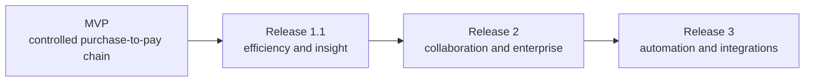

# MVP vs Future Scope

## 1. How scope was decided

A feature is in the MVP only if it passes at least one of these tests:

1. **Chain test.** Without it, an organization can't complete the controlled path *verified supplier → approved request → PO → receipt → matched invoice → payment*.
2. **Trust test.** Without it, a customer's security, finance or audit team would refuse to use the system (tenant isolation, RBAC, audit log, MFA for money roles, segregation of duties).
3. **Hard-to-retrofit test.** Adding it later would force a data migration or break in-flight records (versioned approval policies, multi-currency base amounts, composite tenant keys, goods receipts).
4. **Buyer test.** The person who pays for the product (Owner/CFO) needs it to see the value (spend by department and supplier, pending requests).

Everything else waits until real usage shows where it is needed.

## 2. Release plan

### MVP: "One controlled, audited path from need to payment"
| Area | Included |
|---|---|
| Platform | Org sign-up, departments, invitations, 5 system roles, department-scoped roles with approval limits, password + TOTP MFA (mandatory for Owner and Finance), audit log, in-app + email notifications, document numbering |
| Suppliers | Registration (internal + one-time onboarding link), profile, categories, documents with virus scan, verification workflow, status management, duplicate detection, document-expiry risk flag |
| Requests & approvals | Multi-line requests, draft / submit / cancel / return, rule-based multi-step approvals with quorum, versioned policies, approval inbox, seeded default policy, request comments |
| Purchase orders | PO from approved request (split across suppliers), tolerance check, issue with PDF + supplier email, status tracking, goods receipts (partial deliveries) |
| Invoices & payments | Invoice against PO, duplicate prevention, three-way match with tolerances, discrepancy workflow, approval with segregation of duties, payment recording (full/partial, idempotent), aging view |
| Supplier intelligence | Monthly performance record per supplier: on-time rate, completion rate, invoice discrepancy rate, spend |
| Analytics | Total committed vs paid spend, spend by department / supplier / category, pending requests, approval cycle time |
| Ops | Docker Compose on one EC2 host + RDS + S3 + SES, GitHub Actions CI/CD, backups with PITR, structured logging |

### Release 1.1: "Faster and smarter" (≈ 2–3 months after MVP)
| Feature | Why now |
|---|---|
| SLA reminders + escalation, approval delegation | By now we have real approval cycle-time data showing where requests stall |
| Reliability score + trend-based risk flags | Needs 2–3 months of MVP performance records before the scores mean anything |
| Supplier-trend analytics, CSV export | Same data dependency |
| Custom roles | The 5 system roles cover pilots. Larger customers ask for finer control. |
| SSE real-time notifications, saved views | Usability polish based on feedback |
| Bulk supplier CSV import | Onboarding larger customers with existing vendor lists |
| PO revisions after issue | Real-world change orders |

### Release 2: "Collaboration and enterprise readiness"
| Feature | Why later | Design hooks already in place |
|---|---|---|
| **SSO (SAML / OIDC) + SCIM** | Needed for enterprise deals, not for mid-market pilots | `users.password_hash` nullable; membership model independent of login method |
| **Supplier portal** (supplier logins, see POs, acknowledge, upload invoices) | Doubles the identity surface. Needs a separate permission realm. | Suppliers already have contacts and onboarding tokens. Invoices already reference supplier + PO. |
| Department budgets + over-budget warnings | Requires a finance-calendar model (fiscal years, budget periods) | Requests already store `department_id` and base-currency totals |
| RFQ / quote comparison | Adds a sourcing step before PO | `purchase_request_items.preferred_supplier_id` |
| Contract management (terms, renewal reminders, e-signature) | A separate product area | `supplier_documents.document_type = 'contract'` + `expires_at` already track contracts as documents |
| Approval engine for invoices (not just requests) | Few customers need it at first | `approval_workflows.subject_type` |
| Localization (Bangla, Arabic RTL, …) | Market-driven | Strings externalized from day one |

### Release 3: "Automation and integrations"
| Feature | Why later |
|---|---|
| ERP / accounting connectors (SAP, Oracle NetSuite, QuickBooks, Xero), outbound webhooks | Every customer's ERP is different. Webhooks from the outbox come first, connectors second. |
| Payment execution via bank APIs / payment gateways | Country-specific compliance and security reviews |
| Invoice OCR / AI extraction | Needs a stable manual flow first, then acts as an assistant that pre-fills it |
| AI spend insights (savings opportunities, anomaly detection) | Needs a large, clean history, which the earlier releases create |
| Native mobile apps (approve on the go) | The responsive web app covers the main mobile use case (approving) |
| Multi-entity organizations (several legal entities, currencies, ledgers) | Large-enterprise need. Affects the base-currency model. |

## 3. Explicitly out of scope (Won't, for now)
- Marketplace / supplier discovery (a different business model).
- Inventory and warehouse management (SupplyMesh stops at "goods received").
- Payroll, expense claims and travel booking (adjacent spend categories with different workflows).
- Multi-region data residency (revisit when a customer contractually requires it; the dedicated-DB-per-tenant path in the Risk doc supports it).

## 4. Why the MVP is **not** smaller

An obvious "leaner MVP" would be suppliers + requests + approvals only. It was rejected:
- It solves P2 and P3 (tracking and approvals) but **none of the money problems** (P5 invoice errors, P8 unauthorized spend), which are what a finance buyer pays to fix.
- Users would still need spreadsheets for POs and invoices, so the data would be split and analytics would be meaningless.
- Retrofitting goods receipts and matching onto POs already in production would mean back-filling receipt records for historical POs.

The MVP is still kept lean **inside** each module: no portal, no SSO, no budgets, no integrations, no AI. Each of these is added later without changing the core data model.
