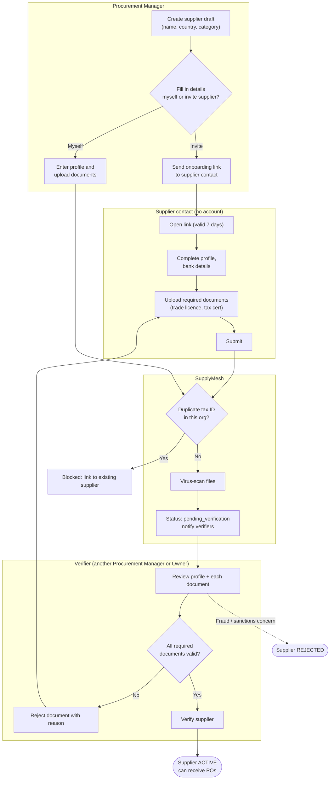
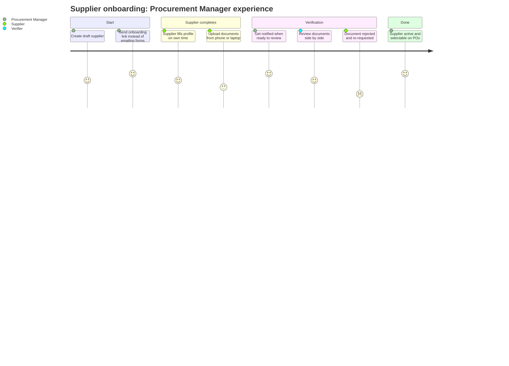
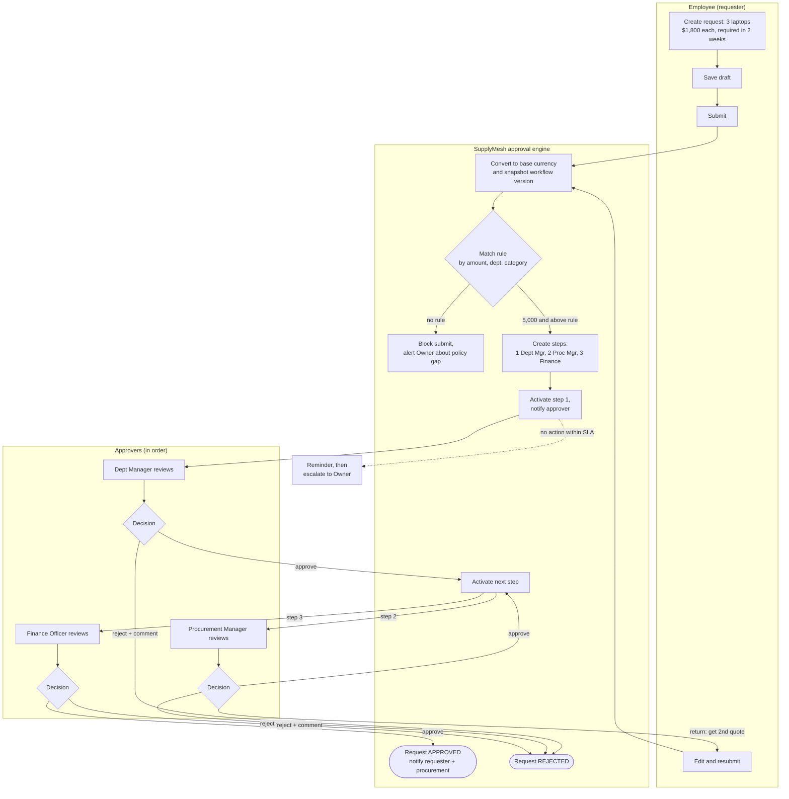
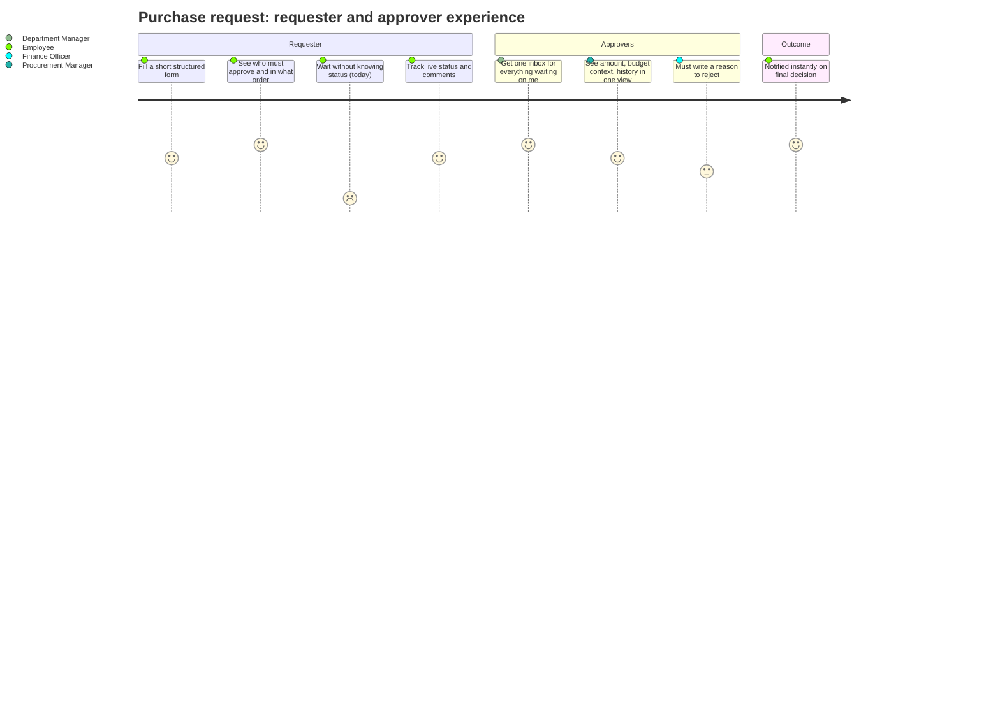
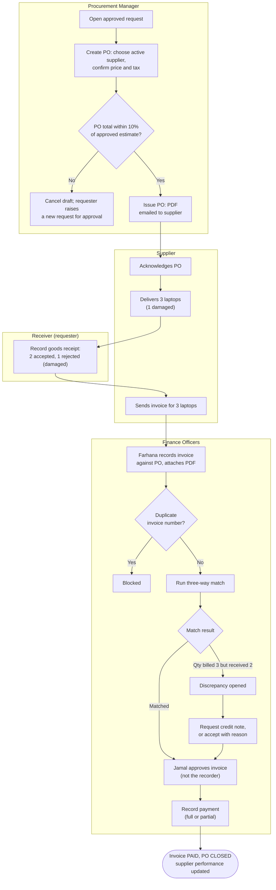
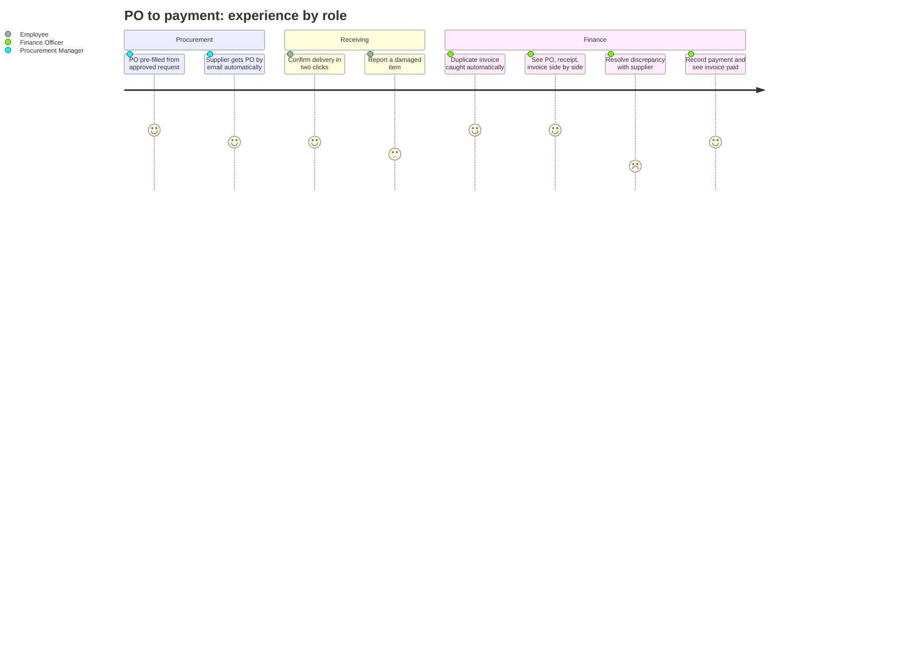
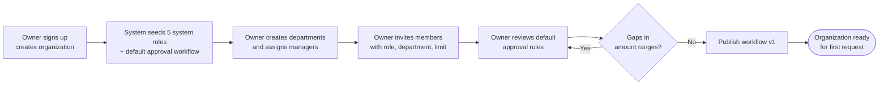

# User Journey Diagrams

Four journeys are shown. The first three are the brief's suggested workflows; the fourth (organization setup) is the precondition for the rest. Each journey has:
- a **swim-lane flow** (who does what, including decision points and the unhappy paths), and
- an **experience map** (how each step feels for the user, scored 1–5), which shows where the product must reduce friction.

The technical view of the same flows (API calls, transactions, failure handling) is in [system-design.md](../04-system-design/system-design.md).

---

## Journey 1 — Supplier onboarding and verification

**Persona:** Rafi, a Procurement Manager, needs to start buying network equipment from a new vendor in Singapore.
**Goal:** the vendor becomes an `active` supplier that POs can be issued to, without Rafi chasing documents by email.

**Design choices this journey drives**
- The **self-service onboarding link** turns the worst part of today's process (chasing PDFs by email) into an async task for the supplier. It uses a token, not an account, so the MVP doesn't need a supplier login system.
- **Duplicate check happens before verification.** Finding out after someone has spent 20 minutes reviewing documents would be the most frustrating outcome.
- **Per-document rejection** sends the supplier back to re-upload just one file, not the whole form (the lowest-scored step above).
- **Four-eyes rule:** the person who changed the bank details (`bank_details_changed_by_member_id`) can't be the one who verifies them (BR-05).

---

## Journey 2 — Purchase request and multi-level approval

**Persona:** Nusrat, a software engineer (Employee), needs 3 laptops for new hires: estimated **$5,400**, above the $5,000 multi-approval threshold.
**Approvers:** Karim (IT Department Manager, limit $2,000), Rafi (Procurement Manager), Farhana (Finance Officer).

**Design choices this journey drives**
- **The approval chain is shown at submission.** "Who has it now?" is the requester's biggest frustration today (score 1). Because the steps are created up front, the UI can draw the whole route immediately.
- **"Return" differs from "reject".** Most real "no"s are "not like this" (e.g. get a second quote). Returning keeps the request and its history; rejecting ends it.
- **Karim's $2,000 limit doesn't block this request.** His step is an endorsement, and final authority comes from the Finance step. The limit (BR-09) only matters when a manager would be the **last** approver. For example, under rule 1 (< $500, department manager only), a newly promoted manager with a $300 limit couldn't finalize a $450 request on their own, so the engine would add the parent department's manager.
- **The SLA reminder/escalation** prevents the classic bottleneck: an approver on leave holds up a request for weeks.

---

## Journey 3 — Purchase order, goods receipt, invoice and payment

**Personas:** Rafi (Procurement Manager) creates the PO. Nusrat (requester) confirms delivery. Farhana and Jamal (Finance Officers) process the invoice.

**Design choices this journey drives**
- **Goods receipt is a first-class step.** Without it, the damaged laptop would have been paid for. This is the "three-way" in three-way match.
- **The 10% PO-vs-approval tolerance** (BR-13) stops a $5,400 approval from quietly becoming a $9,000 order.
- **Segregation of duties.** Farhana records the invoice and Jamal approves it. The database CHECK `chk_inv_sod` makes this unbypassable, even by a buggy client.
- **Discrepancy resolution is the lowest-scored step.** That is why the matching screen shows the PO line, the receipt line and the invoice line next to each other, with the variance pre-computed.

---

## Journey 4 — Organization setup (prerequisite)

The **seeded default workflow** encodes the brief's example ($500 / $5,000 / multi-approval). A new organization can submit its first request in minutes, then adjust the policy. A blank rule editor would be the main reason for drop-off during onboarding.
