# Deliverable 02 — Database Design

> Source of truth: [`schema.sql`](./schema.sql) (PostgreSQL 16). It has been loaded into a real PostgreSQL 16 instance, and the tenant-isolation rules were tested against it (see §8.4). Every table, column and status name used in the other documents comes from this file.

## 1. Design goals (what the data model has to guarantee)

| # | Business requirement | What it means for the database |
|---|---|---|
| G1 | Many organizations share one platform, with **strict data isolation** | Every tenant row is tagged with `organization_id`. Isolation is enforced by the database itself, not only by application code. |
| G2 | Money moves through requests → POs → invoices → payments | Exact decimal arithmetic, totals that add up, and no double payment |
| G3 | **Configurable** approval policies differ per organization | Approval rules are stored as **data**, not code, and are versioned |
| G4 | Procurement must be **transparent** and **auditable** | Append-only audit trail. Financial records are never hard-deleted. |
| G5 | Suppliers are **global** | Multi-currency support with the FX rate captured at the time of each transaction |
| G6 | Supplier intelligence and analytics | Pre-aggregated performance data, so dashboards don't scan every transaction row |
| G7 | Data grows with every organization | Indexes lead with `organization_id`. Hot tables are partitionable. |

## 2. Domain map

The 35 tables fall into 9 groups (`audit_logs` also has monthly partitions):

| Domain | Tables |
|---|---|
| Identity & tenancy | `users`, `user_sessions`, `organizations`, `organization_members`, `departments`, `invitations`, `organization_sequences` |
| RBAC | `roles`, `permissions`, `role_permissions`, `member_roles` |
| Suppliers | `supplier_categories`, `suppliers`, `supplier_documents` |
| Approval definition | `approval_workflows`, `approval_workflow_versions`, `approval_rules`, `approval_step_templates` |
| Requests & approval runtime | `purchase_requests`, `purchase_request_items`, `purchase_request_comments`, `approval_steps`, `approval_decisions` |
| Purchase orders & receiving | `purchase_orders`, `purchase_order_items`, `goods_receipts`, `goods_receipt_items` |
| Invoices & payments | `invoices`, `invoice_items`, `invoice_discrepancies`, `payments` |
| Supplier intelligence | `supplier_performance_records` |
| Cross-cutting | `audit_logs` (partitioned), `notifications`, `outbox_events` |

The brief requires 16 entities. The schema adds 19 supporting tables (memberships, sessions, invitations, role links, sequences, categories, workflow versions, rules and step templates, line-item and decision tables, comments, notifications). Five of them change the business design:

- **`goods_receipts` / `goods_receipt_items`.** Without a record of what was physically delivered, an invoice can only be compared with the PO (two-way match). Finance needs to know the goods actually arrived before paying (three-way match), and on-time delivery for supplier intelligence is calculated from receipt dates.
- **`invoice_discrepancies`.** "Review invoice discrepancies" is a required feature. A discrepancy has its own lifecycle (open → accepted / rejected / resolved), its own resolver and its own note, so it gets its own table instead of a flag on the invoice.
- **`outbox_events`.** Lets the system send notifications reliably, without losing them if the process crashes (see ADR-007).
- **`purchase_request_comments`.** The brief gives employees the capability to "communicate with procurement teams". A comment thread on the request keeps that conversation next to the request, not in email.

## 3. Entity-Relationship diagram

> Every tenant table also has an `organization_id → organizations.id` relationship. Those edges are left out below (except for top-level tables), because otherwise every entity would point at `organizations` and the diagram would be unreadable. Only PK/FK and key business columns are shown. Full columns are in §4 and in `schema.sql`.

```mermaid
erDiagram
    users ||--o{ user_sessions : "has"
    users ||--o{ organization_members : "is member via"
    organizations ||--o{ organization_members : "has"
    organizations ||--o{ departments : "has"
    organizations ||--o{ roles : "defines"
    organizations ||--o{ suppliers : "works with"
    organizations ||--o{ approval_workflows : "configures"
    organizations ||--o{ invitations : "sends"
    organizations ||--o{ organization_sequences : "numbers docs with"
    organizations ||--o{ audit_logs : "records"
    organizations ||--o{ outbox_events : "emits"

    departments |o--o{ departments : "parent of"
    departments |o--o{ organization_members : "employs"
    organization_members |o--o{ departments : "manages"

    roles ||--o{ role_permissions : "grants"
    permissions ||--o{ role_permissions : "granted in"
    organization_members ||--o{ member_roles : "holds"
    roles ||--o{ member_roles : "assigned as"
    departments |o--o{ member_roles : "scopes"
    roles ||--o{ invitations : "offered in"

    supplier_categories |o--o{ supplier_categories : "parent of"
    supplier_categories |o--o{ suppliers : "classifies"
    suppliers ||--o{ supplier_documents : "provides"

    approval_workflows ||--|{ approval_workflow_versions : "versioned as"
    approval_workflow_versions ||--|{ approval_rules : "contains"
    approval_rules ||--|{ approval_step_templates : "defines steps"
    roles |o--o{ approval_step_templates : "approver role"

    organization_members ||--o{ purchase_requests : "raises"
    departments ||--o{ purchase_requests : "charged to"
    approval_workflow_versions |o--o{ purchase_requests : "governs"
    purchase_requests ||--|{ purchase_request_items : "contains"
    suppliers |o--o{ purchase_request_items : "preferred for"
    purchase_requests ||--o{ approval_steps : "routed through"
    approval_step_templates |o--o{ approval_steps : "instantiated as"
    approval_steps ||--o{ approval_decisions : "receives"
    organization_members ||--o{ approval_decisions : "decides"
    purchase_requests ||--o{ purchase_request_comments : "discussed in"
    organization_members ||--o{ purchase_request_comments : "writes"

    purchase_requests ||--o{ purchase_orders : "fulfilled by"
    suppliers ||--o{ purchase_orders : "receives"
    purchase_orders ||--|{ purchase_order_items : "contains"
    purchase_request_items |o--o{ purchase_order_items : "sourced into"
    purchase_orders ||--o{ goods_receipts : "delivered via"
    goods_receipts ||--|{ goods_receipt_items : "contains"
    purchase_order_items ||--o{ goods_receipt_items : "received as"

    suppliers ||--o{ invoices : "bills"
    purchase_orders ||--o{ invoices : "billed by"
    invoices ||--|{ invoice_items : "contains"
    purchase_order_items ||--o{ invoice_items : "billed as"
    invoices ||--o{ invoice_discrepancies : "flags"
    invoices ||--o{ payments : "settled by"

    suppliers ||--o{ supplier_performance_records : "measured by"
    organization_members ||--o{ notifications : "receives"

    users {
        uuid id PK
        citext email UK
        text password_hash
        user_status status
    }
    user_sessions {
        uuid id PK
        uuid user_id FK
        text refresh_token_hash UK
        timestamptz expires_at
    }
    organizations {
        uuid id PK
        varchar slug UK
        char base_currency
        org_status status
        jsonb settings
        uuid owner_user_id FK
    }
    organization_members {
        uuid id PK
        uuid organization_id FK
        uuid user_id FK
        uuid department_id FK
        member_status status
    }
    departments {
        uuid id PK
        uuid organization_id FK
        varchar code
        uuid parent_department_id FK
        uuid manager_member_id FK
    }
    invitations {
        uuid id PK
        uuid organization_id FK
        citext email
        uuid role_id FK
        text token_hash UK
    }
    organization_sequences {
        uuid organization_id PK
        varchar sequence_key PK
        bigint next_value
    }
    roles {
        uuid id PK
        uuid organization_id FK
        varchar key
        boolean is_system
    }
    permissions {
        uuid id PK
        varchar code UK
        varchar module
    }
    role_permissions {
        uuid role_id PK
        uuid permission_id PK
    }
    member_roles {
        uuid id PK
        uuid member_id FK
        uuid role_id FK
        uuid scope_department_id FK
        numeric approval_limit_amount
    }
    supplier_categories {
        uuid id PK
        uuid organization_id FK
        uuid parent_category_id FK
    }
    suppliers {
        uuid id PK
        uuid organization_id FK
        varchar supplier_code
        varchar tax_id
        char country_code
        uuid category_id FK
        supplier_status status
        risk_level risk_level
        int version
    }
    supplier_documents {
        uuid id PK
        uuid supplier_id FK
        supplier_doc_type document_type
        text file_key
        date expires_at
        supplier_doc_status status
    }
    approval_workflows {
        uuid id PK
        uuid organization_id FK
        varchar subject_type
        boolean is_active
    }
    approval_workflow_versions {
        uuid id PK
        uuid workflow_id FK
        int version_no
        workflow_version_status status
    }
    approval_rules {
        uuid id PK
        uuid workflow_version_id FK
        int priority
        numeric min_amount
        numeric max_amount
        uuid department_id FK
    }
    approval_step_templates {
        uuid id PK
        uuid rule_id FK
        smallint step_order
        approver_type approver_type
        uuid approver_role_id FK
        smallint required_approvals
    }
    purchase_requests {
        uuid id PK
        uuid organization_id FK
        varchar request_number
        uuid requester_member_id FK
        uuid department_id FK
        numeric estimated_total_base
        purchase_request_status status
        uuid workflow_version_id FK
        int version
    }
    purchase_request_items {
        uuid id PK
        uuid purchase_request_id FK
        numeric quantity
        numeric estimated_unit_price
        uuid preferred_supplier_id FK
    }
    purchase_request_comments {
        uuid id PK
        uuid purchase_request_id FK
        uuid author_member_id FK
        text body
    }
    approval_steps {
        uuid id PK
        uuid purchase_request_id FK
        uuid step_template_id FK
        smallint step_order
        uuid approver_member_id FK
        approval_step_status status
    }
    approval_decisions {
        uuid id PK
        uuid approval_step_id FK
        uuid decided_by_member_id FK
        approval_decision_type decision
    }
    purchase_orders {
        uuid id PK
        uuid organization_id FK
        varchar po_number
        uuid purchase_request_id FK
        uuid supplier_id FK
        numeric total
        purchase_order_status status
        int version
    }
    purchase_order_items {
        uuid id PK
        uuid purchase_order_id FK
        uuid purchase_request_item_id FK
        numeric quantity
        numeric unit_price
        numeric quantity_received
        numeric quantity_invoiced
    }
    goods_receipts {
        uuid id PK
        uuid purchase_order_id FK
        varchar receipt_number
        uuid received_by_member_id FK
    }
    goods_receipt_items {
        uuid id PK
        uuid goods_receipt_id FK
        uuid purchase_order_item_id FK
        numeric quantity_received
    }
    invoices {
        uuid id PK
        uuid supplier_id FK
        uuid purchase_order_id FK
        varchar supplier_invoice_number
        numeric total
        numeric amount_paid
        invoice_status status
        int version
    }
    invoice_items {
        uuid id PK
        uuid invoice_id FK
        uuid purchase_order_item_id FK
        numeric quantity
        numeric unit_price
    }
    invoice_discrepancies {
        uuid id PK
        uuid invoice_id FK
        discrepancy_type discrepancy_type
        discrepancy_status status
    }
    payments {
        uuid id PK
        uuid invoice_id FK
        numeric amount
        payment_status status
        varchar idempotency_key
    }
    supplier_performance_records {
        uuid id PK
        uuid supplier_id FK
        date period_start
        numeric reliability_score
        risk_level risk_level
    }
    audit_logs {
        bigint id PK
        timestamptz created_at PK
        uuid organization_id
        varchar action
        varchar entity_type
        uuid entity_id
    }
    notifications {
        uuid id PK
        uuid recipient_member_id FK
        varchar type
        timestamptz read_at
    }
    outbox_events {
        bigint id PK
        uuid organization_id
        varchar event_type
        jsonb payload
        timestamptz published_at
    }
```



## 4. Table definitions

Conventions used in every table (not repeated below): `id UUID PK`, `organization_id UUID NOT NULL`, `created_at`/`updated_at TIMESTAMPTZ`, plus, on every table that other tables point to, `UNIQUE (organization_id, id)` so they can use composite foreign keys (§6.1).

### 4.1 Identity & tenancy

**`users`.** One row per real person, shared across organizations.
| Column | Type | Constraint / note |
|---|---|---|
| email | CITEXT | UNIQUE. Case-insensitive, so `A@x.com` and `a@x.com` are the same user. |
| full_name | VARCHAR(150) | NOT NULL |
| password_hash | TEXT | Argon2id hash. NULL for SSO-only accounts. |
| mfa_secret_enc | TEXT | TOTP secret, encrypted by the application |
| status | `user_status` | `active` / `disabled` |

**`user_sessions`.** Refresh-token sessions, so each one can be revoked individually.
| Column | Type | Note |
|---|---|---|
| user_id | UUID FK → users | ON DELETE CASCADE |
| refresh_token_hash | TEXT UNIQUE | Only a hash is stored; the raw token never is |
| expires_at / revoked_at | TIMESTAMPTZ | A partial index covers active sessions |

**`organizations`.** The tenant.
| Column | Type | Note |
|---|---|---|
| slug | VARCHAR(80) UNIQUE | Used in URLs |
| base_currency | CHAR(3) | CHECK `^[A-Z]{3}$`. All analytics are reported in this currency. |
| settings | JSONB | Per-organization switches that don't need relational queries, e.g. invoice match tolerance `{ "price_tolerance_pct": 2, "qty_tolerance_pct": 0 }` |
| owner_user_id | UUID FK → users | |

**`organization_members`.** A user's membership in one organization. All business tables point to the **member**, not the user, so a person who belongs to two organizations has two separate permission sets and histories.
| Column | Type | Note |
|---|---|---|
| user_id | FK → users | UNIQUE (organization_id, user_id) |
| department_id | FK → departments | Home department |
| status | `member_status` | `invited` / `active` / `deactivated`. Members are deactivated, never deleted, because approvals point to them. |

**`departments`.** Includes `code` (UNIQUE per org), `parent_department_id` (self-FK for hierarchy), `manager_member_id` (used to route `department_manager` approval steps) and `cost_center`.

**`invitations`.** Holds `email`, the `role_id` and `department_id` to assign, a `token_hash`, and `expires_at` / `accepted_at`. A partial unique index allows only one open invitation per email per organization.

**`organization_sequences`.** PK (`organization_id`, `sequence_key`). Generates human-readable numbers (`PR-2026-000123`) that are gap-free per organization. The row is read with `SELECT … FOR UPDATE` inside the creating transaction. Finance teams expect consecutive PO numbers, which a global PostgreSQL sequence can't provide per tenant.

### 4.2 RBAC

**`permissions`** is a global catalog owned by the platform. `code` is UNIQUE, e.g. `supplier.verify`, `purchase_request.approve`, `invoice.approve`, `payment.record`. It is not tenant data, because the code checks these exact strings.

**`roles`** are per organization: `key` is UNIQUE per org and `is_system` is a boolean. The five roles from the brief are created for each new org as `is_system = true` (they can't be deleted, but their permissions can be adjusted). Organizations can add custom roles.

**`role_permissions`.** PK (`role_id`, `permission_id`). A many-to-many link.

**`member_roles`**
| Column | Type | Note |
|---|---|---|
| member_id, role_id | composite FKs | |
| scope_department_id | FK → departments, nullable | NULL means organization-wide. Set means "Department Manager **of IT**". |
| approval_limit_amount | NUMERIC(19,4) | "Approve within assigned limits". Stored in the org's base currency. CHECK ≥ 0. NULL means no personal cap: the workflow rule alone decides. |
| | | Unique on (member, role, scope), so the same role can't be granted twice for the same scope |

### 4.3 Suppliers

**`supplier_categories`.** A hierarchy (`parent_category_id`). Names are UNIQUE per org.

**`suppliers`**
| Column | Type | Note |
|---|---|---|
| supplier_code | VARCHAR(30) | UNIQUE per org |
| legal_name, trade_name | VARCHAR(200) | A trigram GIN index on `legal_name` supports fuzzy search |
| registration_number, tax_id, country_code | | Partial UNIQUE (org, country, tax_id), so the same company can't be registered twice |
| default_currency, payment_terms_days | | Copied onto POs as defaults |
| bank_details_enc | TEXT | Encrypted by the application (AES-256-GCM, key in AWS KMS). Bank details are the most common target of supplier fraud. |
| status | `supplier_status` | `draft → pending_verification → active ⇄ suspended`, plus `rejected` and `blacklisted` |
| risk_level | `risk_level` | Updated by the intelligence job |
| onboarding_token_hash / _expires_at | | One-time self-registration link for the supplier |
| verified_by_member_id, verified_at | | CHECK: status `active` requires `verified_at` |
| version | INT | Optimistic locking |
| deleted_at | TIMESTAMPTZ | Soft delete only, because POs and invoices still point to the supplier |

**`supplier_documents`.** Holds `document_type` (enum), `file_key` (the S3 object key, never a public URL), `checksum_sha256`, `size_bytes` (CHECK ≤ 25 MB), `issued_at` / `expires_at` (CHECK expires > issued), `status` (`pending/approved/rejected/expired`), and the reviewer. A partial index on `expires_at WHERE status='approved'` makes the nightly "documents expiring soon" job cheap.

### 4.4 Approval workflow definition

The four tables describe **policy**:

```
approval_workflows (1 active per org per subject_type)
 └─ approval_workflow_versions (immutable once 'published'; one published at a time)
     └─ approval_rules (priority-ordered; first match wins)
         │   min_amount ≤ amount < max_amount, optional department / category / min_priority
         └─ approval_step_templates
               step_order (same order = parallel, increasing = sequential)
               approver_type: role | department_manager | specific_member
               required_approvals (quorum, e.g. 2 of N)
               sla_hours (escalation)
```

The brief's example policy, stored as data:

| Rule (priority) | Range (base currency) | Steps |
|---|---|---|
| 1 | 0 – 500 | ① `department_manager` |
| 2 | 500 – 5,000 | ① `role = procurement_manager` |
| 3 | 5,000 – ∞ | ① `department_manager` → ② `role = procurement_manager` → ③ `role = finance_officer` |

Ranges are `min_amount ≤ amount < max_amount`, so exactly $500.00 matches rule 2 and exactly $5,000.00 matches rule 3 (the stricter reading of the brief). CHECK `chk_approver_target` makes sure each step names exactly one kind of approver.

### 4.5 Purchase requests & approval runtime

**`purchase_requests`**
| Column | Type | Note |
|---|---|---|
| request_number | VARCHAR(30) | UNIQUE per org, from `organization_sequences` |
| requester_member_id, department_id, category_id | FKs | |
| title, description, priority, required_by_date | | The fields required by the brief |
| currency, estimated_total, fx_rate_to_base, estimated_total_base | NUMERIC | The rule engine and analytics always use the **base** amount |
| status | `purchase_request_status` | `draft → submitted → in_approval → approved / rejected / returned → converted`, plus `cancelled` |
| workflow_version_id, matched_rule_id | FKs | **Snapshot** of the policy used, so later policy edits don't affect requests already in progress |
| version | INT | Optimistic locking (an approver and the requester editing at the same time) |

**`purchase_request_items`.** Holds `line_no` (UNIQUE per request), `item_name`, `quantity` (CHECK > 0), `unit_of_measure`, `estimated_unit_price`, `line_total` (a **generated column**, so it can never disagree with quantity × price), and an optional `preferred_supplier_id`.

**`purchase_request_comments`.** The discussion thread between the requester and procurement: `purchase_request_id`, `author_member_id`, `body` (CHECK not blank) and `created_at`. Comments are append-only; there is no edit or delete.


**`approval_steps`.** Created from the matched rule's templates when the request is submitted. Holds `status` (`waiting → pending → approved / rejected / skipped`), `approver_member_id` (resolved at creation for department-manager steps), `required_approvals` / `approvals_count` (CHECK count ≤ required), and `due_at` for SLA escalation. `step_template_id` is NULL for steps the engine adds itself (the BR-09 escalation step and BR-08 reroutes).

**`approval_decisions`.** One row per vote. UNIQUE (`approval_step_id`, `decided_by_member_id`), so nobody can vote twice on the same step. CHECK: a rejection or return requires a comment.

### 4.6 Purchase orders & receiving

**`purchase_orders`.** Holds `po_number` (UNIQUE per org), `purchase_request_id` (NOT NULL: in the MVP every PO comes from an approved request), `supplier_id`, `currency`, `fx_rate_to_base`, `subtotal` / `tax_total` / `total` (CHECK total = subtotal + tax), `total_base`, `status` (`draft → issued → acknowledged → partially_received → received → closed`, plus `cancelled`), `expected_delivery_date`, `payment_terms_days`, and `version`.

**`purchase_order_items`.** Holds `quantity`, `unit_price`, `tax_rate` (CHECK 0 ≤ rate < 1), the generated `line_subtotal`, and the running totals **`quantity_received`** (CHECK ≤ quantity) and **`quantity_invoiced`**. These two counters are what make three-way matching a fast row lookup instead of a SUM over history.

**`goods_receipts` / `goods_receipt_items`.** Holds `receipt_number`, the receiver, `received_at`, and per line `quantity_received` and `quantity_rejected` with a reason. Partial deliveries are just several receipts against one PO.

### 4.7 Invoices & payments

**`invoices`**
| Column | Note |
|---|---|
| supplier_invoice_number | UNIQUE (org, supplier, number). The DB rejects a supplier invoice that has already been entered. |
| purchase_order_id | NOT NULL. No PO, no invoice (prevents unauthorized purchases from being paid). A composite FK `(organization_id, purchase_order_id, supplier_id)` guarantees the invoice's supplier is the PO's supplier (BR-16). |
| subtotal, tax_total, total, total_base, amount_paid | CHECK total = subtotal + tax. CHECK 0 ≤ amount_paid ≤ total. |
| status | `received → matched / discrepancy → approved → partially_paid → paid`, plus `rejected` and `void` |
| recorded_by / approved_by | CHECK `chk_inv_sod`: the person who recorded the invoice can't approve it (segregation of duties) |
| version | Optimistic locking |

**`invoice_items`.** One line per PO line being billed. UNIQUE (`invoice_id`, `purchase_order_item_id`).

**`invoice_discrepancies`.** Holds `discrepancy_type` (`price/quantity/tax/total/missing_receipt/currency`), `expected_value`, `actual_value`, `variance_pct`, and a `status` workflow. CHECK: a discrepancy can't be closed without a resolver and a note.

**`payments`.** Holds `payment_number`, `amount` (CHECK > 0), `method`, `external_reference`, `status` (`scheduled → processing → completed / failed / cancelled`), and **`idempotency_key` UNIQUE per org**, so a double-clicked "Record payment" or a retried request can't create two payments.

### 4.8 Supplier intelligence

**`supplier_performance_records`.** One row per supplier per month (UNIQUE org + supplier + `period_start`). It holds counts (orders issued and completed, on-time and late deliveries, invoices with discrepancies), rates, `spend_base`, a 0–100 `reliability_score`, `risk_level` and `risk_flags TEXT[]`. The data is **derived**: a background job builds it from operational tables and can always rebuild it from them, which makes it a deliberate, documented denormalization (§7).

### 4.9 Cross-cutting

- **`audit_logs`.** Records `actor_user_id`, `actor_member_id`, `action`, `entity_type`, `entity_id`, `before_data` / `after_data` JSONB, `ip_address`, `request_id` and `created_at`. It is **partitioned by month** (`PARTITION BY RANGE (created_at)`), with PK (`id`, `created_at`). The application's database role has INSERT and SELECT on the parent table only and no privileges on the partitions, so the log is append-only and can only be read through the tenant policy.
- **`notifications`.** In-app inbox. A partial index covers unread notifications.
- **`outbox_events`.** Holds `event_type`, `aggregate_type`/`aggregate_id`, `payload`, `published_at` and `attempts`. See ADR-007.

## 5. Relationship explanations (why each cardinality)

| Relationship | Cardinality | Reason |
|---|---|---|
| users ↔ organizations | M:N via `organization_members` | Consultants and group companies: one person can work for several tenants, with different roles in each |
| members ↔ roles | M:N via `member_roles` (+ department scope) | One person can be "Employee" org-wide **and** "Department Manager" of IT. A role attached to the user row couldn't express that. |
| purchase_request → purchase_orders | 1 : 0..N | One approved request can be split across suppliers (laptops from A, monitors from B) |
| purchase_request_item → purchase_order_items | 1 : 0..N, nullable | Keeps traceability from each PO line back to the requested line. Nullable for lines added during sourcing (e.g. shipping). |
| purchase_order → goods_receipts | 1 : 0..N | Partial deliveries |
| purchase_order → invoices | 1 : 0..N | Partial or milestone invoicing. Every invoice needs a PO. |
| invoice → payments | 1 : 0..N | Installments and partial payments. `amount_paid` is the running total. |
| approval_workflow → versions → rules → step_templates | 1:N:N:N | Policy is versioned data (ADR-005) |
| purchase_request → approval_steps → approval_decisions | 1:N:N | Runtime state is kept separate from the policy, and quorum steps need several decisions |
| supplier → supplier_performance_records | 1 : N (one per month) | A trend can be computed in a single cheap query |

## 6. Important constraints

### 6.1 Tenant-safe composite foreign keys
Every child table uses `FOREIGN KEY (organization_id, parent_id) REFERENCES parent(organization_id, id)`. A normal FK only checks that the parent **exists**. The composite FK checks that it exists **in the same organization**. A purchase order in Org B therefore can't point at a supplier in Org A, even through an application bug.

### 6.2 Business-rule constraints enforced in the database
| Constraint | Rule |
|---|---|
| `chk_supplier_verified` | An `active` supplier must have been verified |
| `uq_supplier_tax_id` | No duplicate supplier per (country, tax id) |
| `chk_approver_target` | Each approval step template targets exactly one kind of approver |
| `UNIQUE (approval_step_id, decided_by_member_id)` | One vote per person per step |
| `chk_reject_comment` | Rejections must be explained |
| `chk_po_totals`, `chk_inv_totals` | Header totals add up |
| `chk_poi_received` | You can't receive more than you ordered |
| `UNIQUE (org, supplier, supplier_invoice_number)` | No duplicate invoice |
| FK `invoices (organization_id, purchase_order_id, supplier_id)` → `purchase_orders` | An invoice bills the PO's own supplier (BR-16) |
| `chk_inv_paid` | You can't pay more than the invoice total |
| `chk_inv_sod` | The recorder can't approve their own invoice |
| `UNIQUE (org, idempotency_key)` on payments | No double payment on retry |
| Generated `line_total` / `line_subtotal` | Line totals are always quantity × price |

Rules that need data from other rows (for example "a requester can't approve their own request" or "the person who created the PO can't release payment on it") are enforced in the domain service inside the same transaction, and are covered by tests (see `07-engineering/engineering-practices.md`).

### 6.3 Delete policy
Financial and approval records are **never hard-deleted**. Suppliers are soft-deleted (`deleted_at`), members are deactivated, and invoices are `void`ed. `ON DELETE CASCADE` is used only for true composition: lines of a document that is still a draft, role-permission links, and sessions.

## 7. Normalization decisions

The schema is in **3NF** for all operational data. The denormalizations below are deliberate, and each one has a reason and a way to keep it correct:

| Denormalized value | Why | How it stays correct |
|---|---|---|
| `line_total`, `line_subtotal` | Read on every list and report | Generated column; can't drift |
| `purchase_requests.estimated_total(_base)` | The rule engine and list views need it without a JOIN plus SUM | Recalculated in the same transaction as any item change |
| `purchase_order_items.quantity_received / quantity_invoiced` | Three-way match and "what's still open" checks must be O(1) | Updated in the same transaction as the receipt or invoice approval, under a row lock. `quantity_received` is guarded by `chk_poi_received`; `quantity_invoiced` has no upper CHECK on purpose, because over-invoicing is recorded as a discrepancy (ADR-006) |
| `invoices.amount_paid` | Payment status checks | Updated with each payment, in the same transaction. CHECK ≤ total. |
| `*_base` amounts + `fx_rate_to_base` | Historical FX must not change past reports | Captured once, when the transaction happens |
| PO lines copy `item_name`, `unit_price` instead of only referencing the request line | A PO is a **legal document**: it must keep what was ordered even if the request is later edited | Snapshot by design |
| `supplier_performance_records` | Dashboards would otherwise aggregate every PO, receipt and invoice | Rebuilt by an idempotent job; the source data stays authoritative |

Where JSONB is used, and why it is limited to these places: `organizations.settings` (sparse configuration, never joined), `suppliers.address` and `purchase_orders.delivery_address` (shape varies by country, never filtered on), and the audit `before/after` data and outbox payloads (schemaless by nature). **Nothing used for filtering, joining or summing lives in JSONB.** One accepted trade-off: the list of required supplier document types per category is stored in `organizations.settings`, keyed by category id, so that id has no foreign key (the weakness ADR-005 rejects for workflow definitions). It is acceptable here because the settings endpoint validates the ids on write, and a stale key only means a deleted category's list is ignored.

## 8. Multi-tenant data isolation strategy

### 8.1 Options considered
| Option | Isolation | Operational cost | Cross-tenant ops (migrations, platform analytics) | Fit |
|---|---|---|---|---|
| Database per tenant | Strongest | Very high: N databases, N connection pools, N migrations | Hard | Only worth it for regulated tenants that require it |
| Schema per tenant | Strong | High: migrations × N; PostgreSQL slows down past a few thousand schemas | Hard | Hard to justify for an SMB/mid-market SaaS |
| **Shared schema + `organization_id` + RLS** | Strong if enforced in the DB | Low: one migration, one pool | Easy | **Chosen** |

### 8.2 The three layers
1. **Application layer.** The tenant comes from the verified JWT (`org_id` claim), **never** from the request body or URL alone. A NestJS request-scoped `TenantContext` passes it down, and repositories always filter by it.
2. **Database layer: Row-Level Security.** `FORCE ROW LEVEL SECURITY` is on for every tenant table, with the policy `organization_id = NULLIF(current_setting('app.current_org_id', true), '')::uuid`. The `NULLIF` makes an unset tenant compare to NULL, so a missing context returns **no rows** instead of failing open or throwing a cast error. Each request runs in a transaction that starts with `SET LOCAL app.current_org_id = $1`. `SET LOCAL` matters with connection pooling: the setting disappears at commit, so it can't leak to the next request that reuses the connection.
3. **Schema layer: composite foreign keys** (§6.1). Rows can't reference another tenant's data.

### 8.3 What RLS doesn't cover
- The application connects as a non-owner role (`supplymesh_app`) with **no** `BYPASSRLS`. Migrations run as a separate owner role from CI only.
- Platform-wide jobs (for example billing) use a separate `supplymesh_platform` role, which is audited.
- Redis keys and S3 object keys are also prefixed by `org:{id}:` / `orgs/{id}/`. RLS only protects PostgreSQL.
- **`organizations` is protected too.** A session sees only its own organization row (`id = app.current_org_id`). A second, SELECT-only policy `org_member_lookup` shows a logged-in user the organizations they belong to, which the organization switcher needs. Sign-up sets `app.current_org_id` to the new organization's id before inserting it.
- **Three tables are global on purpose and have no RLS:** `users` and `user_sessions` (a person exists before any organization is chosen, and login looks them up by email or token hash) and `permissions` (a read-only platform catalog). Only the identity module reads the first two.
- **Audit partitions.** RLS on a partitioned table applies to queries that go through the parent. The application role is granted nothing on the partitions themselves, so they cannot be queried directly.

**Lookups that happen before the organization is known.** Three flows have to find a row before a tenant can be set. Each has a narrow, explicit answer, so there is no general bypass:

| Flow | Problem | Solution |
|---|---|---|
| Login / organization switcher | "Which organizations does this user belong to?" reads `organization_members` across tenants | Extra permissive **SELECT-only** policy `member_self_lookup`: `user_id = app.current_user_id`. Identity sets `app.current_user_id` from the verified session, never from client input. A user sees only their own memberships, and can't write through this policy. |
| Invitation accept | Find the `invitations` row by token | Tokens have the form `<organization_id>.<secret>`. The API sets `app.current_org_id` from the prefix, then matches `token_hash = sha256(secret)` **inside that tenant**. A forged prefix just finds nothing. |
| Supplier onboarding link | Find the `suppliers` row by `onboarding_token_hash` | Same `<organization_id>.<secret>` format |

### 8.4 Verified
The schema was loaded into PostgreSQL 16 and tested as a non-superuser application role:
- With `app.current_org_id` set to Org B, `SELECT * FROM supplier_categories` returned only Org B's rows.
- Inserting an Org B supplier that pointed at an Org A category failed with `violates foreign key constraint "suppliers_organization_id_category_id_fkey"`.
- Inserting a row tagged with Org A's id while the session was set to Org B failed with `new row violates row-level security policy`.
- With **no** tenant set (and with the setting reset to `''`, as on a pooled connection), queries returned 0 rows and no error: it fails closed.
- With only `app.current_user_id` set (the login case), the user saw exactly their own 2 memberships (Org A and Org B) and not another user's. An `UPDATE` through the same policy affected 0 rows.
- With the session set to Org B, `SELECT * FROM organizations` returned only Org B. With only `app.current_user_id` set, a user saw exactly the organizations they belong to.
- Inserting an invoice for supplier S2 against a purchase order issued to supplier S1 failed with `violates foreign key constraint "invoices_organization_id_purchase_order_id_supplier_id_fkey"`.
- As the application role, reading an `audit_logs` partition directly and updating `audit_logs` both failed with `permission denied`.

## 9. Indexing strategy

**Rule 1: lead with `organization_id`.** Every list query is "within my organization, filter by X, sort by date", so composite indexes are `(organization_id, <filter>, <sort> DESC)`. Because of the leading `organization_id`, each tenant's slice of the index is close to contiguous.

**Rule 2: partial indexes for work queues.** Queues hold a small, hot fraction of each table:
| Index | Serves |
|---|---|
| `idx_pr_pending … WHERE status IN ('submitted','in_approval')` | Pending-requests widget, approval-time analytics |
| `idx_steps_pending_member` / `_role … WHERE status='pending'` | "My approvals" inbox (the most-hit query in the product) |
| `idx_steps_overdue … WHERE status='pending'` | SLA escalation job |
| `idx_inv_unpaid_due … WHERE status IN ('approved','partially_paid')` | Payment run / aging report |
| `idx_po_open_delivery` | Late-delivery detection |
| `idx_supplier_docs_expiry … WHERE status='approved'` | Document-expiry job |
| `idx_outbox_unpublished … WHERE published_at IS NULL` | Outbox relay poller |
| `idx_notif_unread` | Notification bell count |

**Rule 3: unique indexes double as business rules** (duplicate invoice, duplicate tax id, idempotency key, one open invitation, one published workflow version).

**Rule 4: special index types only where needed.** A `pg_trgm` GIN index on `suppliers.legal_name` supports type-ahead search. No other GIN indexes are added until `pg_stat_statements` shows a need.

**Not indexed on purpose:** low-cardinality columns on their own (`status`, `priority`), and JSONB settings. Every extra index slows down writes, and procurement is write-heavy at month-end.

UUIDs are generated as **UUIDv7** (time-ordered) by the application, so B-tree inserts stay close to append-only instead of landing at random pages, as they would with v4.

## 10. Handling growing organizational data

| Growth vector | Strategy |
|---|---|
| `audit_logs` (the fastest-growing table: every change writes a row) | Monthly range partitions created ahead of time by a scheduled job. Audit data is retained for **7 years** (financial audit), but only the last **24 months stay in PostgreSQL**. Older partitions are exported to S3 as Parquet (Object Lock, so they can't be altered) and then detached and dropped: a `DROP` of a partition is instant, while `DELETE` would bloat the table. See Risk doc §3.4 for the sizing. |
| Transaction tables (PR / PO / invoice) | Composite indexes plus partial indexes keep hot queries bounded. Partitioning by `created_at` (yearly) becomes an option past roughly 50M rows; the PK design (`(organization_id, id)` uniqueness) already allows it. |
| Analytics reads | Read from `supplier_performance_records` and materialized views (`mv_monthly_spend_by_department`, `mv_monthly_spend_by_supplier`) refreshed by a job, not from OLTP tables. Later, route them to a **read replica**. |
| Very large tenants | Shared schema doesn't rule this out. A tenant can later be moved to a dedicated database (same schema) and routed by `organization_id`, because nothing in the model assumes one physical database. |
| Connection pressure | PgBouncer in transaction mode. This works because tenant context is `SET LOCAL`, not a session variable. |
| Files | Never stored in PostgreSQL; S3 with metadata rows only |

## 11. Why this structure, and the alternatives considered

- **Relational (PostgreSQL) vs document (MongoDB).** Procurement data is a graph of references that must stay consistent: an invoice line points to a PO line, which points to a request line, which belongs to a department under a policy. Payment correctness depends on multi-row transactions (insert payment + update invoice `amount_paid` + status + audit row together). Those are PostgreSQL's strengths. MongoDB would push FK and CHECK enforcement into application code. See ADR-001.
- **Policy as rows vs policy as JSON.** A single `workflow_definition JSONB` was considered. It is easier to save from a UI, but it can't use FKs: a step pointing to a deleted role would fail silently at runtime, and "which workflows use the Finance role?" would need a JSON scan. The relational tables plus immutable versions were chosen (ADR-005).
- **Generic `approvals(subject_type, subject_id)` vs typed FKs.** A polymorphic subject was considered, so invoices could reuse the engine. It was rejected for the MVP because polymorphic columns can't have FKs. `approval_workflows.subject_type` already exists, so adding invoice approval later means adding an `invoice_id` FK column to `approval_steps`, not a redesign.
- **EAV / custom-fields for supplier attributes.** Rejected; it would make every query a pivot. Real custom fields are in Future scope (JSONB with validation).
