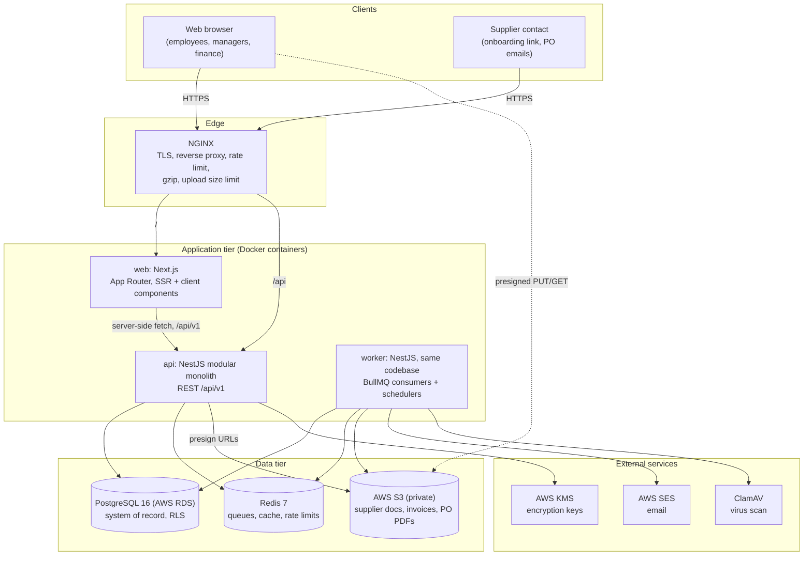
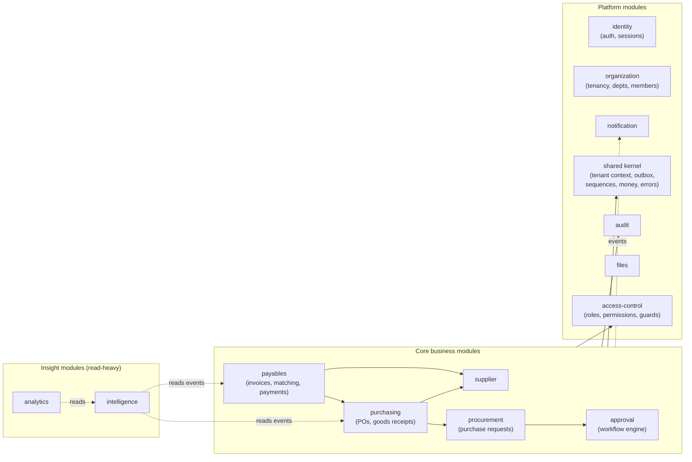
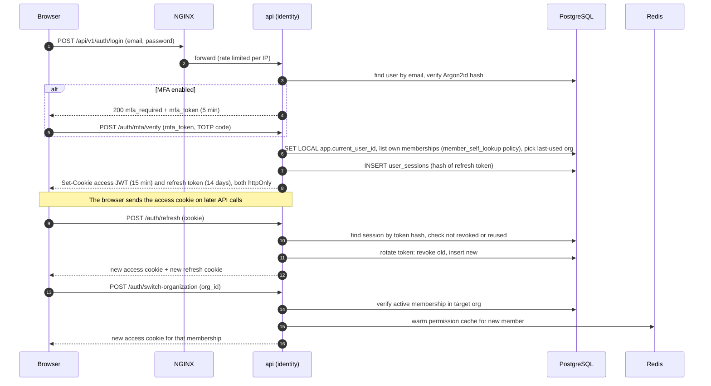
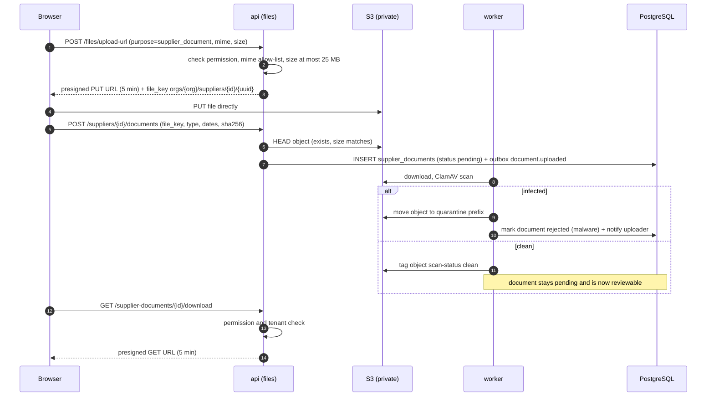
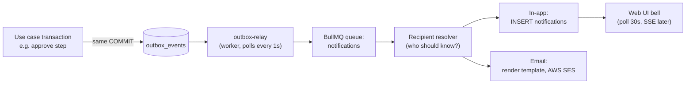
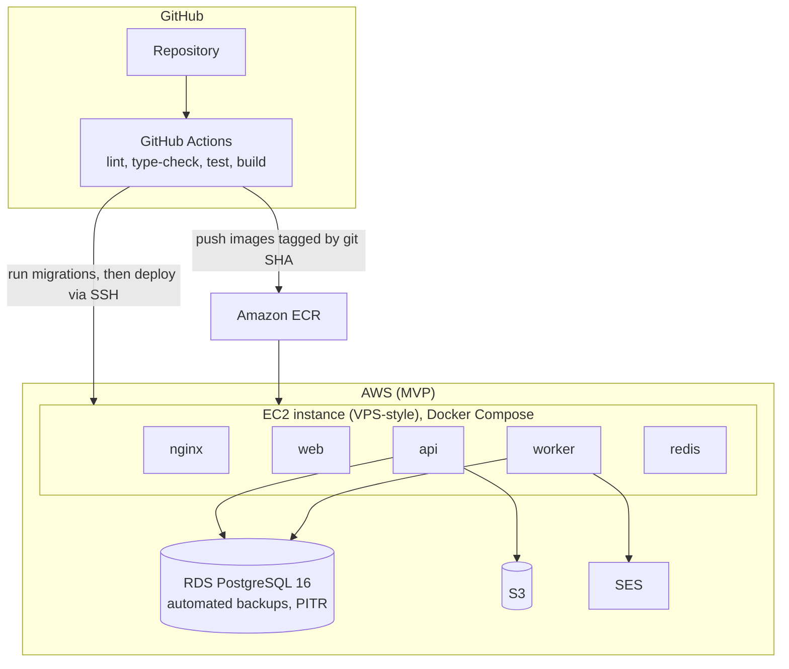

# Deliverable 03 — Application Architecture

## 1. Architecture style: Modular Monolith

**Decision:** SupplyMesh is built as a **modular monolith**: one NestJS codebase with strictly separated business modules. It is deployed as two processes from the same image (`api` and `worker`), plus a Next.js `web` frontend.

**Why it fits this product** (full comparison in [ADR-002](../05-adr/ADR-002-modular-monolith.md)):

| SupplyMesh characteristic | Consequence |
|---|---|
| The core flows are **transactional across modules**: approving the last step must update the request, write the audit row and enqueue the notification **atomically**. Paying an invoice must insert a payment and update `invoices.amount_paid` and status together. | In one process with one database, this is a single ACID transaction. With microservices, every one of these becomes a saga with compensation logic, which is the hardest kind of code to get right, and in money flows. |
| Modules are **tightly related in data** (PO line → request line, invoice line → PO line) | Microservices would duplicate data across services or need chatty cross-service calls |
| Early-stage SaaS, small team (3–6 engineers) | Microservices have a per-service operating cost (pipelines, monitoring, versioned contracts, network failure handling) that a small team can't absorb |
| Load is moderate and **predictable** (business hours, month-end peaks) | A stateless monolith scales horizontally behind a load balancer, which is enough for years (see Risk doc) |
| Modules do have **different runtime profiles** (HTTP latency vs nightly scoring jobs) | Handled by running the same code as a separate `worker` process. We get the main operational benefit of separating them without a distributed system. |

**Rejected:**
- **Microservices.** They would solve problems we don't have yet (independent team deployments, very different scaling needs) and create one we can't afford (distributed transactions in financial flows).
- **SOA with an ESB / shared service layer.** It is designed for integrating existing enterprise systems. A new product has none to integrate, and an ESB adds a central coupling point.

**What keeps the monolith from becoming a "big ball of mud":** see §3.3. Module boundaries are enforced in code and checked in CI, so the most likely future extraction (Supplier Intelligence/Analytics, then Notifications) is a deployment change, not a rewrite.

## 2. High-level architecture



Request path: browser → NGINX → `web` (renders pages) or `api` (JSON). `web` calls `api` server-side for SSR and the browser calls `api` directly for interactive actions. Files never pass through our servers: the browser uploads and downloads directly from S3 using short-lived presigned URLs.

## 3. Backend architecture (NestJS)

### 3.1 Modules



| Module | Owns tables | Public interface (used by other modules) |
|---|---|---|
| identity | `users`, `user_sessions` | `AuthService.verifyAccessToken()` |
| organization | `organizations`, `departments`, `organization_members`, `invitations` | `MemberDirectory.getDepartmentManager(deptId)` |
| access-control | `roles`, `permissions`, `role_permissions`, `member_roles` | `PermissionService.can(member, perm, scope)`, `ApprovalLimitService` |
| supplier | `supplier_categories`, `suppliers`, `supplier_documents` | `SupplierQuery.assertActive(supplierId)` |
| procurement | `purchase_requests`, `purchase_request_items`, `purchase_request_comments` | `PurchaseRequestQuery.getApproved(id)` |
| approval | `approval_workflows`, `approval_workflow_versions`, `approval_rules`, `approval_step_templates`, `approval_steps`, `approval_decisions` | `ApprovalEngine.start(subject)`, emits `approval.completed` |
| purchasing | `purchase_orders`, `purchase_order_items`, `goods_receipts`, `goods_receipt_items` | `PurchaseOrderQuery`, `ReceiptQuery` |
| payables | `invoices`, `invoice_items`, `invoice_discrepancies`, `payments` | — (end of the chain) |
| intelligence | `supplier_performance_records` | `SupplierScoreQuery` |
| analytics | materialized views | — |
| notification | `notifications` | consumes events only |
| audit | `audit_logs` | `AuditWriter.record()` |
| files | none (object keys are stored on the owning tables, e.g. `supplier_documents.file_key`) | `FileStorage.presignUpload()`, `FileStorage.presignDownload()` |
| shared kernel | `outbox_events`, `organization_sequences` | `withTenantTx()`, `Money`, `OutboxPublisher`, `SequenceService` |

### 3.2 Layers inside every module (Clean Architecture)

```
supplier/
├── domain/            Entities + value objects + domain rules. Pure TypeScript, no NestJS, no Drizzle.
│   ├── supplier.entity.ts          (Supplier aggregate: verify(), suspend(), changeBankDetails())
│   ├── supplier-status.ts          (state machine: allowed transitions)
│   └── supplier.repository.ts      (interface / port)
├── application/       Use cases. Orchestrate the domain, transactions, permission checks, events.
│   ├── register-supplier.use-case.ts
│   ├── verify-supplier.use-case.ts
│   └── dto/  (zod schemas shared from packages/contracts)
├── infrastructure/    Adapters: Drizzle repository, S3 adapter, mappers.
│   └── drizzle-supplier.repository.ts
└── presentation/      NestJS controllers, guards, OpenAPI decorators.
    └── suppliers.controller.ts
```

Dependency rule: `presentation → application → domain ← infrastructure`. The domain layer has no dependencies, so the core rules can be unit-tested in milliseconds without a database. Examples: "a suspended supplier can't be assigned to a PO", or "quantity billed can't exceed quantity received within tolerance". See [engineering-practices.md](../07-engineering/engineering-practices.md) for OOP/SOLID details.

### 3.3 How module boundaries are enforced
1. **Each module owns its tables.** Other modules never query them directly; they call the owning module's public service. A lint rule (`eslint-plugin-boundaries` / dependency-cruiser) fails CI if `payables` imports from `purchasing/infrastructure`.
2. **Synchronous calls** go through public interfaces (e.g. `SupplierQuery.assertActive`) when the caller needs an answer *now*, inside its transaction.
3. **Asynchronous reactions** use domain events (`purchase_order.issued`, `invoice.matched`) written to the **outbox** in the same transaction (ADR-007). Notification and intelligence react to events and are never called directly by business code. Audit is the exception: use cases call `AuditWriter` inside the same transaction, so the audit row commits with the change (§14).
4. **Shared kernel is small**: tenant context, `Money`, error types, outbox, sequences. Business logic doesn't belong there.

## 4. Front-end architecture (Next.js)

| Concern | Decision | Reason |
|---|---|---|
| Framework | Next.js App Router, TypeScript | SSR for data-heavy list and dashboard pages (fast first paint on large tables). Same language and shared types as the backend. |
| Rendering | **Server Components** for read views (lists, dashboards, detail pages). **Client Components** for forms, the approval inbox actions, and the workflow editor. | Less JavaScript sent to the browser; interactive only where needed |
| Data fetching | Server: `fetch` to `api`, forwarding the user's access cookie as a bearer token, `cache: 'no-store'` for transactional data. Client: TanStack Query for mutations, optimistic updates and polling. | Financial status must never be shown from a stale cache |
| Forms & validation | React Hook Form + **zod schemas imported from `packages/contracts`** | The same validation rules on client and server. One source of truth. |
| Routing | `/(auth)/login`, `/[orgSlug]/requests`, `/[orgSlug]/approvals`, `/[orgSlug]/suppliers/[id]`, `/[orgSlug]/purchase-orders`, `/[orgSlug]/invoices`, `/[orgSlug]/analytics`, `/[orgSlug]/settings/...`, `/onboard/[token]` (public supplier onboarding) | The org slug in the URL is for **display and navigation only**. The API always takes the tenant from the token. |
| Role-aware UI | `GET /api/v1/me` returns the member's permission codes. Navigation and buttons are hidden when not permitted. | Usability only. **The API remains the enforcement point.** |
| UI kit | Tailwind CSS + shadcn/ui (Radix) components; TanStack Table for large lists | Accessible components; consistent dense tables for procurement data |
| Auth on the frontend | Access token and refresh token are both httpOnly, Secure cookies on the shared origin (access: `SameSite=Lax`, `Path=/`; refresh: `SameSite=Strict`, `Path=/api/v1/auth`). Next.js middleware reads the access cookie and redirects unauthenticated users. | JavaScript can never read either token (protects against XSS), and the Next.js server can use the access cookie for server rendering. State-changing requests are protected against CSRF by an `Origin` check (ADR-010). |
| Charts | Recharts (spend trends, supplier scores) | |

## 5. API structure (summary)
REST over JSON at `/api/v1`, with an OpenAPI 3 contract generated from NestJS decorators. Resources use plural nouns. **State transitions are explicit action endpoints** (`POST /purchase-requests/{id}/submit`, `POST /approval-steps/{id}/decisions`, `POST /purchase-orders/{id}/issue`), because each transition has its own permission, validation and audit event. A generic `PATCH status` would hide all of that. Cursor pagination, RFC 9457 error format, `Idempotency-Key` on money-moving calls, and `ETag`/`If-Match` for optimistic concurrency.

Full catalog: **[api-structure.md](api-structure.md)**.

## 6. Authentication architecture



- **Passwords:** Argon2id, minimum length 12, checked against a breached-password list. Login attempts are limited per IP and per account, with exponential lockout.
- **MFA (TOTP):** mandatory for the Owner and Finance Officer roles (they control settings and money), optional for others.
- **Access token:** JWT signed with RS256, 15 minutes. Claims: `sub` (user), `org_id`, `member_id`, `sid` (session). **Permissions are not embedded**, so role changes take effect within seconds (cache invalidation), not after the token expires. It is delivered as an httpOnly `SameSite=Lax` cookie; the API also accepts it as an `Authorization: Bearer` header from the Next.js server.
- **Refresh token:** opaque, 14 days, **rotated on every use**. Reusing an old token indicates theft, and the whole session family is revoked.
- **Logout / admin revoke:** sets `user_sessions.revoked_at`. Deactivating a member removes all of their access in that organization immediately.
- **Future:** SAML/OIDC SSO plugs in as another way to obtain a session. The membership and permission model is unchanged.

## 7. Authorization architecture

Authorization has **four layers**. Each answers a different question:

| Layer | Question | Mechanism |
|---|---|---|
| 1. Tenant | "Is this person an active member of this organization?" | `TenantContextGuard`: loads the membership for `member_id` from the token, rejects if not `active`, stores `{orgId, memberId, userId}` in AsyncLocalStorage. Every DB transaction then runs `SET LOCAL app.current_org_id` (PostgreSQL RLS). |
| 2. Permission (RBAC) | "May this role perform this action at all?" | `@RequirePermission('invoice.approve')` on controllers + `PermissionGuard`. Permissions come from the member's roles, cached in Redis. |
| 3. Scope | "…on **this** record?" | Policy classes per module, e.g. `PurchaseRequestPolicy.canView(member, request)`: the requester, members with a department-scoped role for `request.department_id`, or an org-wide role. List queries apply the same scope as SQL filters. |
| 4. Business policy | "…given the business rules?" | Domain checks in use cases: approval limit (BR-09), no self-approval (BR-08), segregation of duties (BR-20), supplier must be active (BR-01). Critical ones are also DB constraints (`chk_inv_sod`). |

Why not attribute-based access control (ABAC) with a policy engine (OPA/Casbin)? The rules are few, stable and domain-specific. Expressing them as typed policy classes keeps them testable and readable. A policy engine would add a new language and runtime for about 20 rules. We would revisit this if customers ask for user-defined access policies.

## 8. Database communication

- **Drizzle ORM** over `node-postgres` (`pg.Pool`). The schema is defined in TypeScript (`packages/db`), migrations are generated by `drizzle-kit` and reviewed as SQL ([ADR-004](../05-adr/ADR-004-drizzle-orm.md)).
- **Repository pattern:** domain code depends on repository interfaces. Drizzle implementations live in `infrastructure/`.
- **Unit of work per request:** `withTenantTx(orgId, async (tx) => { ... })`
  1. `BEGIN`
  2. `SET LOCAL app.current_org_id = $orgId` (activates RLS)
  3. run the use case, including outbox and audit inserts
  4. `COMMIT` (or `ROLLBACK` on any error)
- **Locking:** money-moving use cases lock the rows they change with `SELECT … FOR UPDATE`. Edited documents use optimistic locking (`version` column + `If-Match`). See ADR-006.
- **Roles:** the app connects as `supplymesh_app` (no `BYPASSRLS`, no UPDATE/DELETE on `audit_logs`). Migrations run as `supplymesh_migrator` from CI only.
- **Pooling:** pool size per container ~10–20. PgBouncer (transaction mode) is introduced when container count grows. This is safe because tenant context uses `SET LOCAL`, not session state.
- **Reads for analytics** go to materialized views now, and to a read replica later.

## 9. File / document storage



- **Private bucket**, server-side encryption with KMS, versioning enabled (protects against accidental overwrite or delete), lifecycle rules move files older than 1 year to infrequent-access storage.
- Object keys are **prefixed with the organization id**, and the API only signs keys that belong to the caller's organization.
- Files never pass through the API (no memory or bandwidth cost on our side), but **every access requires a fresh permission check**, because URLs expire in 5 minutes.
- Generated documents (PO PDFs) are rendered by the worker and stored the same way.
- Local development uses MinIO (S3-compatible) in Docker Compose.

## 10. Notification system



- **Why the outbox:** if we sent the email inside the request and the transaction then rolled back, the approver would be told about something that never happened. If we committed and then crashed before sending, the approver would never know. Writing the event in the same transaction as the business change guarantees **at-least-once** delivery of exactly the events that committed ([ADR-007](../05-adr/ADR-007-transactional-outbox.md)).
- Consumers are **idempotent** (BullMQ `jobId = outbox_event.id`), so a relay retry can't send a duplicate.
- Events and recipients:

| Event | Recipients | Channels |
|---|---|---|
| `approval.requested` | step approver(s) | in-app + email |
| `approval.reminder` / escalated | approver / Owner | in-app + email |
| `purchase_request.approved` / `rejected` / `returned` | requester (+ procurement on approved) | in-app + email |
| `purchase_request.commented` | requester, the request's approvers, procurement managers | in-app |
| `purchase_order.issued` | supplier contact (PDF attached), requester | email / in-app |
| `supplier.verification_requested` / `verified` / `rejected` | verifiers / creator | in-app |
| `supplier_document.expiring` | procurement managers | in-app + email (weekly digest) |
| `invoice.discrepancy_detected` | finance officers, PO creator | in-app |
| `invoice.approved`, `payment.completed` / `failed` | finance, requester | in-app |

- Email bounces and complaints from SES are recorded through an SNS webhook, and bad addresses are suppressed.

## 11. Background processing

A dedicated **worker** container runs BullMQ consumers on Redis ([ADR-008](../05-adr/ADR-008-background-jobs.md)). It is the same codebase as `api`, started with a different entrypoint, so the domain logic is shared and not duplicated.

| Queue | Jobs | Trigger | Notes |
|---|---|---|---|
| `outbox-relay` | Move committed `outbox_events` into the right queue | every 1 s | `SELECT … FOR UPDATE SKIP LOCKED LIMIT 100`, so several workers can run safely |
| `notifications` | In-app + email delivery | events | Idempotent per event id |
| `documents` | Virus scan; nightly document-expiry check → risk flags | event / cron 02:00 | Uses `idx_supplier_docs_expiry` |
| `approvals` | SLA reminders and escalation | every 15 min | Uses `idx_steps_overdue`. The job and the SLA fields are built from the start; reminders and escalation are switched on in Release 1.1 |
| `purchasing` | Render PO PDF, email supplier | `purchase_order.issued` | |
| `intelligence` | Recompute `supplier_performance_records` + `risk_level` | nightly + on `invoice.matched` / receipt events (debounced) | Idempotent upsert per (supplier, month) |
| `analytics` | `REFRESH MATERIALIZED VIEW CONCURRENTLY` | hourly | Off the request path |
| `maintenance` | Create next month's `audit_logs` partition; purge expired sessions and invitations | monthly / daily | |

Failure policy: 5 attempts with exponential backoff (1 s → ~1 min). After that, the job stays in BullMQ's failed set, which acts as a **dead-letter queue**. An alert fires and an admin can retry it after the fix. Jobs are tenant-aware: every payload carries `organization_id`, and the worker opens `withTenantTx` exactly like the API.

## 12. Caching strategy

**Principle: cache what is read often and changes rarely. Never cache what a money or approval decision depends on.**

| What | Where | TTL | Invalidation | Why |
|---|---|---|---|---|
| Member permission set | Redis `org:{o}:member:{m}:perms` | 10 min | Deleted on any `member_roles` / `role_permissions` change | Checked on **every** request |
| Org settings, departments, categories | Redis `org:{o}:ref:*` | 15 min | Deleted on write | Used in forms and validation everywhere |
| Analytics dashboard results | Redis `org:{o}:anl:{hash(filters)}` | 5 min | TTL only | Expensive aggregations, and slightly stale numbers are acceptable |
| Rate-limit counters | Redis | window | — | Shared across api replicas |
| Idempotency responses | Redis `org:{o}:idem:{key}` | 24 h | — | Replays the original response on retry |
| Static assets | NGINX / browser (CloudFront later) | 1 year, hashed filenames | New build → new hash | |
| **Not cached** | — | — | — | Request / PO / invoice status, amounts, approval steps. Always read from PostgreSQL inside the transaction. |

If Redis is unavailable: permission checks fall back to PostgreSQL (slower, still correct), caches are bypassed, and queue producers keep working because events wait in the **outbox table**, not in Redis. Business data is never lost.

## 13. Deployment view



- **Multi-container:** `nginx`, `web`, `api`, `worker`, `redis` each run in their own container with health checks and resource limits. They are the same images in dev, CI and production.
- **Why a single VPS-style host + managed database for the MVP:** the app tier is stateless and cheap to rebuild. The **database** holds financial records and needs managed backups, point-in-time recovery and patching, so that is where we pay for a managed service from day one.
- **Growth path:** the same images move to ECS Fargate behind an ALB (api and web scale horizontally), with ElastiCache for Redis and an RDS read replica. Details in [ADR-012](../05-adr/ADR-012-deployment.md) and the [Risk & Scalability](../06-risk/risk-and-scalability.md) doc.
- **CI/CD:** PR → lint, type-check, unit tests, integration tests (Testcontainers Postgres + Redis), build. Main → images → staging → smoke tests → **manual approval** → migrations (backward-compatible, expand/contract) → rolling restart gated on health checks. Rollback: redeploy the previous SHA tag.

## 14. Cross-cutting concerns

| Concern | Approach |
|---|---|
| Configuration | 12-factor environment variables validated at boot with zod. Secrets in AWS Secrets Manager / SSM, never in images. |
| Logging | Structured JSON (pino) with `request_id`, `org_id`, `member_id`. No personal data or bank details in logs. |
| Tracing & metrics | OpenTelemetry → CloudWatch / Grafana: p95 latency per route, queue depth, failed jobs, DB pool usage |
| Error handling | Domain errors (e.g. `SupplierNotActiveError`) map to RFC 9457 problem responses in one global exception filter. Unknown errors → 500 with `request_id`, and no stack trace leaves the server. |
| Audit | An `AuditWriter` called by use cases (not DB triggers), so audit rows carry the business action name and actor, not just the changed columns |
| Time & money | All timestamps are `timestamptz` (UTC). The UI shows the organization's timezone. A `Money` value object (amount as string/decimal + currency) means no JavaScript floats ever touch amounts. |
| Internationalization | UI strings externalized from day one, English only in the MVP |

## 15. Technology decisions: used now vs later vs not needed

| Technology | Decision | Justification |
|---|---|---|
| TypeScript everywhere | **Use now** | One language for web, api, worker and shared contracts. Compile-time checks on money and status types. |
| Next.js | **Use now** | SSR for heavy tables and dashboards; shares zod contracts with the API |
| NestJS | **Use now** | The module system and dependency injection fit the modular monolith and Clean Architecture. Guards and interceptors fit the 4-layer authorization model. |
| Express.js | **Not used directly** | It is NestJS's default HTTP adapter underneath. A separate Express app would be a second framework with no added capability. |
| PostgreSQL + Drizzle | **Use now** | ADR-001, ADR-004 |
| Redis | **Use now** | Required by BullMQ, and also used for caching and rate limits (ADR-009) |
| Docker + multi-container + NGINX | **Use now** | Reproducible environments, process isolation, TLS/edge controls |
| AWS (RDS, S3, SES, KMS) | **Use now** | Managed services where failure is expensive (data, email deliverability, keys) |
| VPS-style single host | **Use now** | Cheapest reliable start for a stateless app tier |
| GitHub Actions CI/CD | **Use now** | Code lives on GitHub; environments with approvals give a controlled production deploy |
| ECS Fargate / ALB / ElastiCache / read replica | **Later** | Trigger: sustained CPU above 60% on the host, or an availability SLA above 99.5% |
| Kubernetes | **Not needed** | ECS covers our orchestration needs without running a cluster |
| Microservices / Kafka | **Not needed** | ADR-002, ADR-008: one database and in-process events are enough |
| Elasticsearch | **Not needed** | PostgreSQL trigram and full-text search cover supplier and request search at this scale |
