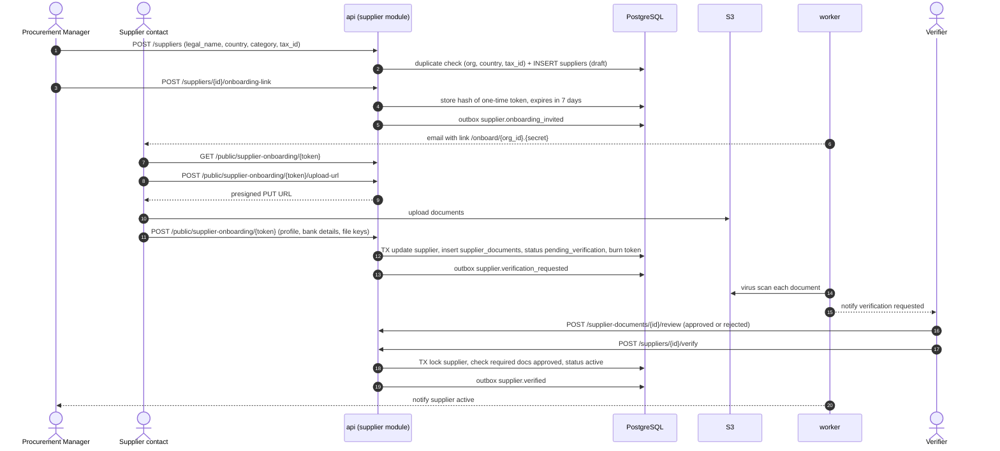
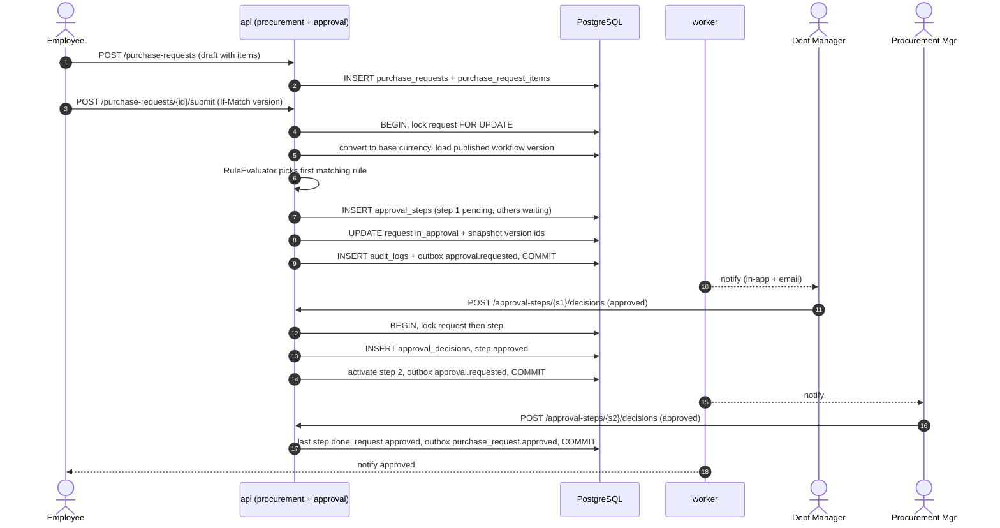
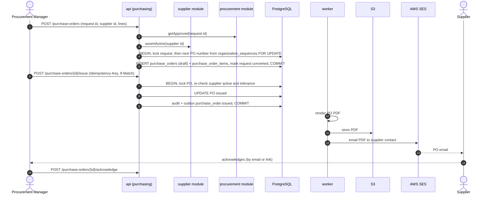
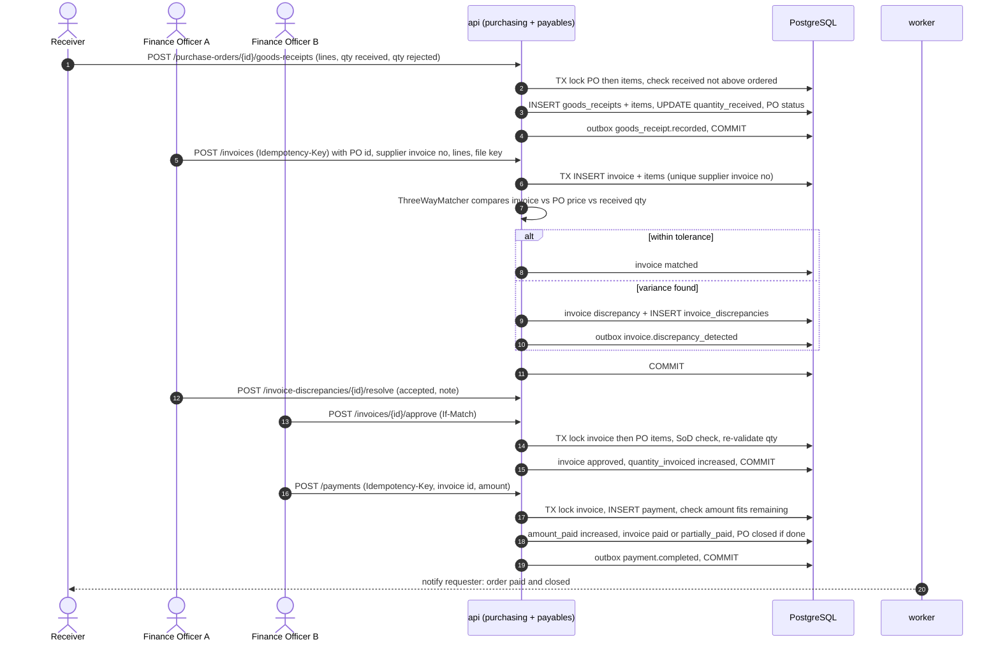

# Deliverable 04 — System Design

This document designs the four critical workflows end to end. For each one it covers request flow, business logic, data flow, database operations, authorization checks, failure scenarios, transaction handling and notification flow. It closes with bottlenecks and how the system handles growth.

Common mechanics used by all workflows (defined once here):
- **`withTenantTx`**: every write runs as `BEGIN → SET LOCAL app.current_org_id → use case → audit row + outbox row → COMMIT`. Audit and outbox rows are written **in the same transaction** as the business change, so both happen or neither does.
- **Guard chain**: `JwtAuthGuard → TenantContextGuard → PermissionGuard → use-case policy checks` (see Architecture §7).
- **Lock order** (to avoid deadlocks): `purchase_requests → approval_steps`, and on the money side `invoices → purchase_orders → purchase_order_items` (ascending `id`) `→ organization_sequences`. A use case locks only the rows it changes, but always in this order, with `organization_sequences` last (ADR-006).
- **Errors** are RFC 9457 problem responses: `409` conflict (duplicate / invalid state), `412` stale version, `422` validation or business rule, `403` permission or segregation of duties.

---

## Workflow 1 — Supplier Registration and Verification

### 1.1 Request flow



### 1.2 Business logic
- **Duplicate prevention:** an exact (country, tax_id) match is blocked by `uq_supplier_tax_id`. A fuzzy `legal_name` similarity above 0.6 (pg_trgm) is shown as a warning ("Did you mean Acme Ltd?"), not a block.
- **State machine** (enforced by the `Supplier` aggregate):
  `draft → pending_verification → active | rejected`, `rejected → pending_verification` (resubmitted), `active → pending_verification` (bank details changed, BR-05), `active → suspended → active`, `pending_verification | active | suspended → blacklisted` (terminal). Any other transition raises `InvalidSupplierTransition`.
- **Required documents per category** (e.g. IT Hardware requires `trade_license` + `tax_certificate`; Services also requires `insurance`) are configured in organization settings. `verify()` fails unless every required type has an `approved`, non-expired document.
- **Four-eyes on bank details (BR-05):** `changeBankDetails()` moves an active supplier back to `pending_verification` and records who made the change. `verify()` rejects a verifier who is the same member who last changed the bank details.
- **Onboarding token:** `<organization_id>.<32 random bytes>`. The org prefix lets the API set the tenant before lookup (RLS stays on). Only the SHA-256 hash of the secret is stored. It is single-use (burned on submit) and valid for 7 days, and it can only edit **that one** supplier record.

### 1.3 Data flow
Supplier contact (form + files) → S3 (files) + `suppliers` (profile; `bank_details_enc` encrypted with a KMS data key before it reaches the DB) → `supplier_documents` (metadata + `checksum_sha256`) → worker scan result → verifier decision → `suppliers.status = active`. From then on, the supplier appears in the PO supplier picker (only `status='active' AND deleted_at IS NULL`).

### 1.4 Database operations
| Step | Operations |
|---|---|
| Create | `INSERT suppliers` (status `draft`, `supplier_code` from `organization_sequences` key `SUP`), `INSERT audit_logs` |
| Invite | `UPDATE suppliers SET onboarding_token_hash, onboarding_token_expires_at`, `INSERT outbox_events` |
| Supplier submits | Parse `<organization_id>.<secret>` → `SET LOCAL app.current_org_id = <organization_id>` → `SELECT suppliers WHERE onboarding_token_hash = sha256(secret) AND onboarding_token_expires_at > now() FOR UPDATE` → `UPDATE suppliers` (profile, status `pending_verification`, token NULL) → `INSERT supplier_documents` × n → audit + outbox |
| Review document | `UPDATE supplier_documents SET status, reviewed_by_member_id, reviewed_at, review_note` |
| Verify | `SELECT … FROM suppliers WHERE id=$1 FOR UPDATE` → `SELECT document_type, status, expires_at FROM supplier_documents WHERE supplier_id=$1` → `UPDATE suppliers SET status='active', verified_by_member_id, verified_at, version=version+1 WHERE id=$1 AND version=$2` |

### 1.5 Authorization checks
| Action | Check |
|---|---|
| Create / edit supplier | `supplier.create` / `supplier.update` |
| Send onboarding link | `supplier.create` (only while `draft`) |
| Public onboarding endpoints | No JWT. The token has the form `<organization_id>.<secret>`. The API sets the tenant from the prefix (RLS on), then matches the hash of the secret inside that tenant. A valid, unexpired, unused token gives access to exactly one supplier row, and a forged prefix finds nothing. Rate-limited per IP and per token. |
| Review document / verify / reject | `supplier.verify`, and **verifier ≠ member who last changed bank details** |
| Suspend / blacklist | `supplier.suspend` / `supplier.blacklist`, and a reason is required |
| Download document | `supplier.read` (+ `supplier.bank_details.read` for `bank_letter`) + same organization (key prefix check) → presigned GET, only once the virus scan is clean |

### 1.6 Failure scenarios
| Failure | Handling |
|---|---|
| Duplicate tax id | `409 supplier_duplicate`, with a link to the existing supplier |
| Token expired or already used | `410 Gone`. Procurement can re-send a new link. |
| Upload interrupted, or client never confirms | The S3 object exists with no DB row. Objects are created with an `unconfirmed` tag that the confirm step removes, and a lifecycle rule expires tagged objects after 1 day. |
| File infected | The worker moves the object to a quarantine prefix, marks the document `rejected` ("malware detected") and notifies the uploader (ADR-011) |
| Virus scanner down | The job retries with backoff. The document stays `pending` and can't be approved until scanned, so the system **fails closed**. |
| Two verifiers click "verify" at once | Row lock + `version` check: the second gets `409 already_active` |
| Required document expires after activation | Nightly job flags `doc_expired`. After the grace period, PO creation is blocked (BR-04). |

### 1.7 Transaction handling
Each step is one short transaction. The **supplier submission** is the important one: profile update, document rows, status change and token burn are **atomic**. A crash in the middle leaves the token valid and nothing half-saved, so the supplier can simply submit again. External effects (email, virus scan) are triggered only through outbox rows committed with that transaction.

### 1.8 Notification flow
`supplier.onboarding_invited` → email to the supplier contact · `supplier.verification_requested` → in-app to members with `supplier.verify` · `supplier_document.rejected` → email to the supplier with the reason and a new upload link · `supplier.verified` / `supplier.rejected` → in-app to the creator · `supplier_document.expiring` (30/7 days before) → weekly digest to procurement.

---

## Workflow 2 — Purchase Request and Multi-Level Approval

### 2.1 Request flow



### 2.2 Business logic

**Rule evaluation (on submit)**
1. `estimated_total = Σ items.line_total`. `estimated_total_base = estimated_total × fx_rate_to_base`, using the server-side FX rate lookup (a daily reference rate from the FX provider, cached; 1 for base currency). The rate is stored on the request.
2. Load the **published** `approval_workflow_versions` row for `subject_type='purchase_request'`.
3. Evaluate `approval_rules` ordered by `priority`. A rule matches when `min_amount ≤ total_base < max_amount (or max is NULL)` **and** (`department_id` is NULL or equal) **and** (`category_id` is NULL or equal) **and** (`min_priority` is NULL or request priority ≥ it). **First match wins.**
4. No match → `422 approval_policy_gap`, and the Owner is notified (BR-12).

**Step creation**: one `approval_steps` row per template of the matched rule.
- `department_manager` → resolve to `departments.manager_member_id` of the request's department.
- `role` → keep `approver_role_id`. Any member with that role (org-wide, or scoped to the request's department) can act.
- `specific_member` → copy `approver_member_id`.
- **Self-approval guard (BR-08):** if the resolved member is the requester, resolve to the parent department's manager, or fall back to the `procurement_manager` role.
- **Limit guard (BR-09):** if the last step resolves to a member whose `approval_limit_amount < estimated_total_base`, append an escalation step.
- All steps with the lowest `step_order` become `pending` (with `activated_at`, `due_at = now() + sla_hours`). The rest are `waiting`.

**Decision handling**
- `approved` → `approvals_count + 1`. If it equals `required_approvals`, the step becomes `approved`. If **all** steps at this `step_order` are approved, the steps at the next order are activated. If none remain, the request becomes `approved`.
- `rejected` → step `rejected`, all `waiting`/`pending` steps `skipped`, request `rejected` (BR-10).
- `returned` → like rejected, but the request becomes `returned`. The requester can edit and resubmit, which creates a **fresh set of steps** with `round` increased by one and keeps the old ones as history. Step activation and completion only look at steps of the current round.

The brief's example policy as data:

| priority | min | max | steps (order: approver) |
|---|---|---|---|
| 1 | 0 | 500 | 1: department_manager |
| 2 | 500 | 5,000 | 1: role procurement_manager |
| 3 | 5,000 | NULL | 1: department_manager → 2: role procurement_manager → 3: role finance_officer |

Ranges are **inclusive of `min_amount` and exclusive of `max_amount`**, so every amount matches exactly one rule. The brief's wording ("between $500 and $5,000" / "above $5,000") leaves the exact boundary open. This design sends exactly **$500.00** to rule 2 and exactly **$5,000.00** to rule 3, the stricter choice. These are the expected results of the boundary tests in [engineering-practices §5](../07-engineering/engineering-practices.md). An organization can move a boundary by editing its policy.

### 2.3 Data flow
Request form → `purchase_requests` + `purchase_request_items` → (submit) policy snapshot (`workflow_version_id`, `matched_rule_id`) → `approval_steps` → `approval_decisions` → request status → outbox events → notifications. Analytics later read `submitted_at` / `decided_at` to compute approval cycle time.

### 2.4 Database operations
**Submit** (one transaction):
```sql
SELECT * FROM purchase_requests WHERE id = $1 FOR UPDATE;              -- status must be draft/returned, version = If-Match
SELECT … FROM approval_workflow_versions v JOIN approval_workflows w …
  WHERE w.subject_type = 'purchase_request' AND w.is_active AND v.status = 'published';
SELECT … FROM approval_rules WHERE workflow_version_id = $v ORDER BY priority;  -- small set, evaluated in memory
SELECT … FROM approval_step_templates WHERE rule_id = $r ORDER BY step_order;
INSERT INTO approval_steps (…) VALUES (…), (…), (…);
UPDATE purchase_requests SET status='in_approval', submitted_at=now(), workflow_version_id=$v,
       matched_rule_id=$r, estimated_total_base=$t, fx_rate_to_base=$fx, version=version+1 WHERE id=$1;
INSERT INTO audit_logs (…);  INSERT INTO outbox_events (…);
```
**Decide** (one transaction): lock the request → lock the step → `INSERT approval_decisions` (the unique constraint blocks a second vote) → `UPDATE approval_steps` → optionally `UPDATE` sibling and next steps → optionally `UPDATE purchase_requests` → audit + outbox.

**Approval inbox** (the most frequent read):
```sql
SELECT s.*, r.title, r.estimated_total_base, r.requester_member_id
FROM approval_steps s JOIN purchase_requests r ON r.id = s.purchase_request_id
WHERE s.organization_id = $org AND s.status = 'pending'
  AND ( s.approver_member_id = $me
     OR (s.approver_role_id = ANY($myRoleIds) AND <department scope matches>) )
ORDER BY s.due_at;
```
This query is served by the partial indexes `idx_steps_pending_member` and `idx_steps_pending_role`, which only contain pending steps.

### 2.5 Authorization checks
| Action | Check |
|---|---|
| Create / edit draft | `purchase_request.create`; editing only by the requester while `draft` / `returned` |
| Submit | requester only |
| View | requester, OR a department-scoped role on `department_id`, OR an org-wide role with `purchase_request.view_all` |
| Decide | `purchase_request.approve` **and** the step is `pending` **and** (member = `approver_member_id` OR the member holds `approver_role_id` with a matching scope) **and** member ≠ requester **and** no previous decision by this member on this step |
| Configure workflows | `approval_workflow.manage` (Owner, Procurement Manager). Publishing a version is audited. |

### 2.6 Failure scenarios
| Failure | Handling |
|---|---|
| Two approvers of a quorum step decide at the same moment | Both lock the request row first, so the decisions are serialized and the counts stay correct |
| The same approver double-clicks | Second insert violates `UNIQUE(approval_step_id, decided_by_member_id)` → `409 already_decided` (the UI treats it as success) |
| Requester edits while an approver is reviewing a returned request | `version` mismatch → `412`, and the client reloads |
| Policy edited while requests are in flight | No effect: requests point to their `workflow_version_id` snapshot |
| Department manager position empty, or the manager is deactivated | Step resolves to the parent department's manager, or the Procurement Manager role, and the Owner is alerted to fix the org chart |
| Approver on leave | SLA job: reminder at 75% of `sla_hours`, then escalation to the Owner or the delegate (Should feature) |
| Notification delivery fails | The outbox keeps the event and the relay retries. The approval itself is already committed and still shows in the approver's inbox, so a lost email doesn't block the flow. |

### 2.7 Transaction handling
Submit and each decision are **single ACID transactions**: steps, status, audit and outbox are all-or-nothing. Isolation level is READ COMMITTED with **explicit row locks** (`FOR UPDATE`) on the request. That is simpler and cheaper than SERIALIZABLE, and enough because all changes to one request go through the same locked row. Transactions are short (single-digit milliseconds of work), so lock contention stays negligible.

### 2.8 Notification flow
`approval.requested` → approver(s), in-app + email with deep link · `approval.reminder` at 75% SLA · `approval.escalated` → Owner · `purchase_request.approved` → requester + Procurement Managers ("ready for PO") · `purchase_request.rejected` / `returned` → requester, with the comment.

---

## Workflow 3 — Purchase Order Generation

### 3.1 Request flow



### 3.2 Business logic
- **Source:** the PO must reference a request with status `approved`. Lines are pre-filled from `purchase_request_items`, and procurement sets the final `unit_price`, `tax_rate` and quantity.
- **Splitting:** a request can be sourced across several POs, for example laptops from supplier A and monitors from supplier B. Creating the first PO moves the request `approved → converted`, and more POs can still be created from a `converted` request. If every PO of the request is later cancelled, it returns to `approved`.
- **Supplier gate (BR-01, BR-04):** `status = 'active'` and no `doc_expired` flag past the grace period. This is checked at draft creation **and again at issue**, because the supplier may have been suspended in between.
- **Price tolerance (BR-13):** `Σ total_base of all non-cancelled POs for the request ≤ estimated_total_base × (1 + po_tolerance_pct)`. Default 10%. Above that, the PO can't be issued: procurement cancels the draft and the requester submits a new request for the higher amount, which goes through approval again (BR-13).
- **Totals:** `subtotal = Σ line_subtotal`, `tax_total = Σ line_subtotal × tax_rate`, `total = subtotal + tax_total` (enforced by `chk_po_totals`). `fx_rate_to_base` is captured when the PO is issued.
- **Immutability (BR-14):** after `issued`, lines can't be edited. Cancellation requires a reason and is only allowed while nothing has been received.

### 3.3 Data flow
`purchase_requests` / `purchase_request_items` (approved need) + `suppliers` (active, terms, currency) → `purchase_orders` / `purchase_order_items` (legal commitment, copied values) → PDF in S3 → supplier email. `purchase_order.issued` also feeds analytics (committed spend) and intelligence (`orders_issued`).

### 3.4 Database operations
| Step | Operations |
|---|---|
| Number | `SELECT next_value FROM organization_sequences WHERE organization_id=$o AND sequence_key='PO' FOR UPDATE; UPDATE … SET next_value = next_value + 1` (inside the same transaction, so a rollback doesn't consume a number) |
| Draft | `INSERT purchase_orders`, `INSERT purchase_order_items` × n, `UPDATE purchase_requests SET status='converted'` (first PO of the request only) |
| Issue | `SELECT … FROM purchase_orders WHERE id=$1 FOR UPDATE` → re-check supplier → `SELECT SUM(total_base) FROM purchase_orders WHERE purchase_request_id=$r AND status <> 'cancelled'` → `UPDATE purchase_orders SET status='issued', issued_at=now(), version=version+1 WHERE id=$1 AND version=$v` → audit + outbox |

### 3.5 Authorization checks
`purchase_order.create` and `purchase_order.issue` (Procurement Manager). The requester and department manager get **read** access to POs created from their requests. Cancel requires `purchase_order.cancel`. Segregation of duties is recorded here: the PO creator (`created_by_member_id`) is later **excluded** from approving the related invoice and recording its payment (BR-20).

### 3.6 Failure scenarios
| Failure | Handling |
|---|---|
| Supplier suspended between draft and issue | The re-check at issue fails with `422 supplier_not_active` |
| Double-click on "Issue" / network retry | `Idempotency-Key` returns the stored first response. The status check (`draft` only) also blocks a second issue. |
| PO exceeds the approved amount | `422 exceeds_approved_amount`, with the variance shown |
| PDF render or email fails | The PO is already issued (committed). Worker retries 5×, then it goes to the dead-letter set, and procurement sees "Email not delivered" with a "Resend" action. **The legal state never depends on email.** |
| Supplier email bounces | SES bounce webhook → notification to procurement to fix the contact |
| Sequence row contention under concurrent PO creation | The lock is held for microseconds in a short transaction. Even 50 concurrent creations per organization serialize in well under a second. |

### 3.7 Transaction handling
Draft creation and issue are separate transactions, because users review drafts. **Issue** is atomic: status, audit and outbox happen together. Side effects (PDF, email) run **after commit** via the outbox, so a rolled-back issue never emails a supplier.

### 3.8 Notification flow
`purchase_order.issued` → supplier contact (email + PDF), requester (in-app: "your request is ordered") · `purchase_order.cancelled` → supplier + requester · Late delivery job (daily: `expected_delivery_date < today` and status not received) → `purchase_order.overdue` → procurement.

---

## Workflow 4 — Invoice Verification and Payment Processing

Three-way matching needs to know what was received, so this workflow starts with **goods receipt**.

### 4.1 Request flow



### 4.2 Business logic

**Goods receipt**
- For each line: `quantity_received(after) = quantity_received(before) + accepted qty ≤ ordered quantity` (CHECK `chk_poi_received`). Rejected quantity is recorded with a reason and counts against the supplier's quality score.
- PO status: `partially_received` if some lines are still open, `received` when all are fully received.
- On-time is measured by comparing `received_at` with `expected_delivery_date` (feeds intelligence).

**Three-way match** (`ThreeWayMatcher`, a pure domain service). Tolerances come from `organizations.settings`.

| Check | Rule | Discrepancy type |
|---|---|---|
| Supplier | `invoice.supplier_id = po.supplier_id` | rejected outright (422) |
| Currency | `invoice.currency = po.currency` | `currency` |
| Price | `|inv.unit_price − po.unit_price| / po.unit_price ≤ price_tolerance_pct` (default 2%) | `price` |
| Quantity | `po_item.quantity_invoiced + inv.quantity ≤ po_item.quantity_received × (1 + qty_tolerance_pct)` (default 0%) | `quantity`, or `missing_receipt` if nothing has been received |
| Tax | `inv.tax_amount ≈ inv.line_subtotal × po_item.tax_rate` (± rounding) | `tax` |
| Header | `invoice.total = Σ lines + tax`, within ±1.00 | `total` |

All checks pass → `matched`. Otherwise → `discrepancy`, with one `invoice_discrepancies` row per finding (`expected_value`, `actual_value`, `variance_pct`).

**Discrepancy resolution:** each one is `accepted` (e.g. agreed freight surcharge), `rejected` (supplier must issue a credit note or a corrected invoice, and the invoice moves to `rejected`), or `resolved` (corrected after a receipt was recorded). The invoice can be approved only when there are **no open** discrepancies and none are rejected (BR-18). After a late goods receipt, `POST /invoices/{id}/match` re-runs matching.

**Approval:** re-validate the quantity rule **under lock** (another invoice for the same PO may have been approved since matching), then `quantity_invoiced += inv.quantity` per line and set the status to `approved`.

**Payment**
- `amount > 0` and `amount ≤ invoice.total − invoice.amount_paid − Σ(scheduled payments)`.
- Status `completed` (recording a transfer that has already been made) → `amount_paid += amount`, invoice status becomes `paid` or `partially_paid`. Status `scheduled` → counted toward the limit above, and `amount_paid` is updated when it is later marked `completed`.
- When every invoice line equals the received quantity, the PO is fully received, and all its invoices are `paid` → PO `closed`.

### 4.3 Data flow
`goods_receipt_items` → `purchase_order_items.quantity_received` → (matching reads PO price + received qty) → `invoices` / `invoice_items` → `invoice_discrepancies` → `invoices.status = approved` + `purchase_order_items.quantity_invoiced` → `payments` → `invoices.amount_paid` / status → `purchase_orders.status = closed`. Events from each step feed `supplier_performance_records` (on-time rate, rejection rate, discrepancy rate, spend).

### 4.4 Database operations (approval and payment, the critical ones)
```sql
-- Approve invoice
BEGIN; SET LOCAL app.current_org_id = $org;
SELECT * FROM invoices WHERE id = $inv FOR UPDATE;                  -- status matched (or discrepancies closed), version = If-Match
SELECT count(*) FROM invoice_discrepancies WHERE invoice_id = $inv AND status IN ('open','rejected');  -- must be 0
SELECT * FROM purchase_order_items WHERE id = ANY($poItemIds) ORDER BY id FOR UPDATE;   -- deterministic lock order
-- re-validate: quantity_invoiced + inv_qty <= quantity_received * (1 + tol) for each line
UPDATE purchase_order_items SET quantity_invoiced = quantity_invoiced + $q WHERE id = $i;   -- per line
UPDATE invoices SET status='approved', approved_by_member_id=$me, approved_at=now(), version=version+1
 WHERE id=$inv AND version=$v;                                      -- chk_inv_sod enforces recorder <> approver
INSERT INTO audit_logs …; INSERT INTO outbox_events …;
COMMIT;

-- Record payment
BEGIN; SET LOCAL app.current_org_id = $org;
SELECT * FROM invoices WHERE id = $inv FOR UPDATE;                          -- lock first: a concurrent payment for this invoice waits here
INSERT INTO payments (…, idempotency_key) VALUES (…)
  ON CONFLICT (organization_id, idempotency_key) DO NOTHING RETURNING id;   -- no row returned = replay, so return the existing payment
-- check: amount <= total - amount_paid - other pending scheduled amounts (a failed check rolls the insert back)
UPDATE invoices SET amount_paid = amount_paid + $amt,
       status = CASE WHEN amount_paid + $amt = total THEN 'paid' ELSE 'partially_paid' END
 WHERE id = $inv;                                                   -- chk_inv_paid guards overflow
-- maybe UPDATE purchase_orders SET status='closed' …
INSERT INTO audit_logs …; INSERT INTO outbox_events …;
COMMIT;
```

The invoice is locked **before** the payment row is inserted. Inserting first would take a foreign-key share lock on the invoice, and two concurrent payments would then deadlock when both try to upgrade to `FOR UPDATE` (ADR-006).

### 4.5 Authorization checks
| Action | Check |
|---|---|
| Record goods receipt | `goods_receipt.create`: Procurement Manager, or the **requester / department-scoped manager** of the originating request (people who physically receive the goods) |
| Record invoice | `invoice.create` (Finance Officer) |
| Resolve discrepancy | `invoice.resolve_discrepancy` (Finance). A note is required (`chk_disc_resolution`). |
| Approve invoice | `invoice.approve` **and** member ≠ `recorded_by_member_id` (DB CHECK) **and** member ≠ `purchase_orders.created_by_member_id` (domain check) |
| Record payment | `payment.record` **and** member ≠ PO creator |
| View invoices / payments | Finance, Owner. Procurement can read. The requester sees status only. |

### 4.6 Failure scenarios
| Failure | Handling |
|---|---|
| Duplicate supplier invoice number | `UNIQUE (organization_id, supplier_id, supplier_invoice_number)` → `409 duplicate_invoice`, with a link to the original |
| Invoice before goods arrive | `missing_receipt` discrepancy. It is re-matched automatically when a receipt is recorded (`goods_receipt.recorded` event triggers re-matching for open invoices on that PO). |
| Two invoices for the same PO approved concurrently | Both lock the same `purchase_order_items` rows in id order. The second sees the updated `quantity_invoiced` and fails re-validation (`422 over_invoiced`). |
| "Record payment" sent twice (double-click, retry after timeout) | The same `Idempotency-Key` → `ON CONFLICT DO NOTHING` → the original payment is returned. **No double payment.** |
| Payment amount exceeds the balance | `422 exceeds_outstanding`. If code ever got it wrong, `chk_inv_paid` would abort the transaction. |
| Scheduled or processing transfer fails | Payment status → `failed` with `failure_reason`. `amount_paid` is untouched (it only changes when a payment is `completed`), so the outstanding balance is free again, and a `payment.failed` notification is sent. Reversing an already `completed` payment (e.g. a bank recall) is out of MVP scope and handled as a manual adjustment (ADR-006). |
| Same person tries to record and approve | `403 segregation_of_duties` (domain check). The DB CHECK is a backstop. |
| Stale screen (someone else changed the invoice) | `412 precondition_failed` → reload |

### 4.7 Transaction handling
- Every money-changing operation (receipt, approval, payment) is **one transaction** that locks the affected rows in a deterministic order (`invoices` → `purchase_order_items ORDER BY id`) to prevent deadlocks.
- The running totals (`quantity_received`, `quantity_invoiced`, `amount_paid`) are updated **only** inside these locked transactions. `quantity_received` and `amount_paid` are also guarded by CHECK constraints (`chk_poi_received`, `chk_inv_paid`); `quantity_invoiced` is not, on purpose, because over-invoicing is recorded as a discrepancy rather than blocked (ADR-006). If application logic were ever wrong, the database rejects the commit, so the error can't be silently stored.
- No distributed transactions are needed: PO, receipts, invoices and payments all live in the same PostgreSQL database (a key reason for the modular monolith, ADR-002 / ADR-006).
- A nightly **reconciliation job** recomputes `Σ payments` vs `amount_paid` and `Σ receipts` vs `quantity_received` and alerts on any mismatch. This is cheap insurance for financial data.

### 4.8 Notification flow
`goods_receipt.recorded` → finance (if invoices are waiting on it) · `invoice.discrepancy_detected` → finance + PO creator · `invoice.approved` → the finance member who will pay · `payment.completed` → requester and procurement ("order closed") · `payment.failed` → finance · `invoice.due_soon` (daily job, using `idx_inv_unpaid_due`) → finance digest.

---

## 5. Bottlenecks and handling growth

Workload assumptions (year 1). **These are this design's own planning assumptions; the brief gives no volumes.** Each one is justified in Risk §3.1. 200 organizations; the largest has about 5,000 employees, 2,000 suppliers, 10,000 requests per month and ~90,000 invoices per year (about one per PO). Platform-wide: about 1M requests per year and about 3M audit rows per month. Peaks: Monday-morning approvals, month-end and quarter-end invoice batches. Capacity math is in the [Risk & Scalability](../06-risk/risk-and-scalability.md) doc.

| # | Potential bottleneck | Why | Mitigation built into the design | Next step when it isn't enough |
|---|---|---|---|---|
| B1 | **Approval inbox query** (hit on every page load by every approver) | Joins steps to requests and filters by role and scope | Partial indexes on `status='pending'` keep the index tiny no matter how large history grows. Short TTL cache of the count badge. | Denormalized `approval_inbox` projection table maintained by events |
| B2 | **Month-end invoice batch** (Finance enters hundreds of invoices per hour, plus matching) | Write bursts, row locks on popular PO lines | Matching is bounded by invoice line count. Locks are on rows, not tables, and transactions are short. Bulk entry endpoint processes each invoice in its own transaction. | Async matching through the queue with a "matching…" status. Scale api replicas. |
| B3 | **Analytics on OLTP tables** | Aggregations over millions of rows compete with transactions | Materialized views refreshed hourly by the worker. Pre-aggregated `supplier_performance_records`. 5-minute Redis cache. | RDS read replica for all analytics reads, then a columnar store (e.g. ClickHouse/Redshift) fed by the outbox |
| B4 | **`audit_logs` growth** (every change = 1 row; ~36M rows per year) | Largest table; index bloat | Monthly partitions; old partitions archived to S3 (Parquet) and dropped | Separate audit database or an append-only log store |
| B5 | **Document numbering** (`organization_sequences` row lock) | One row per (org, type) serializes number generation | Lock held only during a short transaction | Pre-allocate number blocks per api instance, if a tenant ever needs more than 100 POs/second (unrealistic for procurement) |
| B6 | **Outbox relay** | Single poller could lag during bursts | `FOR UPDATE SKIP LOCKED` lets several relay workers run in parallel. Partial index on unpublished rows. | Logical replication / Debezium CDC instead of polling |
| B7 | **Noisy-neighbor tenant** (one huge org's import or report slows everyone) | Shared database and shared queues | Per-tenant rate limits (Redis). Per-tenant job concurrency (BullMQ group keys). Statement timeout of 5 s on API queries. | Move a very large tenant to a dedicated database (same schema, routed by `organization_id`) |
| B8 | **DB connections** as api replicas grow | Each container has its own pool | Modest pool sizes | PgBouncer (transaction mode). Safe because tenant context is `SET LOCAL`. |
| B9 | **File uploads** | Large files through the API would block Node's event loop | Direct-to-S3 presigned uploads, so the API never streams file bytes | CloudFront in front of S3 for downloads |
| B10 | **Single EC2 host** (MVP) | Single point of failure, limited vertical headroom | Stateless containers, automated rebuild from images, RDS holds all state | ECS Fargate with ≥ 2 tasks per service across availability zones, behind an ALB |

**How the system grows, in order of cost:**
1. **Optimize queries and indexes** (`pg_stat_statements`-driven).
2. **Scale vertically** (bigger EC2 / RDS instance class).
3. **Scale horizontally** at the stateless tiers: more `api` and `web` containers behind NGINX/ALB, and more `worker` replicas with per-queue concurrency.
4. **Offload reads** to a read replica and caches.
5. **Partition** large tables (audit first, then transactions by year).
6. **Extract a module** whose load profile differs (Intelligence/Analytics first). The module boundaries and outbox events already define its interface.
7. **Dedicated database for very large tenants.**

Each step is triggered by a measured metric (p95 latency, CPU, replica lag, queue depth), not by guesswork. See the roadmap in the Risk & Scalability doc.
