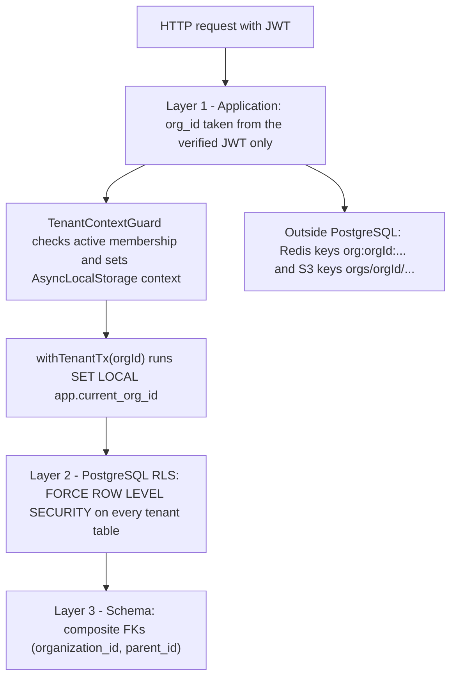

# ADR-003: Multi-tenancy with a shared schema, Row-Level Security and composite tenant FKs

- **Status:** Accepted · **Date:** 2026-11-12 · **Deciders:** Masum Islam Badsha
- **Related:** [ADR-001 PostgreSQL](ADR-001-postgresql-over-mongodb.md) · [ADR-004 Drizzle ORM](ADR-004-drizzle-orm.md) · [ADR-009 Redis](ADR-009-redis.md) · [ADR-010 Auth & RBAC](ADR-010-auth-and-rbac.md) · [ADR-011 File storage](ADR-011-file-storage.md) · [Database design §8](../02-database/database-design.md)

## Context (the problem)

SupplyMesh is a SaaS product. Every organization stores supplier bank details, negotiated prices, invoices and payment history. A leak of one organization's data to another is the most damaging failure the product can have: it exposes commercial terms between competitors. At the same time, a small team must operate the platform, run one set of migrations and support about 200 organizations in year 1, from 20-person firms to tenants with ~5,000 employees. One person can also belong to several organizations (`organization_members`), for example a consultant or a group finance officer.

## Decision drivers

- A forgotten `WHERE organization_id = …` in one repository must not leak data.
- An `invoices` row in Org B must not be able to reference a `purchase_orders` row in Org A, even through an application bug.
- One migration run per release, not one per tenant.
- Connection pooling (PgBouncer in transaction mode, later) must not leak tenant context between requests.
- Platform jobs (outbox relay, partition maintenance) must still work across tenants, in a controlled and audited way.
- Isolation must also cover Redis keys and S3 objects, not only PostgreSQL.
- A very large or regulated tenant may later need physical isolation.

## Options considered

| Option | How it would work here | Pros | Cons |
|---|---|---|---|
| Database per tenant | One RDS database (or instance) per organization; a routing table maps org → connection string | Strongest isolation; per-tenant backup/restore; noisy neighbours removed | 200 databases × migrations, pools and monitoring; cross-tenant platform analytics are hard; cost per small tenant is high |
| Schema per tenant | One PostgreSQL schema per organization; `search_path` set per request | Good isolation; one instance | Migrations run N times and can partially fail; catalog bloat past a few thousand schemas; pooled connections must reset `search_path` correctly |
| Shared schema, application filter only | `organization_id` on every row; repositories add the filter | Simplest; cheapest | One missed filter is a cross-tenant leak; nothing in the database stops it |
| **Shared schema + RLS + composite FKs** | `organization_id NOT NULL` on every tenant table, `FORCE ROW LEVEL SECURITY` policies, `UNIQUE (organization_id, id)` + composite FKs | Database enforces isolation even if code is wrong; one migration; cheap per tenant; works with transaction pooling via `SET LOCAL` | RLS policies must be kept in sync with new tables; slightly more complex queries and indexes; noisy neighbours share one instance |

## Decision

Use a **shared database and shared schema**, with three independent layers of isolation:

1. **Application.** The tenant comes from the `org_id` claim of the verified JWT, never from the URL or body. `TenantContextGuard` checks that the member is `active` in that organization and stores the context in AsyncLocalStorage. Repositories filter by it.
2. **Database (RLS).** Every request runs in `withTenantTx(orgId, fn)`, which starts the transaction with `SET LOCAL app.current_org_id`. The policy `organization_id = NULLIF(current_setting('app.current_org_id', true), '')::uuid` applies to reads (`USING`) and writes (`WITH CHECK`). The app connects as `supplymesh_app`, which has no `BYPASSRLS`.
3. **Schema.** Every child table references its parent with `(organization_id, parent_id) → parent(organization_id, id)`.

## Reasons for selection

1. **Fail closed.** If tenant context is missing, the policy can never match another tenant. On a fresh connection `current_setting(..., true)` returns NULL. On a pooled connection where an earlier transaction used `SET LOCAL`, it reverts to an empty string, which `NULLIF` turns into NULL. Either way no rows match and writes are rejected; it never returns another tenant's data. Pre-tenant lookups (login, invitation and onboarding tokens) use narrow, explicit mechanisms instead of a bypass: a SELECT-only `member_self_lookup` policy, and tokens of the form `<organization_id>.<secret>` (database-design §8.3).
2. **Two independent checks on references.** RLS hides other tenants' rows; composite FKs reject cross-tenant references on insert. Both were tested against `schema.sql` (database-design §8.4).
3. **`SET LOCAL` fits pooling.** The setting ends at commit or rollback, so a reused connection cannot carry Org A's context into Org B's request. Session-level `SET` or schema-per-tenant `search_path` would need careful resets.
4. **Operational cost matches a 3–6 person team:** one schema, one migration, one pool.
5. **Consultants and group companies** are handled by memberships: switching organization issues a new access token with a different `org_id` (ADR-010); the data model does not change.

## Advantages

- Isolation does not depend on every developer remembering a filter.
- Platform-wide operations (migrations, backups, partition maintenance) are done once.
- Indexes lead with `organization_id`, so each tenant's slice of an index is nearly contiguous.

## Disadvantages

- Every new tenant table needs `organization_id`, `UNIQUE (organization_id, id)`, composite FKs and an RLS policy. Forgetting one is a real risk.
- Cross-tenant jobs need an explicit, separate path (below).
- Noisy neighbours: a large tenant's month-end batch shares CPU with everyone.
- Restoring one tenant from backup means restoring to a side instance and copying its rows.

## Trade-offs accepted

- We accept shared infrastructure, and the noisy-neighbour risk, in exchange for low cost per tenant and a single migration path.
- We accept slightly more verbose schema conventions in exchange for database-enforced isolation.

## Consequences / follow-ups

- **CI check:** a test lists all tables with an `organization_id` column and fails if any lacks `FORCE ROW LEVEL SECURITY` and the `tenant_isolation` policy.
- **Isolation test suite:** integration tests run as `supplymesh_app` and assert that Org B cannot read, update or reference Org A's rows.
- **Cross-tenant work** (the outbox relay polling `outbox_events`, partition creation) uses the separate, audited `supplymesh_platform` role from database-design §8.3. Business job handlers that act on one organization always run inside `withTenantTx(payload.organization_id)`, and nightly jobs fan out one job per organization.
- Redis keys are prefixed `org:{orgId}:` and S3 keys `orgs/{orgId}/…`. RLS does not protect them, so the prefix is built by one shared helper.
- Noisy neighbours: per-member rate limits (ADR-009), per-organization job fan-out, and statement timeouts on the app role.
- **Revisit when:** a tenant contractually requires physical isolation or in-region data residency. Because nothing assumes one physical database, that tenant moves to a dedicated database with the same schema, and requests are routed by `organization_id`.
