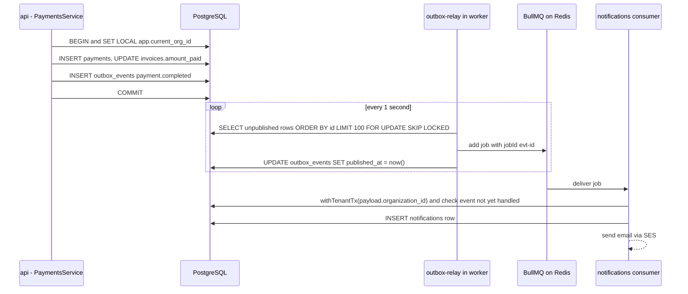

# ADR-007: Transactional outbox for events and notifications

- **Status:** Accepted · **Date:** 2026-11-12 · **Deciders:** Masum Islam Badsha
- **Related:** [ADR-002 Modular monolith](ADR-002-modular-monolith.md) · [ADR-003 Multi-tenancy](ADR-003-multi-tenancy.md) · [ADR-008 Background jobs](ADR-008-background-jobs.md) · [ADR-009 Redis](ADR-009-redis.md) · [System design](../04-system-design/system-design.md)

## Context (the problem)

Many business changes must trigger work outside the database transaction:

- `purchase_order.issued` → email the supplier contact with the PO PDF;
- `approval.requested` → in-app notification and email to the approver;
- `invoice.discrepancy_detected` → alert the Finance Officer;
- `payment.completed` / `payment.failed` → notify the requester and update intelligence later.

The work runs in the `worker` process through BullMQ queues on Redis (ADR-008). The question is how to get from "the PostgreSQL transaction committed" to "a job is in the queue" without losing or inventing events. This is the dual-write problem: the database and Redis cannot commit together.

## Decision drivers

- If a PO is saved as `issued`, the supplier email must eventually be sent, even if the API process crashes right after commit.
- If the transaction rolls back (e.g. `chk_inv_paid` fails), no `payment.completed` notification may be sent.
- A short Redis outage must not fail API writes or lose events.
- Events must carry `organization_id` and be processed inside the correct tenant context.
- No new infrastructure beyond PostgreSQL and Redis, which we already run.

## Options considered

| Option | How it would work here | Pros | Cons |
|---|---|---|---|
| Enqueue after commit | `await tx.commit(); await queue.add(...)` in the service | Simple; low latency | A crash or Redis error between the two steps loses the event: the PO is `issued` but the supplier never hears about it |
| Enqueue inside the transaction | `queue.add(...)` before commit | Event is never lost on commit | Job can run before commit (reads stale state) or after a rollback (sends a false "payment completed"); Redis outage fails the business write |
| **Transactional outbox + polling relay** | Insert into `outbox_events` in the same transaction; a relay in the worker publishes unpublished rows to BullMQ every second | Event is stored if and only if the business change commits; Redis outage only delays delivery; uses existing infrastructure | Up to ~1 s extra latency; a poller to run; at-least-once delivery means consumers must be idempotent |
| Change data capture (Debezium on logical replication) | Stream the WAL (or the outbox table) to a broker | No polling; very low latency; no application code to publish | Needs Kafka or Kafka Connect and replication-slot management: infrastructure ADR-002 deliberately avoids at this team size |
| PostgreSQL `LISTEN/NOTIFY` only | `NOTIFY` in the transaction; worker listens | Fires only on commit; no polling | Not durable: notifications sent while the worker is down are lost; not usable through PgBouncer transaction pooling |

## Decision

Use a **transactional outbox**. Every command that changes business state also inserts an `outbox_events` row (`event_type`, `aggregate_type`, `aggregate_id`, `payload`, `organization_id`) in the **same** `withTenantTx` transaction. The `outbox-relay` queue in the worker publishes them.

Details:

- **Relay query** uses `idx_outbox_unpublished` (`WHERE published_at IS NULL`) and `FOR UPDATE SKIP LOCKED`, so a second worker replica can run safely.
- **Tenant context.** `outbox_events` has RLS like every tenant table, so the relay, which reads across organizations, connects with the audited `supplymesh_platform` role (database-design §8.3) and only reads and marks outbox rows. Consumers do the actual work as `supplymesh_app` inside `withTenantTx(payload.organization_id)`.
- **De-duplication.** The BullMQ `jobId` is derived from the outbox `id`, so publishing the same row twice does not create two jobs while the first one is still kept by BullMQ.
- **Failures.** A failed publish increments `attempts` and stores `last_error`; the row stays unpublished and is retried on the next poll.
- **Delivery is at-least-once.** Consumers are idempotent, keyed by event id (ADR-008).

In-process domain events (NestJS event emitter) are still used for reactions that must happen **inside** the same transaction (e.g. the approval module marking the purchase request approved). Audit rows are not events at all: use cases call `AuditWriter.record()` directly in the same transaction. The outbox is only for work that may happen later.

## Reasons for selection

1. **"If the PO was saved, the supplier email will eventually be sent"** is guaranteed by the database commit itself, without two-phase commit between PostgreSQL and Redis.
2. **No false notifications.** A rolled-back payment leaves no outbox row, so nobody is told it completed.
3. **Redis outages do not block procurement.** During an outage, approvals and payments still commit; events wait in `outbox_events` and are drained when Redis returns.
4. **Fits the team and stack.** CDC is the better tool at larger scale, but needs a broker we chose not to run (ADR-002).

## Advantages

- Exactly the same transaction boundary for state and events, easy to test.
- The outbox doubles as a replayable log for a few days, useful for incident recovery.
- The relay is a few dozen lines and scales with `SKIP LOCKED`.

## Disadvantages

- Up to about one second of extra latency before a notification is queued.
- One more write per business command, and a hot table that needs cleanup.
- Ordering is only roughly by `id`; consumers must not assume strict order across aggregates.

## Trade-offs accepted

- We accept at-least-once delivery and idempotent consumers in exchange for never losing an event.
- We accept polling (one cheap indexed query per second) instead of CDC infrastructure.

## Consequences / follow-ups

- Every module's command handler writes events through one `OutboxWriter.add(tx, event)` helper; writing to BullMQ directly from the API is forbidden by lint rules.
- The `maintenance` queue deletes published events older than 7 days, to keep the table small.
- Alerts: oldest unpublished event age > 60 s; rows with `attempts` ≥ 5.
- A runbook command re-publishes events in a time window (resets `published_at`), used after a Redis data loss (ADR-009). Idempotent consumers make this safe.
- **Revisit when:** sustained event volume exceeds what a 1 s poll of 100–500 rows can publish, or a second consumer system (data warehouse, separate service extracted per ADR-002) needs the event stream. Then move to CDC (Debezium) over the same `outbox_events` table, so producers do not change.
