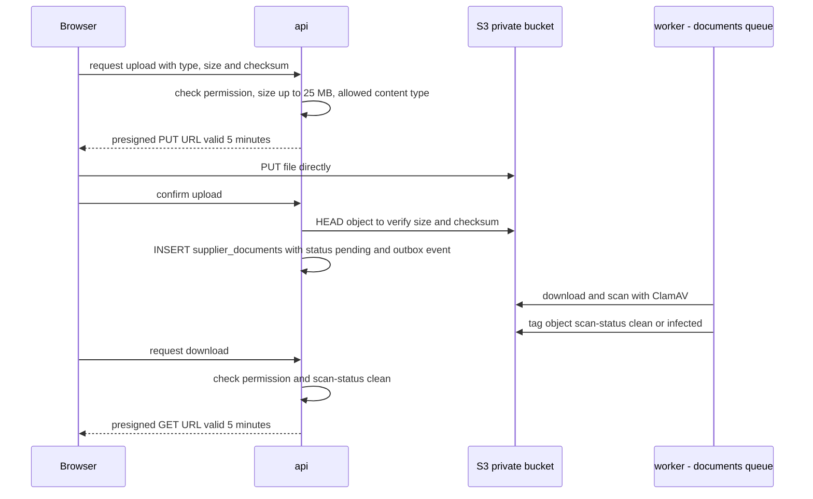

# ADR-011: Supplier documents in a private S3 bucket with presigned URLs and virus scanning

- **Status:** Accepted · **Date:** 2026-11-12 · **Deciders:** Masum Islam Badsha
- **Related:** [ADR-003 Multi-tenancy](ADR-003-multi-tenancy.md) · [ADR-008 Background jobs](ADR-008-background-jobs.md) · [ADR-010 Auth & RBAC](ADR-010-auth-and-rbac.md) · [ADR-012 Deployment](ADR-012-deployment.md) · [Database design §4.3](../02-database/database-design.md)

## Context (the problem)

Supplier verification depends on documents: trade licenses, tax certificates, bank letters, ISO certificates, insurance, NDAs and contracts (`supplier_doc_type`). Some are uploaded by employees, others by the supplier through a one-time onboarding link (`suppliers.onboarding_token_hash`), so files come from **outside** the organization. Invoices can also carry a PDF (`invoices.file_key`).

These files are sensitive (bank letters are the main target of supplier-payment fraud), can be up to 25 MB (`chk_doc_size`), arrive in bursts when a large tenant onboards suppliers, and expire (`supplier_documents.expires_at`), which feeds supplier risk.

## Decision drivers

- Files must never be publicly reachable; access follows the same permissions and tenant isolation as the supplier record.
- Uploads from external suppliers must be checked for malware before anyone in the organization opens them.
- The `api` container is small and stateless; 25 MB uploads should not pass through its memory or tie up its connections.
- File metadata (type, checksum, size, expiry, review status) must be queryable in SQL; file bytes do not belong in PostgreSQL.
- Expiring documents must raise a risk flag automatically.
- Local development and CI must work without AWS.

## Options considered

| Option | How it would work here | Pros | Cons |
|---|---|---|---|
| Store bytes in PostgreSQL (`bytea`) | File content in a column next to `supplier_documents` | One system; transactional with metadata | Bloats the primary database and its backups; slows month-end OLTP; RDS storage is expensive per GB |
| API proxies uploads to S3 | Client sends multipart to `api`, which streams to S3 | Full control of the bytes; simple client | 25 MB requests hold API connections and memory; NGINX and API timeouts must allow slow uploads |
| Local disk / EBS volume on the host | Files on the EC2 instance | Cheapest; no AWS SDK | Lost with the host unless backed up; blocks horizontal scaling; no lifecycle or encryption features |
| **Private S3 + presigned URLs + async scan** | API signs a short-lived PUT; browser uploads directly; worker scans; downloads via presigned GET after a permission check | API stays small; S3 durability, encryption and lifecycle; access per request | More steps (sign, upload, confirm); scan delay before a document can be reviewed |
| Third-party file service (e.g. Cloudinary, UploadThing) | Hosted uploads and storage | Fast to integrate | Supplier bank documents held by another processor; data-residency questions; weaker fit with our tenant key layout and KMS keys |

## Decision

Use a **private S3 bucket** (Block Public Access on, SSE-KMS encryption) with **presigned URLs**, and MinIO locally. Object keys follow `orgs/{orgId}/suppliers/{supplierId}/{uuid}`; the original file name lives only in `supplier_documents.file_name`.

**Scan gate.** `supplier_documents.status` stays `pending` after upload. The scan result is stored as an S3 object tag (`scan-status`), not as a new status value. A reviewer can only open the document and move it to `approved` or `rejected` once the tag is `clean`. If the scan finds malware, the worker moves the object to a quarantine prefix and sets the document to `rejected` with a `review_note`. Downloads are issued only for clean objects.

**Expiry.** The nightly `documents` job uses `idx_supplier_docs_expiry` (`WHERE status = 'approved'`) to mark expired documents `expired`, emits `supplier_document.expiring` ahead of the date, and adds a risk flag used by supplier intelligence.

## Reasons for selection

1. **External uploads are untrusted.** Suppliers upload through an onboarding link; the scan gate makes sure a Procurement Manager never opens an unscanned file.
2. **The API stays small and stateless.** Bursts of 25 MB uploads when a large tenant onboards ~2,000 suppliers go straight to S3, not through `api` (ADR-012).
3. **Tenant isolation extends to files.** The `orgs/{orgId}/` prefix plus a permission check before each presigned GET mirrors RLS for objects (ADR-003); URLs expire after 5 minutes, so a leaked link has a short life.
4. **Bank letters need strong protection.** SSE-KMS gives encryption with auditable key use; the bucket is never public.
5. **Metadata stays relational.** `checksum_sha256`, `size_bytes`, `expires_at` and status remain queryable and constrained in PostgreSQL.

## Advantages

- S3 durability and lifecycle policies without running storage ourselves.
- Uploads scale independently of the API.
- The same flow covers invoice PDFs (`invoices.file_key`) and, later, PO PDFs.

## Disadvantages

- Three-step upload (sign, PUT, confirm) is more client code than a simple multipart form.
- A short delay (seconds to a minute) between upload and the document being reviewable.
- ClamAV needs signature updates and memory in the worker container.

## Trade-offs accepted

- We accept a more complex upload flow in exchange for a small API and a mandatory scan.
- We accept that a presigned GET URL can be shared for up to 5 minutes; downloads are also written to `audit_logs`.

## Consequences / follow-ups

- The presigned PUT signs `Content-Type` and `Content-Length`; the confirm step re-checks size and checksum with `HEAD` before inserting the row, so `chk_doc_size` and the stored checksum match the real object.
- Uploads that are never confirmed are deleted: objects are created with an `unconfirmed` tag that the confirm step removes, and an S3 lifecycle rule expires tagged objects after 1 day.
- Bucket versioning on, so an overwritten or deleted object can be recovered during an investigation.
- S3 CORS allows PUT only from the SupplyMesh web origin.
- **Revisit when:** scan volume makes the worker's ClamAV memory a bottleneck (move scanning to a dedicated container or a managed malware-scanning service), or a tenant requires in-region storage (bucket per region, chosen by organization).
