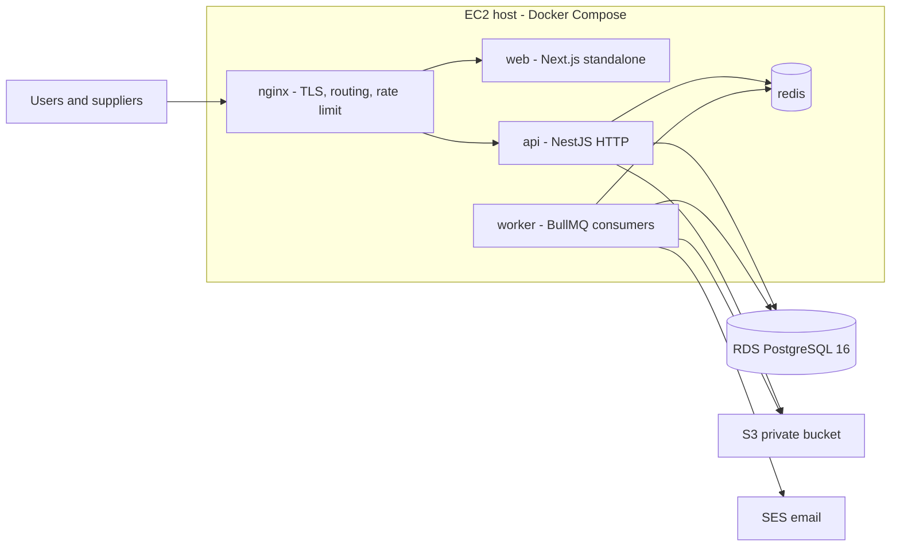

# ADR-012: Deployment and CI/CD: Docker multi-container on one EC2 host with managed AWS data services, GitHub Actions pipeline

- **Status:** Accepted · **Date:** 2026-11-12 · **Deciders:** Masum Islam Badsha
- **Related:** [ADR-002 Modular monolith](ADR-002-modular-monolith.md) · [ADR-004 Drizzle ORM](ADR-004-drizzle-orm.md) · [ADR-008 Background jobs](ADR-008-background-jobs.md) · [ADR-009 Redis](ADR-009-redis.md) · [ADR-011 File storage](ADR-011-file-storage.md) · [Risk and scalability](../06-risk/risk-and-scalability.md)

## Context (the problem)

We need to run SupplyMesh for a pilot and the first year (~200 organizations, peaks at month-end and on Monday mornings) with a team of 3–6 engineers and no dedicated operations staff. The system consists of a Next.js frontend, the NestJS `api` and `worker` processes from one codebase (ADR-002), PostgreSQL, Redis, and files in S3. The brief asks us to address Docker, multi-container setups, NGINX, AWS, VPS hosting, GitHub Actions and CI/CD, and to say what is unnecessary at this stage.

## Decision drivers

- Financial data needs managed backups with point-in-time recovery from day one.
- Releases must be safe: tests and migration checks before production, manual approval for production, fast rollback.
- The same images must run in development, CI, staging and production.
- Infrastructure cost and operational effort must match a pilot, with a clear path to horizontal scaling.
- Refresh cookies are `SameSite=Strict` (ADR-010), so web and API should be served from the same site.

## Options considered

| Option | How it would work here | Pros | Cons |
|---|---|---|---|
| PaaS (e.g. Vercel for web, Render or Railway for api/worker, managed Postgres) | Push-to-deploy per service | Least operations; preview environments | Web and API on different platforms complicates same-site cookies and data-residency answers; less control over worker and ClamAV; costs rise per service |
| **One EC2 host (VPS-style) running Docker Compose + RDS + S3 + SES + KMS** | `nginx`, `web`, `api`, `worker`, `redis` containers on e.g. a t3.large; PostgreSQL on RDS | Cheap and simple; full control; managed database backups; same Compose file as local dev | Single host is a single point of failure for compute; vertical scaling only; we patch the OS |
| ECS Fargate + ALB from day one | Each container as an ECS service | Managed compute, rolling deploys, autoscaling | More AWS wiring (VPC, task roles, service discovery) before there is load to justify it |
| Kubernetes (EKS) | Helm charts for every component | Industry standard at scale; rich ecosystem | Control plane, upgrades, ingress and RBAC to operate; far beyond 5 containers and a small team |
| Serverless (Lambda + API Gateway) | Functions per route | Scale to zero | NestJS cold starts; long-running worker, ClamAV and BullMQ do not fit; connection storms against PostgreSQL |

## Decision

**MVP:** one EC2 instance running **Docker Compose**, with **AWS RDS PostgreSQL 16** (PITR 7–35 days, Multi-AZ optional), **S3**, **SES** and **KMS** as managed services. Local development uses a postgres container and MinIO instead.

| Technology | Role here | Why it is needed now |
|---|---|---|
| Docker | One image per app (`web`; `api` and `worker` share one image) | Same artifact from CI to production; reproducible builds |
| Multi-container (Compose) | `nginx`, `web`, `api`, `worker`, `redis` | Separate processes with their own restart and resource limits; worker isolated from API latency |
| NGINX | TLS termination, `/` → web, `/api` → api, gzip, per-IP rate limit, 1 MB request body limit (files go straight to S3) | Single entry point and same-site routing for cookies |
| AWS | RDS, S3, SES, KMS; ECR for images | Managed backups, durable files, email deliverability, key management |
| VPS (EC2) | Hosts the Compose stack | Lowest cost and complexity for the pilot |
| GitHub Actions | CI and CD | Already where the code lives; Environments give manual approval gates |

**CI on every pull request:** lint, type-check, unit tests, integration tests (Testcontainers PostgreSQL + Redis, including the RLS isolation suite), migration dry run, image build.

**CD on merge to `main`:**

1. Build and push images to ECR, tagged with the git SHA.
2. Deploy to staging automatically and run smoke tests.
3. Production requires manual approval (GitHub Environments).
4. Run migrations as `supplymesh_migrator`. Migrations are **expand/contract**: they must work with both the old and the new code.
5. `docker compose pull && docker compose up -d` over SSH, with health checks gating the rollout.
6. **Rollback** = redeploy the previous SHA tag. Because migrations are backward compatible, no down-migration is needed.

## What is unnecessary at this stage

| Not now | Reason | When it becomes relevant |
|---|---|---|
| Kubernetes | Five containers on one host do not need an orchestrator; ECS covers the next step with less to operate | Many services, multiple teams, or a platform team |
| Microservices | Consistency boundaries and team size (ADR-002) | Extraction triggers in ADR-002 |
| Kafka | Outbox + BullMQ handle our event volume (ADR-007) | CDC or several independent event consumers |
| Elasticsearch / OpenSearch | `pg_trgm` covers supplier name search | Full-text search inside documents |
| Multi-region | Pilot customers are served from one region; RDS backups cover disaster recovery | Data-residency contracts or a 99.95%+ SLA |
| A separate Express service | NestJS already runs on Express; a second HTTP stack would duplicate auth, tenancy and validation | Not planned |
| ElastiCache, ALB, read replica | One host and one Redis are enough for year-1 load | Growth stage below |

## Reasons for selection

1. **Managed database where it matters most.** Financial records get RDS PITR and Multi-AZ even in the MVP; the stateless containers are cheap to recreate.
2. **Containers now make the growth path short.** The same images move to ECS Fargate behind an ALB; `api` is stateless and scales horizontally.
3. **Safe releases with a small team.** Automated tests, staging, manual production approval and SHA-based rollback without a dedicated release engineer.
4. **Same-site serving.** NGINX puts web and API on one origin, which the session cookies (ADR-010) require.

## Advantages

- Low monthly cost; one Compose file for local, CI and production.
- Every production change is traceable to a commit SHA and an approver.
- Clear, incremental scaling path.

## Disadvantages

- The EC2 host is a single point of failure for compute and for Redis (queued jobs, ADR-009).
- Deploys on one host restart containers; brief disruption is possible without careful health-check ordering.
- We patch and monitor the host OS ourselves.

## Trade-offs accepted

- We accept lower compute availability at MVP (recovery by launching a new host from the image and redeploying, target under one hour) in exchange for much lower cost and complexity. Data durability is unaffected because PostgreSQL and S3 are managed.

## Consequences / follow-ups

- Secrets come from AWS SSM Parameter Store or Secrets Manager at container start; nothing secret in images or the repository.
- Logs shipped to CloudWatch; uptime checks on `/health/live`; alerts on queue failures and RDS metrics.
- A restore drill from RDS PITR each quarter.
- **Growth stage:** ECS Fargate behind an ALB, ElastiCache Redis, RDS read replica for analytics, CloudFront for static assets, PgBouncer.
- **Revisit when:** host CPU stays above ~70% during month-end peaks, a customer contract requires 99.9% availability, or `api` needs more than one replica; any of these triggers the move to ECS.
