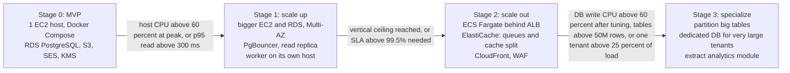

# Deliverable 06 — Risk and Scalability Analysis

> This document asks two questions: **what can go wrong** (risk register, threat model, known limitations) and **what breaks first as SupplyMesh grows** (capacity estimate, bottlenecks, scaling roadmap). Table, column and status names follow [`schema.sql`](../02-database/schema.sql). Endpoint and permission names follow the [API Structure Proposal](../03-architecture/api-structure.md). Bottlenecks B1–B10 are introduced in [System Design §5](../04-system-design/system-design.md#5-bottlenecks-and-handling-growth); this document adds the numbers and the triggers.

## 1. Risk register

Likelihood (L) and Impact (I): **L** = low, **M** = medium, **H** = high. "Residual" is the risk left **after** the listed mitigations.

| ID | Risk | Category | L | I | Mitigation (in this design) | Residual |
|---|---|---|:-:|:-:|---|:-:|
| R01 | **Cross-tenant data leak**: a missing `WHERE organization_id = …` or a guessed id exposes another organization's suppliers, prices or invoices | security | M | H | Three independent layers ([ADR-003](../05-adr/ADR-003-multi-tenancy.md)): (1) tenant only from the JWT, never from the URL or body; (2) PostgreSQL **RLS** with `FORCE ROW LEVEL SECURITY` on all 31 tenant tables and on `organizations` itself, activated by `SET LOCAL app.current_org_id` in `withTenantTx`; the app role `supplymesh_app` has no `BYPASSRLS`; (3) **composite foreign keys** `(organization_id, parent_id)`, so rows can't reference another tenant. Redis keys `org:{orgId}:…` and S3 keys `orgs/{orgId}/…`. A generated cross-tenant test for every endpoint expects `404`. | L |
| R02 | **Supplier bank-detail fraud**: an attacker impersonates a supplier ("we changed banks") or an insider edits the account, and real payments go to the attacker | financial / business | M | H | `bank_details_enc` encrypted with AES-256-GCM under a KMS key; readable only with `supplier.bank_details.read` and every read is audited. Changing bank details on an `active` supplier sends it back to `pending_verification` (BR-05), blocks new payments, and emails the **existing** contact (out-of-band warning). Re-verification must be done by a different member than the one who made the change (`403 segregation_of_duties`). A `bank_letter` document is required for verification. Public onboarding tokens are single-use, hashed and valid for 7 days. | M (social engineering of the verifier is still possible; a call-back to a known phone number is a process control outside the software) |
| R03 | **Duplicate invoice payment**: the same invoice entered twice, or "Record payment" submitted twice | financial / business | M | H | `UNIQUE (organization_id, supplier_id, supplier_invoice_number)` → `409 duplicate_invoice`. `Idempotency-Key` required on `POST /invoices` and `POST /payments`, plus `UNIQUE (organization_id, idempotency_key)` on `payments`. The invoice row is locked (`FOR UPDATE`) while the outstanding amount is computed; `chk_inv_paid` (`amount_paid ≤ total`) is the backstop. Three-way match: `quantity_invoiced` can't exceed `quantity_received`. Nightly reconciliation of `Σ payments` vs `amount_paid`. | L (a supplier re-sending the same bill under a **new** number is caught only by the quantity match, not by the unique key) |
| R04 | **Approval bypass or self-approval**: a requester approves their own request, splits a purchase to stay under a threshold, or inflates a PO after approval | financial / business | M | H | Requester ≠ approver checked on every decision, and the engine routes around the requester when steps are created (BR-08). One vote per member per step (`UNIQUE`). `approval_limit_amount` enforced on the final step with an automatic escalation step (BR-09). A PO needs an `approved` request (FK + status check) and may exceed its estimate by at most 10% (BR-13); an invoice needs a PO (BR-16). Status changes only through action endpoints, never through `PATCH`. Everything is audited. | M (split purchasing, i.e. several small requests instead of one large one, is legal per request; detection is an analytics report, see §9) |
| R05 | **Privilege escalation via custom roles**: a member grants themselves `invoice.approve` or `payment.record`, or creates a custom role that combines conflicting duties | security | L | H | `role.manage` / `role.assign` are Owner-only by default, and MFA is mandatory for Owners. A member can't edit their own assignments or grant a permission they don't hold. Every change deletes the affected permission caches, writes before/after permission sets to `audit_logs`, and notifies all Owners. SoD checks run **on top of** permissions, so even a member holding every permission can't approve their own invoice. | L |
| R06 | **Policy change mid-flight**: an admin edits the approval policy while requests are being approved, and requests end up with a chain nobody approved | product | M | M | Workflow versions are immutable once `published`; publishing retires the previous version in one transaction (`uq_one_published_version`). Each request stores `workflow_version_id` and `matched_rule_id` at submission (BR-07), and its `approval_steps` are materialized then. A `/simulate` endpoint lets admins test a draft before publishing. | L (role-based steps are resolved at decision time, so a role change does affect who may act on in-flight steps. This is intended: a member who lost the role must lose the right) |
| R07 | **Lost notifications**: an approver is never told, the SLA expires, the request stalls | operational | M | M | **Transactional outbox**: the event row is committed in the same transaction as the business change ([ADR-007](../05-adr/ADR-007-transactional-outbox.md)). The relay retries; jobs retry 5 times with backoff, then go to the failed set (DLQ) with an alert. Consumers are idempotent by event id. In-app notifications and the approval inbox read from PostgreSQL, so an approver sees pending work even if email fails. SES bounces are tracked; SLA reminders at 75%. | L |
| R08 | **Redis outage** (MVP: single container, no replica) | operational | M | M | Redis is never the source of truth ([ADR-009](../05-adr/ADR-009-redis.md)). Permission checks fall back to PostgreSQL. Events wait in `outbox_events` and are relayed when Redis returns. Payments stay idempotent through the DB unique key. AOF persistence on the host. After a Redis data loss, a runbook re-publishes outbox events from the affected window (safe because consumers are idempotent). | M in MVP → L after ElastiCache Multi-AZ (Stage 2) |
| R09 | **Database primary failure** (instance or AZ failure, storage corruption) | operational | L | H | RDS PostgreSQL with automated backups and **PITR**. Multi-AZ is recommended from the first paying customer (automatic failover in about 1–2 minutes). The app tier is stateless and reconnects. Restore drills every quarter (§6). | L with Multi-AZ, M without |
| R10 | **Month-end / quarter-end load spike**: invoice batches, payment runs and approval bursts arrive in the same few days | operational | H | M | Short transactions with row-level locks in a fixed order (no table locks). Bulk invoice entry processes each invoice in its own transaction. Heavy work (PDFs, emails, scans, recomputes) is in the worker, off the request path. Analytics read materialized views, not hot tables. Load test at 2× the estimated peak before each quarter-end. | M |
| R11 | **`audit_logs` growth**: ~36M rows per year (§3) makes it the largest table, slows queries and backups | data | H | M | Monthly range partitions created ahead of time by the `maintenance` queue; the `audit_logs_default` partition is monitored and must stay empty. Indexes lead with `organization_id`. Search endpoints require a date range (max 92 days) for partition pruning. Partitions past the hot window are exported to S3 as Parquet and detached (§3.4). | L |
| R12 | **Malicious file upload** (malware in a "certificate", a polyglot PDF, oversized files) | security | M | M | Presigned PUT limited to 5 minutes, fixed content type, 25 MB (`chk_doc_size`). MIME allow-list (PDF, PNG, JPEG) checked by magic bytes on the worker. ClamAV scan before a document can be reviewed or downloaded (`409 scan_pending`); infected files are moved to a quarantine prefix and the document `rejected`. Private bucket, SSE-KMS, downloads only through 5-minute presigned URLs with `Content-Disposition: attachment`, from the S3 domain, never the app domain. | L |
| R13 | **FX rate errors**: a wrong or stale rate converts EUR 6,000 into USD 4,800 and the request skips the multi-approver rule | financial / business | M | M | Rules always match on `estimated_total_base`, and `fx_rate_to_base` is snapshotted on every row, so a later rate change can't rewrite history. Server-side rate lookup only; employees can't send a rate. A sanity band rejects a rate that differs from the previous day's by more than a configured percentage. Finance overrides on invoices are audited. | M (the MVP schema stores the rate but not its source or timestamp, see §9) |
| R14 | **Approval bottleneck**: the only approver for a step is on leave or has left | product | H | M | Role-based steps (any member with the role can act, quorum via `required_approvals`). `sla_hours` + the `approvals` queue every 15 minutes (`idx_steps_overdue`): reminder at 75%, escalation to Owner / Procurement Manager when overdue. `POST /approval-steps/{id}/reassign` (`approval_step.reassign`). Deactivating a member flags their pending steps. Cycle-time analytics per approver. | M (out-of-office delegation is a Should-have and needs a new table) |
| R15 | **Vendor lock-in to AWS** | operational | M | L | Only commodity managed services: RDS is plain PostgreSQL 16 (portable with `pg_dump` / logical replication); S3 is used through the S3 API (MinIO locally proves portability); SES and KMS sit behind `EmailSender` and `KeyProvider` ports in the infrastructure layer. Containers run anywhere Docker runs. No Lambda, DynamoDB or proprietary queues. | L (migration would still cost weeks: IAM, networking, backups) |
| R16 | **Scope creep**: supplier portal, ERP connectors, OCR, RFQ requested before the core flow is stable | product | H | M | MoSCoW and a written MVP boundary ([MVP vs Future Scope](../01-product/mvp-vs-future-scope.md)). The API leaves room for them (webhooks from the outbox, versioned contract) so they can be added later without rework. New scope needs an ADR or a written trade-off. | M |
| R17 | **GDPR erasure vs audit retention**: a person asks to be erased, but financial and audit records must be kept (default 7 years) | compliance | M | M | Retention of financial records is a legal obligation, which is a lawful basis to keep them. Erasure is implemented as **anonymization**: `users.email` / `full_name` replaced, `password_hash` and `mfa_secret_enc` cleared, sessions revoked, the member `deactivated`; business records keep the member id, which then points to an anonymized person. Audit `before_data` / `after_data` store ids, not names, wherever possible; supplier contact fields are anonymized on supplier erasure requests. A documented retention schedule per table. | M (old audit JSON may still contain personal data such as a supplier contact's name; it is protected by access control and expires with the partition) |
| R18 | **Key-person / small-team risk**: one or two engineers know how deployment, migrations or the approval engine work | operational | H | M | Design documented as code-adjacent Markdown + ADRs (this repository). One modular monolith, one language, managed database. CI/CD is fully automated (GitHub Actions), with runbooks for restore, outbox re-publish and secret rotation. Pair reviews on the approval and payables modules. | M |
| R19 | **Account takeover**: credential stuffing, phishing, stolen refresh token | security | M | H | Argon2id, breached-password check, per-account and per-IP login limits. MFA mandatory for Owner and Finance Officer. Access tokens last 15 minutes; refresh tokens rotate and reuse revokes the session family. httpOnly cookies for both tokens, with an `Origin` check on every state-changing request; CSP on the web app. Session list and revoke endpoints. | M (members without MFA remain exposed; SSO with the customer's IdP is the long-term answer) |
| R20 | **Race conditions on money**: two payments or two invoice approvals at the same time overshoot a total | data | M | H | One transaction per operation, `SELECT … FOR UPDATE` in a fixed lock order (`invoices → purchase_order_items ORDER BY id`), optimistic `version` checks (`412`), and CHECK constraints (`chk_inv_paid`, `chk_poi_received`) as the last line ([ADR-006](../05-adr/ADR-006-po-invoice-consistency.md)). | L |
| R21 | **Noisy-neighbor tenant**: one large organization's export or bulk import slows everyone | operational | M | M | Per-member and per-org rate limits in Redis; 5 s statement timeout on API queries; analytics on materialized views (and a replica later); per-tenant job concurrency in the worker; exports are async (`202`). | M |
| R22 | **Bad deployment or migration** breaks production or corrupts data | operational | M | H | Migration dry-run in CI, expand/contract (backward-compatible) migrations, automatic staging deploy + smoke tests, manual approval for production, health-check-gated rollout, rollback by redeploying the previous image SHA; PITR for data mistakes. | L |
| R23 | **Secrets or encryption key exposure** (DB password, JWT signing key, KMS access) | security | L | H | Secrets in AWS Secrets Manager / SSM, never in images or the repository. Bank details use KMS envelope encryption, so a DB dump alone does not reveal them. JWT signing keys rotate with a published key id (`kid`). | L |
| R24 | **Low adoption / maverick spend continues** outside the system | product | M | H | "No PO, no pay": an invoice can't be recorded without a PO, so spending outside SupplyMesh can't be paid through it. Short request form, mobile-friendly approval inbox, email deep links. | M |

### 1.1 Risk heat map (before mitigation)
| Likelihood \ Impact | Low | Medium | High |
|---|---|---|---|
| **High** | | R10, R11, R14, R16, R18 | |
| **Medium** | R15 | R06, R07, R08, R12, R13, R17, R21 | R01, R02, R03, R04, R19, R20, R22, R24 |
| **Low** | | | R05, R09, R23 |

The highest-impact risks (R01–R04, R20) are all about money or tenant data, and each is mitigated by at least one **database-level** control, not only by application code. That is the main reason for choosing PostgreSQL with constraints ([ADR-001](../05-adr/ADR-001-postgresql-over-mongodb.md)).

## 2. Threat model (STRIDE)

Assets: tenant business data, supplier bank details, payment records, approval decisions, the audit trail, credentials. Trust boundaries: browser ↔ NGINX, public onboarding link ↔ API, API ↔ PostgreSQL/Redis/S3, worker ↔ SES.

| Threat | Example against SupplyMesh | Primary controls |
|---|---|---|
| **S**poofing | Stolen password; forged JWT; a guessed supplier onboarding token | Argon2id + MFA for Owner/Finance; RS256 JWT with key rotation; 32-byte random onboarding tokens stored as SHA-256 hashes, single-use, 7-day expiry, rate-limited |
| **T**ampering | Changing `amount` or `status` in a request body; editing a stale invoice; altering an audit row | DTO whitelisting (unknown fields → `422`), server-controlled fields, action endpoints for status; `If-Match` / `version`; CHECK constraints; app role has no UPDATE/DELETE on `audit_logs` |
| **R**epudiation | "I never approved that request" | `approval_decisions` with member, time and comment; `audit_logs` with `actor_member_id`, `ip_address`, `user_agent`, `request_id`; append-only; exported partitions kept immutable in S3 |
| **I**nformation disclosure | Reading another tenant's invoices; bank details in logs; a public S3 link shared by email | RLS + composite FKs; `404` instead of `403` across tenants; bank details encrypted, masked and redacted from logs; private bucket with 5-minute presigned URLs |
| **D**enial of service | Login flooding; huge uploads; an expensive analytics query run in a loop | NGINX per-IP limits, per-member throttling, 1 MB body limit, direct-to-S3 uploads, statement timeout, cached and pre-aggregated analytics, async exports |
| **E**levation of privilege | Granting oneself `payment.record`; a Department Manager approving another department's request | Owner-only role management with escalation guards; permissions loaded per request from a cache that is invalidated on change; department scope in policy classes; SoD checks on top of permissions |

## 3. Scalability analysis

### 3.1 Workload assumptions
**The brief gives no volume figures.** The only scale it states is "medium-to-large organizations", "multiple suppliers across different countries" and "managing hundreds of suppliers". Every number below is a **planning assumption chosen for this design**, not a measurement and not a requirement. Each row says why it was chosen. Assumptions are deliberately sized toward the upper end, so the design is tested against a heavy case. They should be replaced with real data from pilot customers.

| # | Assumption | Basis |
|---|---|---|
| A1 | 200 organizations by the end of year 1 | Our year-1 planning target. It mainly drives the tenant mix in A5. |
| A2 | A large tenant: ~5,000 employees, ~2,000 suppliers, ~10,000 purchase requests per month, ~90,000 invoices per year | Upper end of the brief's "medium-to-large organizations" and "hundreds of suppliers". 10,000 requests/month is about 2 per employee per month, deliberately generous. Invoices follow A9: about one per PO under "no PO, no pay" (10,000 × 70% × 1.1 × 12 ≈ 92,000). |
| A3 | Platform-wide: ~1M purchase requests per year, ~3M audit rows per month | Derived: requests from the tenant mix in A5; audit rows from the per-request action count in §3.3 |
| A4 | Peaks: month-end and quarter-end invoice batches; Monday-morning approval bursts | Domain assumption: suppliers bill and finance closes the books at period end, and approvals pile up over weekends. Not from the brief. |
| A5 | Tenant mix: ~5 large tenants (~50,000 requests/month together) and ~195 small or mid-size tenants (~170 requests/month each, ~33,000 together). Total ≈ 83,000 per month ≈ 1M per year, consistent with A3. | Derived |
| A6 | Seats: 5 × 5,000 + 195 × ~150 ≈ **55,000 members**; 25% active on a given day ≈ **14,000 DAU** | Derived |
| A7 | Busiest hour: ~**4,000 sessions online** at once (Monday 09:00 in the largest timezone cluster, or the last business day of a quarter) | Derived |
| A8 | Each online session polls `/notifications/unread-count` every 30 s and makes ~4 other API calls per minute; ~12% of calls are writes | Derived |
| A9 | Conversion ratios: 70% of requests become POs, 1.1 POs per converted request, ~3 lines per document, 1.8 approval steps per request, 1.2 receipts per PO, ~1 invoice per PO (≈ 0.77 per request), 1.2 payments per invoice (partial payments). | Assumed |

### 3.2 Request rate at peak
| Component | Calculation | Result |
|---|---|---|
| Notification polling | 4,000 sessions ÷ 30 s | ≈ 135 req/s |
| Interactive calls | 4,000 × 4 calls/min ÷ 60 | ≈ 270 req/s |
| **Peak total** | | **≈ 400 req/s** |
| Writes at peak | ~12% of 400 | ≈ 50 writes/s |
| Business-hours average | 14,000 DAU × ~300 calls/day ÷ (10 h × 3,600 s) | ≈ 115 req/s |
| 24-hour average | 14,000 × 300 ÷ 86,400 | ≈ 50 req/s |

What this means for the database: ~50 write transactions/s × ~10 statements (lock, update, audit insert, outbox insert) ≈ 500 write statements/s, plus ~1,000 indexed reads/s. A single well-indexed PostgreSQL primary on a 2–4 vCPU RDS instance handles this. **The database is not the first limit; the single MVP host is** (§3.5).

Month-end invoices are a **contention** problem, not a throughput problem. Platform-wide ~0.8M invoices a year ≈ 65,000 per month; if 40% arrive in the last 3 business days, that is ~8,700 a day, or ~0.25 invoice/s over a 10-hour day. The real risk is several finance users matching invoices against the **same** popular PO lines, which is why locks are row-level, short and taken in a fixed order (B2).

Monday approvals are a **read** spike: a large tenant's ~2,300 requests a week produce ~4,000 decisions; if 30% happen on Monday morning, that is ~0.2 decisions/s, but every approver reloads the inbox repeatedly. That is why the inbox query must stay index-only and small (B1).

### 3.3 Rows and storage per year (platform-wide, year 1)
Row size includes indexes and is a rough average.

| Table | Basis | Rows / year | Avg size | Storage / year |
|---|---|---|---|---|
| `purchase_requests` | A3 | 1.0M | ~1.0 KB | ~1.0 GB |
| `purchase_request_items` | 3 per request | 3.0M | ~0.4 KB | ~1.2 GB |
| `approval_steps` | 1.8 per request | 1.8M | ~0.4 KB | ~0.7 GB |
| `approval_decisions` | ~1.1 per step | 2.0M | ~0.3 KB | ~0.6 GB |
| `purchase_orders` | 70% × 1.1 | 0.8M | ~1.0 KB | ~0.8 GB |
| `purchase_order_items` | 3 per PO | 2.4M | ~0.4 KB | ~1.0 GB |
| `goods_receipts` + items | 1.2 per PO, 3 lines | 1.0M + 2.9M | ~0.25 KB | ~1.0 GB |
| `invoices` + items | ~1 per PO, 3 lines | 0.8M + 2.4M | ~0.5 KB | ~1.6 GB |
| `payments` | 1.2 per invoice | 1.0M | ~0.4 KB | ~0.4 GB |
| `supplier_performance_records` | ~50,000 suppliers × 12 months | 0.6M | ~0.5 KB | ~0.3 GB |
| `notifications` | ~6 per request | 6M | ~0.5 KB | ~3 GB (read notifications pruned after 12 months) |
| `outbox_events` | ~12 per request | 12M written | ~0.6 KB | < 0.5 GB steady state (published rows purged after 7 days) |
| **`audit_logs`** | A3: 3M per month | **36M** | ~1.2 KB (JSONB before/after + 2 indexes) | **~43 GB** |
| **Total in PostgreSQL** | | | | **≈ 55 GB in year 1**, ~78% of it audit |

**Sensitivity.** None of the conclusions depend on these exact numbers. At **10×** the assumed volume, peak writes would be ~500 transactions/s and audit ~430 GB/year. A larger RDS instance plus the read replica and audit partitioning already planned in §4 still cover that. The scaling stages in §4 are triggered by **measured** metrics, not by these estimates.

**Where the 3M audit rows a month come from.** 83,000 requests a month × ~36 audited actions per request lifecycle ≈ 3M:

| Lifecycle stage | Audited actions (approx.) |
|---|---|
| Request: create, edit lines, submit | 5 |
| Approval: steps created + activated + decided (1.8 steps) | 6 |
| PO: create, edit, issue, acknowledge, close | 5 |
| Goods receipts (1.2) | 3 |
| Invoice: record, match, discrepancies, approve | 6 |
| Payment: record, complete | 3 |
| Share of supplier, member, role, settings, login and sensitive-read events | 8 |
| **Total** | **≈ 36** |

**S3 (files).** ~50,000 suppliers × ~5 documents × ~1 MB ≈ 250 GB once, plus renewals; invoice PDFs 0.8M × ~0.5 MB ≈ 400 GB/year; PO PDFs 0.8M × ~0.1 MB ≈ 80 GB/year. About **750 GB in year 1**: cheap on S3, and it never touches the database or the API process.

**Redis.** Permission sets for online members (4,000 × ~2 KB ≈ 8 MB), reference data (~10 MB), analytics cache (~5 MB), idempotency responses (≤ 100,000 keys/day × ~1.5 KB ≈ 150 MB at the 24 h TTL), BullMQ jobs with bounded retention (~50 MB). **Under 500 MB**: memory size is not the issue; the eviction policy is (see the "Redis memory and policy" row in §3.5).

### 3.4 Audit retention, staged (proposal)
The retention policy stays at **7 years** for financial audit ([Database Design §10](../02-database/database-design.md#10-handling-growing-organizational-data)). Keeping all 7 years in PostgreSQL would mean ~300 GB of audit data at year-1 volume. Proposal: keep **24 months hot** in PostgreSQL (~86 GB), export older monthly partitions to S3 as Parquet (roughly 10× smaller) in a bucket with Object Lock, then detach and drop them. Auditors query old years through an export request. Dropping a partition is instant and creates no bloat, unlike `DELETE`.

### 3.5 Bottlenecks
| Component | Why it becomes a bottleneck | Early signal / metric | Mitigation | When |
|---|---|---|---|---|
| **Single MVP host** (EC2 t3.large running nginx, web, api, worker, redis) | 2 vCPUs shared by SSR, API and jobs; **t3 is burstable**, so sustained load drains CPU credits and the instance is throttled; no redundancy | Host CPU, CPU credit balance, p95 latency, deploy-time error rate | Run t3 in `unlimited` mode or move to m6i; container resource limits; then Stage 1/2 | Estimated ~100–150 req/s sustained peak (to be confirmed by load test), i.e. roughly the first 50–80 organizations |
| **PostgreSQL write path** | Every write = business rows + audit row + outbox row + index updates; WAL volume; row locks on hot rows (`organization_sequences`, popular PO lines) | RDS write IOPS, commit latency, lock wait time (`pg_stat_activity`), deadlocks, `pg_stat_statements` top writers | Short transactions, fixed lock order, UUIDv7 (append-like B-tree inserts), minimal indexes on write-heavy tables, gp3 storage with provisioned IOPS, vertical scaling | RDS CPU > 60% or commit p95 > 20 ms at peak |
| **Approval inbox query** (B1) | Hit by every approver on every page load; role-based steps join to `purchase_requests` for department scope | p95 of `GET /approval-inbox` > 200 ms; rows scanned per call | Partial indexes `idx_steps_pending_member` / `_role` (only `pending` rows), cursor pagination, 30 s cached badge count. Next: copy `department_id` onto `approval_steps`, or an `approval_inbox` projection maintained by events. | When pending steps per large tenant exceed ~10,000, or p95 > 200 ms |
| **Analytics on OLTP** (B3) | Aggregations over millions of rows compete with transactions for CPU and buffer cache; `REFRESH MATERIALIZED VIEW` cost grows with total data | Refresh duration, buffer cache hit ratio drop during refresh, analytics p95 | Materialized views refreshed hourly `CONCURRENTLY`, 5-minute Redis cache, pre-aggregated `supplier_performance_records`. Next: read replica; then a columnar store fed from the outbox. | Refresh > 5 minutes, or analytics queries > 10% of primary CPU |
| **`audit_logs` growth** (B4) | 36M rows/year; index size; backup and restore time | Table and index size, partition count, `audit_logs_default` row count (must be 0), restore duration | Monthly partitions, date-bounded queries, staged export to S3 (§3.4) | Hot audit data > ~100 GB, or restore drill RTO approaching 4 h |
| **Outbox relay** (B6) | One poller; at-least-once publishing; a backlog delays every notification | Age of the oldest unpublished event (p99 < 10 s), unpublished row count | `FOR UPDATE SKIP LOCKED LIMIT 100` lets several relays run; partial index `idx_outbox_unpublished`; purge published rows. Next: logical replication / CDC instead of polling. | Oldest unpublished event > 30 s at peak |
| **Redis memory and policy** | BullMQ requires `maxmemory-policy noeviction`; caches in the same instance can't be evicted, so a full Redis makes **queue writes fail** instead of dropping cache entries | `used_memory` vs `maxmemory`, rejected commands, failed-job count | Bounded job retention (`removeOnComplete` / `removeOnFail` by age and count), TTL on every cache key. Stage 2: **two ElastiCache clusters**, one for queues (`noeviction`) and one for caches (`allkeys-lru`). | Memory > 70% of `maxmemory` |
| **File uploads** (B9) | Large bodies through Node would block the event loop; virus scanning is CPU-heavy | Scan queue depth and duration; upload failure rate | Direct-to-S3 presigned PUT; scans in the worker with limited concurrency. Next: dedicated scan worker; CloudFront for downloads. | Scan queue age > 10 minutes |
| **Next.js SSR** | Server rendering of large tables is CPU-bound and competes with the API on the MVP host | web container CPU, TTFB p95 | Server Components only for read views, hashed static assets cached by NGINX (CloudFront later), `web` scaled separately from `api` in Stage 2 | web CPU > 50% of host, or TTFB p95 > 800 ms |
| **DB connections** (B8) | Each container has its own pool; RDS `max_connections` is bounded by instance memory | Connections in use vs max; pool wait time | Pool of 10–20 per container. Then PgBouncer in transaction mode (safe: tenant context is `SET LOCAL`). | Connections > 60% of max, or the first horizontal scale-out |
| **Noisy-neighbor tenants** (B7) | Shared DB, shared queues, shared host | Per-org request rate, per-org slow-query share, per-org queue depth | Per-org rate limits, 5 s statement timeout, per-tenant job concurrency, async exports. Last resort: dedicated database for that tenant. | One tenant > 25% of DB time for a week |

### 3.6 Technologies deliberately not used yet
| Technology | Why not now | What would justify it |
|---|---|---|
| Kubernetes | ECS Fargate gives scheduling, health checks and autoscaling without running a cluster; a small team can't afford cluster operations | Many services with different scaling profiles, or a multi-cloud requirement |
| Microservices | One database and in-process events keep money flows in single ACID transactions ([ADR-002](../05-adr/ADR-002-modular-monolith.md)) | A module whose load or release cadence differs sharply (analytics first), extracted along existing module boundaries |
| Kafka | The outbox + BullMQ delivers ~30,000 events a day with large headroom | Many independent consumers needing replay, or event volume in the thousands per second |
| Elasticsearch | `pg_trgm` and PostgreSQL full-text search cover supplier and request search | Cross-entity fuzzy search over tens of millions of documents |
| Multi-region | One region with Multi-AZ meets a 99.5% SLO | Data-residency contracts (EU-only data) or an SLO above 99.95% |

## 4. Scaling roadmap

| Stage | What changes | Trigger metric to enter | Approx. capacity (estimate) | Cost / complexity added |
|---|---|---|---|---|
| **0. MVP, single host** | One EC2 (t3.large class) with Docker Compose: nginx, web, api, worker, redis. RDS PostgreSQL 16 with PITR (Multi-AZ recommended once customers pay). S3, SES, KMS. | Launch | ~100–150 req/s peak, first ~50–80 organizations | Lowest. One host to patch; rebuilt from images in under an hour. |
| **1. Vertical + read offload** | Larger EC2 (m6i.xlarge → 2xlarge) and RDS class; RDS Multi-AZ on; **PgBouncer** (transaction mode); **RDS read replica** for analytics, exports and intelligence jobs; worker moved to a second host so jobs can't starve the API | Host CPU > 60% at weekday peak for 3 consecutive days, **or** p95 read latency > 300 ms, **or** RDS CPU > 60% | ~400 req/s (the year-1 peak in §3.2) | Replica lag must be tolerated by analytics (shown via `as_of`); one more host to operate |
| **2. Horizontal, managed** | Same images on **ECS Fargate** behind an **ALB**: `api` and `web` with ≥ 2 tasks each across AZs, autoscaling on CPU and request count; workers scaled per queue. **ElastiCache** Redis Multi-AZ, split into a queue cluster (`noeviction`) and a cache cluster (`allkeys-lru`). **CloudFront** for static assets and document downloads; AWS WAF on the ALB. Deploys become rolling with zero downtime. | Vertical ceiling reached (largest sensible host still > 60% CPU), **or** a customer contract needs > 99.5% availability, **or** deploy downtime becomes unacceptable | Several thousand req/s on the app tier; the database becomes the limit | Infrastructure as code becomes mandatory; higher fixed monthly cost |
| **3. Specialize the data tier** | Partition `purchase_requests`, `purchase_orders`, `invoices` by year; move audit partitions out of the primary (§3.4). **Dedicated database** (same schema) for very large tenants, routed by `organization_id`. **Extract** analytics (and possibly intelligence) into a separate service reading a replica or a columnar store fed by outbox events. | Primary write CPU > 60% after query tuning, **or** any transaction table > 50M rows, **or** one tenant > 25% of DB load, **or** a data-residency contract | Bounded by tenant count, not by one database | Tenant routing, cross-database migrations and a second deployable: only worth it with proven demand |

**Rule:** move to the next stage only when a trigger metric has been exceeded for a sustained period and query or index tuning (`pg_stat_statements`) no longer helps. Each stage reuses the same container images and the same code; only the infrastructure around them changes.

## 5. Observability

### 5.1 Logs
- Structured JSON (pino) from `api` and `worker`, shipped by the Docker log driver to CloudWatch Logs.
- Every line carries `timestamp`, `level`, `service`, `request_id` (from `X-Request-Id`), `org_id`, `member_id`, `route`, `status`, `duration_ms`; worker lines carry `queue`, `job_id`, `event_id` and the `request_id` of the request that created the event.
- The same `request_id` is stored on `audit_logs.request_id`, so one id links the HTTP log, the trace and the audit record.
- Redacted: `Authorization`, cookies, onboarding and invitation tokens, passwords, bank details, full request bodies of `/public/*`. Retention: 30 days hot, 1 year archived (application logs are not the audit trail).

### 5.2 Metrics
| Area | Metrics |
|---|---|
| HTTP | Request rate, error rate (5xx and 4xx separately), p50 / p95 / p99 latency per route, `429` count |
| Database | CPU, connections in use vs max, pool wait time, commit latency, lock waits and deadlocks, slow queries (`pg_stat_statements`), replica lag, free storage, autovacuum activity on hot tables |
| Queues | Depth and age of the oldest job per queue, failed jobs (DLQ size), job duration, **outbox lag** (age of the oldest unpublished event) |
| Redis | Memory used vs `maxmemory`, rejected commands, cache hit ratio, connected clients |
| Host / containers | CPU (and CPU credit balance on t3), memory, restarts, disk |
| Business | Approval steps past SLA, invoices in `discrepancy`, payments `failed`, reconciliation mismatches (must be 0), documents expiring in 30 days |

### 5.3 Tracing
OpenTelemetry SDK in `api` and `worker`, with auto-instrumentation for HTTP, `pg`, `ioredis` and BullMQ. The trace context (`traceparent`) is stored in the outbox event payload and job data, so one trace follows "approve step → outbox → notification email". Export through an OpenTelemetry Collector to CloudWatch / X-Ray or Grafana (the collector keeps the backend replaceable). Sampling: 100% of errors and slow requests, 10% of the rest.

### 5.4 Service level objectives (MVP)
| SLO | Target | Measured as |
|---|---|---|
| Availability | **99.5% per month** (error budget ≈ 3 h 36 min) | Share of minutes in which synthetic checks of login, the approval inbox and a read endpoint succeed |
| Read latency | **p95 < 300 ms** for `GET` endpoints, excluding exports | ALB / NGINX access logs |
| Write latency | p95 < 800 ms for state-changing endpoints | Same |
| Notification delivery | 99% of in-app notifications created within 60 s of the commit | Outbox `created_at` → `notifications.created_at` |
| Data durability | RPO 5 minutes (§6) | Restore drills |

Error-budget policy: if more than half of a month's budget is spent, feature releases pause and the next sprint goes to reliability work.

### 5.5 Alerts
| Alert | Condition | Severity |
|---|---|---|
| API down | Synthetic check fails for 3 consecutive minutes | Page |
| Error rate | 5xx > 2% for 5 minutes | Page |
| Latency | p95 read > 300 ms for 15 minutes | Ticket; page if > 1 s |
| Outbox lag | Oldest unpublished event > 60 s | Page |
| DLQ | Any job in a failed set of `notifications`, `documents` or `approvals` | Ticket; page if > 50 |
| Database | CPU > 80% for 10 minutes; connections > 80% of max; free storage < 20%; replica lag > 60 s | Page |
| Redis | Memory > 80% of `maxmemory`; any rejected command | Page |
| Audit partition | Next month's `audit_logs` partition missing 7 days before month start, or rows in `audit_logs_default` | Ticket |
| Reconciliation | Nightly job finds `Σ payments ≠ amount_paid` or `Σ receipts ≠ quantity_received` | Page (financial integrity) |
| Security | Spike in failed logins, refresh-token reuse detected, permission grant to a role holding `role.manage` | Ticket to Owner and on-call |

## 6. Backup and disaster recovery

| Item | MVP design |
|---|---|
| PostgreSQL backups | RDS automated daily snapshots + continuous transaction-log archiving = **point-in-time recovery**. Retention 14 days in the MVP (RDS allows 7–35). A monthly manual snapshot kept for 12 months. Snapshots copied to a second AWS region daily (from Stage 1). |
| **RPO** | **5 minutes** (RDS archives transaction logs about every 5 minutes; with Multi-AZ, an AZ failure loses no committed data) |
| **RTO** | **4 hours** for the MVP, worst case: restore a PITR copy to a new instance, point the app at it, verify. With Multi-AZ, an AZ failure recovers in about 1–2 minutes by automatic failover. Region loss: ~24 hours from cross-region snapshot copies (accepted for the MVP). |
| S3 | Versioning on, so overwritten or deleted documents can be restored. SSE-KMS. Lifecycle to infrequent access after 1 year. Audit exports in a bucket with Object Lock (compliance mode). |
| Redis | Not backed up as a source of truth. AOF on the MVP host to survive restarts. After data loss: caches rebuild themselves; queued jobs are recovered by re-publishing outbox events from the affected window (idempotent consumers). |
| App tier | Stateless. Rebuilt from ECR images (tagged by git SHA) and configuration in Secrets Manager / SSM. Target: a new host serving traffic in under 1 hour. |
| KMS keys | Customer-managed keys with deletion protection (a 30-day waiting period). Losing the key would make `bank_details_enc` and S3 objects unreadable, so key deletion requires two people. |

| Scenario | Recovery |
|---|---|
| EC2 host lost | Launch a new instance from the base image, `docker compose pull && up -d`, restore DNS. Outbox events wait in PostgreSQL. |
| AZ failure | RDS Multi-AZ fails over automatically; the app reconnects. Without Multi-AZ: PITR restore in another AZ (within RTO). |
| Accidental data change (bad migration, wrong bulk update) | PITR to a new instance at a time just before the change; copy the affected rows back after verification; never restore over the live database blindly. |
| Region outage | Restore the latest cross-region snapshot copy in the second region, deploy the same images; RPO up to 24 hours in this scenario. |
| Compromised credentials | Rotate secrets and JWT signing keys, revoke all `user_sessions`, review `audit_logs` by `request_id` and actor. |

**Restore drills:** every quarter, restore PITR into an isolated staging environment, run the reconciliation job and RLS smoke tests against it, and record the measured RTO. A failed drill is treated like a production incident. Once a year, a full game day rebuilds the whole stack from scratch.

## 7. How the main risks map to the design

| Design element | Risks it mitigates |
|---|---|
| RLS + composite FKs + tenant from JWT | R01 |
| Encrypted bank details + re-verification by a second member | R02 |
| Unique invoice number + `Idempotency-Key` + payments unique key + row locks + CHECKs | R03, R20 |
| SoD checks + approval limits + immutable, snapshotted workflow versions | R04, R05, R06 |
| Transactional outbox + idempotent consumers + DLQ alerts | R07, R08 |
| RDS PITR + Multi-AZ + restore drills | R09, R22 |
| Partitioned, append-only `audit_logs` | R11, R17 (traceability), repudiation in STRIDE |
| Presigned S3 + virus scan + private bucket | R12 |
| Rate limits + statement timeout + async exports + materialized views | R10, R21 |

## 8. What we would monitor first after launch
1. Cross-tenant contract tests and RLS policy presence (a CI check that every tenant table has `tenant_isolation`).
2. Outbox lag and DLQ size (silent notification loss is the most likely user-visible failure).
3. p95 of the approval inbox and of invoice approval at the first month-end.
4. Host CPU credit balance on the MVP instance.
5. Reconciliation job results (must always be zero mismatches).

## 9. Known limitations of the design
An honest list of what this design does **not** do yet, and what it would take to fix.

| # | Limitation | Impact | Fix / when |
|---|---|---|---|
| 1 | The MVP app tier is **one host**; deploys restart containers and the host is a single point of failure | Short interruptions during deploys; host loss means up to ~1 hour of downtime | Stage 2 (ECS, ≥ 2 tasks per service) |
| 2 | Redis runs as a container **without replication** in the MVP | A Redis loss delays jobs and drops caches (no business data loss) | ElastiCache Multi-AZ in Stage 2 |
| 3a | **Platform-wide worker jobs can't run under the tenant RLS policy.** With `supplymesh_app` and no `app.current_org_id`, `FORCE ROW LEVEL SECURITY` returns no rows, so the outbox relay poll, the SLA scan on `idx_steps_overdue`, the hourly materialized-view refresh and the nightly intelligence sweep would silently do nothing | These jobs either iterate per organization (opening `withTenantTx` for each) or, for the few cross-tenant scans (outbox relay, SLA scan, MV refresh), run under the separate `supplymesh_platform` role from [Database Design §8.3](../02-database/database-design.md#83-what-rls-doesnt-cover), used only by worker code paths and audited. A bug in that code is not caught by RLS. | Keep the cross-tenant code paths small and covered by tests; per-org iteration wherever volume allows |
| 3b | **PostgreSQL RLS does not apply to materialized views** | `mv_monthly_spend_by_*` must always be read through a query layer that filters by the current organization (or a `security_barrier` view over them); a mistake there is not caught by RLS | Covered by the cross-tenant contract tests; analytics extraction in Stage 3 |
| 4 | The schema has **no virus-scan status column** on `supplier_documents` | Scan state is kept as an S3 object tag (`scan=clean`) checked by the API before review or download, which is outside the transactional database | Add a `scan_status` column in a later migration |
| 5 | The schema has **no FX rate table**: `fx_rate_to_base` is stored per row, but not its source or timestamp | A wrong rate can't be traced back to the feed that produced it | `fx_rates` reference table + source column (Future scope) |
| 6 | **Segregation of duties needs at least two people in finance.** An organization with a single Finance Officer can't approve invoices that member recorded (the Owner does not hold `invoice.approve` by default) | Small customers must add a second member or explicitly grant the Owner role finance permissions (audited) | Accepted: this is the control working as designed |
| 7 | No **out-of-office delegation** or PO revisions (both Should-have; need schema additions) | Admins reassign steps manually; issued POs are cancelled and re-created before receipt | Planned endpoints in [API §5.16](../03-architecture/api-structure.md#516-planned-endpoints-should-have-need-schema-additions) |
| 8 | **Split purchasing** (several requests just under a threshold) is not blocked | Policy can be gamed per request | Analytics report "requests by the same requester to the same category within N days"; a rule in Future scope |
| 9 | **Last-write-wins** on resources without a `version` column (departments, roles, categories, workflow drafts) | Two admins editing at once: the later save wins (both are audited) | Add `version` to those tables if it causes real problems |
| 10 | An access token stays valid for up to **15 minutes** after logout or session revocation. Membership deactivation is immediate (checked on every request) | A stolen access token is usable until it expires | Session-id deny list in Redis checked by the guard, if required by a customer |
| 11 | Notifications are **polled every 30 s**, not pushed | Up to 30 s delay; ~135 req/s of polling at peak | SSE endpoint (Should-have) |
| 12 | **Payments are recorded, not executed**; no bank or ERP integration | Finance pays in the bank and records the result manually | Future scope (webhooks, ERP export, bank files) |
| 13 | **Gap-free numbering** serializes document creation per organization and type (`organization_sequences` row lock) | A theoretical throughput ceiling per tenant (well above realistic procurement volume) | Pre-allocated number blocks if ever needed (B5) |
| 14 | **GDPR erasure is anonymization**, not deletion, for anyone who appears in financial records | Personal data in old audit JSON persists until its partition expires | Accepted; documented in the retention schedule |
| 15 | **Single region**, no data residency choice | Not suitable yet for customers requiring EU-only or in-country hosting | Stage 3 regional deployments |
| 16 | All **capacity numbers in §3 are estimates** derived from assumptions, not load-test results | Stage triggers might be hit earlier or later than expected | Load test (k6) against staging before launch and before each quarter-end; replace the estimates with measurements |
