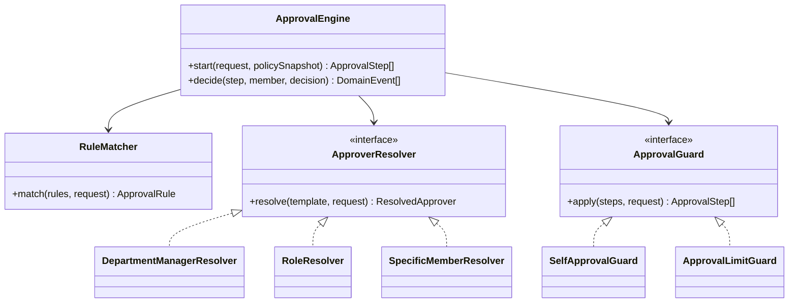
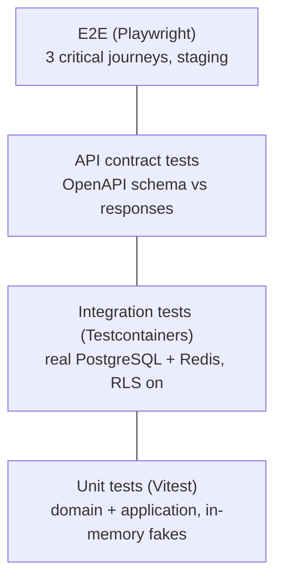

# Engineering Practices: OOP, SOLID, Clean Architecture, Security, Testing

Section 5 of the brief asks the design to show knowledge of OOP, SOLID, Clean Architecture, RBAC, API design, security and testing, and to consider auditability, consistency, fault tolerance, permission boundaries, maintainability and extensibility. This document shows **where** each of these appears in SupplyMesh. The code snippets are illustrative, not an implementation.

## 1. Object-Oriented design

### 1.1 Domain model: aggregates protect their own rules
Each aggregate is a class whose state can only change through methods that enforce its invariants. Controllers and repositories can't set `status` directly.

| Aggregate (root) | Contains | Invariants it enforces |
|---|---|---|
| `Supplier` | documents | State machine (draft → pending_verification → active …). Can't activate without the required approved documents. Bank-detail change resets verification. |
| `PurchaseRequest` | items | Editable only in `draft` / `returned`. Total = Σ lines. Submitting requires ≥ 1 line. |
| `ApprovalProcess` | approval steps, decisions | One vote per member per step. Quorum. Parallel/sequential activation. Reject ends the process. |
| `PurchaseOrder` | items, receipts | Immutable after issue. Received ≤ ordered. Supplier must be active at issue. |
| `Invoice` | items, discrepancies | Can't approve with open discrepancies. Recorder ≠ approver. Paid ≤ total. |

```ts
// Encapsulation + state pattern: status changes go through behaviour, not setters
export class PurchaseRequest {
  private constructor(private props: PurchaseRequestProps) {}

  submit(policy: ApprovalPolicySnapshot, fx: FxRate, clock: Clock): DomainEvent[] {
    if (!['draft', 'returned'].includes(this.props.status))
      throw new InvalidTransitionError('purchase_request', this.props.status, 'submitted');
    if (this.props.items.length === 0) throw new BusinessRuleError('request.empty');

    this.props.estimatedTotalBase = this.total().convert(fx);   // Money value object, no floats
    this.props.workflowVersionId = policy.versionId;            // snapshot (BR-07)
    this.props.status = 'in_approval';
    this.props.submittedAt = clock.now();
    return [new PurchaseRequestSubmitted(this.props.id, policy.versionId)];
  }

  total(): Money {
    return this.props.items.reduce((sum, i) => sum.add(i.lineTotal()), Money.zero(this.props.currency));
  }
}
```

### 1.2 Value objects
`Money` (decimal amount + currency; adding different currencies throws), `Quantity`, `Percentage`, `DocumentNumber`, `TenantId`, `EmailAddress`. These are immutable and compared by value. They remove whole classes of bugs, such as float rounding on money or comparing a `member_id` with a `user_id`.

### 1.3 Polymorphism in the approval engine



`approver_type` in the database maps to a **strategy** class. Adding a new approver type (e.g. "cost-center owner") means adding one resolver class and one enum value. The engine doesn't change.

## 2. SOLID: where each principle shows up

| Principle | Where in SupplyMesh | Benefit |
|---|---|---|
| **S**ingle Responsibility | `ThreeWayMatcher` only compares documents and returns findings. `InvoiceApprovalUseCase` orchestrates. `DrizzleInvoiceRepository` only persists. `AuditWriter` only records. | Each class has one reason to change. When matching tolerances change, persistence is untouched. |
| **O**pen/Closed | Approver resolvers and approval guards (§1.3). Discrepancy checks are a list of `MatchRule` classes (`PriceRule`, `QuantityRule`, `TaxRule`, `CurrencyRule`, `TotalRule`). | A new match rule (e.g. "delivery date") is a new class registered in the list, with no edits to existing ones |
| **L**iskov Substitution | Every `ApproverResolver` returns a valid `ResolvedApprover` or throws `ApproverNotFound`, never `null`. `FileStorage` has two implementations (`S3FileStorage` in prod, `MinioFileStorage` locally), both honoring the presign contract. | Implementations can be swapped in tests and environments without special cases |
| **I**nterface Segregation | Modules expose narrow query interfaces (`SupplierQuery.assertActive()`, `MemberDirectory.getDepartmentManager()`), not their whole service | `purchasing` can't accidentally call `supplier.verify()`. The boundaries are part of the type system. |
| **D**ependency Inversion | Domain and application layers depend on interfaces (`InvoiceRepository`, `Clock`, `FxRateProvider`, `OutboxPublisher`). NestJS DI injects Drizzle / Redis / S3 implementations. | Domain rules are unit-tested with in-memory fakes. Infrastructure can change (e.g. a different FX provider) without touching business code. |

## 3. Clean Architecture

- **Layers per module:** `domain` → `application` → `infrastructure` / `presentation`. Dependencies point inward only (see Architecture §3.2).
- **Enforced, not just documented:** `dependency-cruiser` rules in CI:
  - `domain/**` may not import `@nestjs/*`, `drizzle-orm`, `ioredis` or `aws-sdk`
  - module A may import only module B's `index.ts` (its public API)
  - nothing imports `*/infrastructure/*` from outside its own module
- **Use case = transaction boundary.** One application service method is one `withTenantTx`, so it is always clear what is atomic.
- **DTO ≠ entity.** Zod DTOs (shared with the frontend through `packages/contracts`) are mapped to domain objects at the presentation boundary. This prevents mass assignment: a client can't set `status` or `organization_id` through the API.

### Design patterns used (and why)
| Pattern | Where | Why |
|---|---|---|
| Repository | Every aggregate | Keeps SQL out of the domain |
| Unit of Work | `withTenantTx` | Atomic use cases plus the RLS session setting |
| State | Supplier, PR, PO, Invoice status | Illegal transitions are impossible |
| Strategy | Approver resolution, match rules | Open/closed extension |
| Specification | `ApprovalRule.matches(request)` | Rule conditions are composable and testable |
| Transactional Outbox | All side effects | Reliable events without distributed transactions |
| Policy objects | `PurchaseRequestPolicy`, `InvoicePolicy` | Authorization scope logic in one place, not spread across controllers |
| Idempotency key | Payments, PO issue, invoice create | Safe retries |
| Optimistic locking | `version` + `If-Match` | Concurrent edits without long locks |

## 4. Security design (OWASP Top 10 mapping)

| Risk | SupplyMesh control |
|---|---|
| A01 Broken access control | 4-layer authorization (tenant → permission → scope → business policy). PostgreSQL RLS + composite tenant FKs. Tenant id never accepted from the client. An automated **cross-tenant test suite** (§5). |
| A02 Cryptographic failures | TLS 1.2+ at NGINX, HSTS. Argon2id passwords. Bank details encrypted at the application level with KMS data keys. RDS and S3 encryption at rest. Refresh tokens and onboarding tokens stored only as hashes. |
| A03 Injection | Drizzle parameterized queries; raw SQL only via tagged templates. Zod validation on every input. Output encoding by React. |
| A04 Insecure design | Segregation of duties, four-eyes on bank changes, "no PO no pay", versioned policies. These are business-level controls, not just technical ones. |
| A05 Security misconfiguration | Infrastructure and config in code. Secrets in AWS Secrets Manager. Containers run as non-root with read-only filesystems. NGINX security headers and a strict CSP. |
| A06 Vulnerable components | Dependabot, `pnpm audit` and container image scanning (Trivy) in CI. Pinned base images. |
| A07 Authentication failures | MFA for money roles, rotating refresh tokens with reuse detection, rate limiting and lockout, breached-password check |
| A08 Software & data integrity | Signed commits on main, required reviews, CI-built images tagged by SHA (deploy what was tested). Append-only audit log. |
| A09 Logging & monitoring failures | Structured logs with `request_id` and `org_id`. Alerts on auth anomalies, failed jobs, RLS violations. Audit log for business events. |
| A10 SSRF | No user-supplied URLs are fetched server-side. File handling only via presigned S3 keys that we generate. |

Privacy: personal data is limited to names, emails and phone numbers of members and supplier contacts. Logs exclude personal data and bank details. A member's erasure request anonymizes the `users` row but keeps audit and financial history linked to the pseudonymized member, as financial-record retention laws require (see the Risk doc).

## 5. Testing strategy



| Level | What is tested | Examples | Runs |
|---|---|---|---|
| **Unit** (most tests) | Aggregates, value objects, `RuleMatcher`, `ThreeWayMatcher`, resolvers, guards, policies | Rule matching at exact boundaries (499.99 / 500.00 / 5,000.00); quorum 2-of-3; self-approval reroute; price variance of exactly 2%; `Money` refuses to add USD to EUR | Every commit, < 30 s |
| **Integration** | Use cases against a real PostgreSQL (with RLS, constraints, locks) and Redis | Submit → steps created; concurrent approvals keep correct counts; duplicate invoice → 409; replayed `Idempotency-Key` → one payment; `chk_inv_sod` rejects self-approval | Every PR |
| **Tenant-isolation suite** | **Every endpoint**, called as Org B with Org A's resource ids | Must return 404 (never 200/403, which would confirm the id exists). Generated from the OpenAPI route list, so new endpoints are covered automatically. | Every PR (blocking) |
| **Concurrency tests** | Race conditions in money flows | 20 parallel payment requests on one invoice → Σ ≤ total. Two invoices approved in parallel on the same PO line. | Every PR |
| **Contract** | API responses match the OpenAPI spec; frontend and backend share zod contracts | | Every PR |
| **E2E** | Journeys 1–3 from `user-journeys.md` through the real UI | Onboard supplier → request → approvals → PO → receipt → invoice with discrepancy → payment | On staging deploy |
| **Load** (k6) | Month-end scenario: 300 invoices/hour/org × 20 orgs + inbox reads | p95 < 300 ms reads, < 800 ms matching writes; no deadlocks | Before major releases |
| **Migration tests** | Migrations apply on a copy of production-like data; rollback scripts work | | Every PR touching `packages/db` |
| **Security** | Dependency + image scanning, OWASP ZAP baseline on staging | | Nightly |

Coverage targets: domain layer ≥ 90% line coverage; overall ≥ 75%. Coverage is a signal, not a goal. The tenant-isolation and concurrency suites matter more than the percentage.

Test data: factories create a complete tenant (departments, members with roles, a published workflow) in one call, so every test starts from a realistic organization.

## 6. Cross-cutting qualities

| Quality | How the design delivers it |
|---|---|
| **Auditability** | `audit_logs` (who, what, before/after, IP, request id) written in the same transaction as each change. Append-only DB role. Decisions carry mandatory comments for reject/return. Policy versions are kept forever. |
| **Data consistency** | ACID transactions, CHECK and composite FK constraints, row locks in a deterministic order, optimistic locking, generated columns, nightly reconciliation job |
| **Fault tolerance** | Outbox (no lost side effects), idempotent jobs with retries and a dead-letter set, Redis optional for correctness, RDS Multi-AZ option and PITR, stateless app containers restart automatically |
| **Permission boundaries** | Tenant → permission → scope → business policy. Owner can't move money by default. Segregation of duties enforced in code **and** the database. |
| **Maintainability** | Modular monolith with enforced boundaries, one language, shared contracts, ADRs explaining every major choice, conventional commits, PR template with a "migration / security impact" checklist |
| **Future extensibility** | `approval_workflows.subject_type` (invoice approvals later), resolver strategies, outbox events as integration points (webhooks, ERP sync, analytics store), modules ready for extraction, nullable `password_hash` for SSO |
